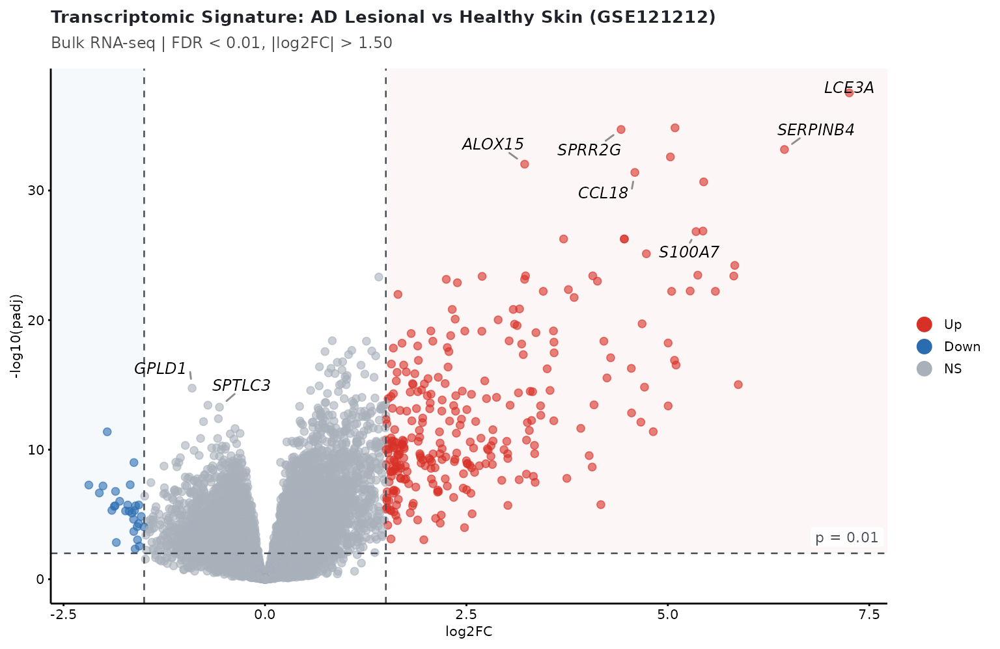
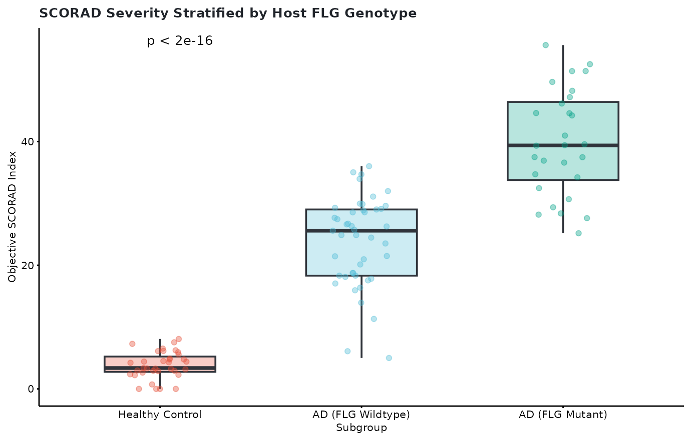
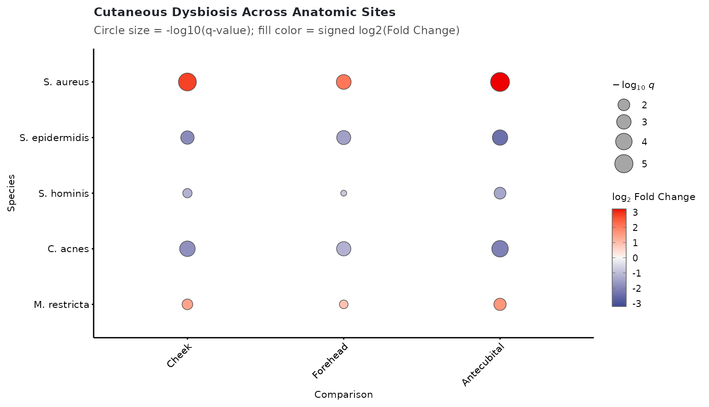
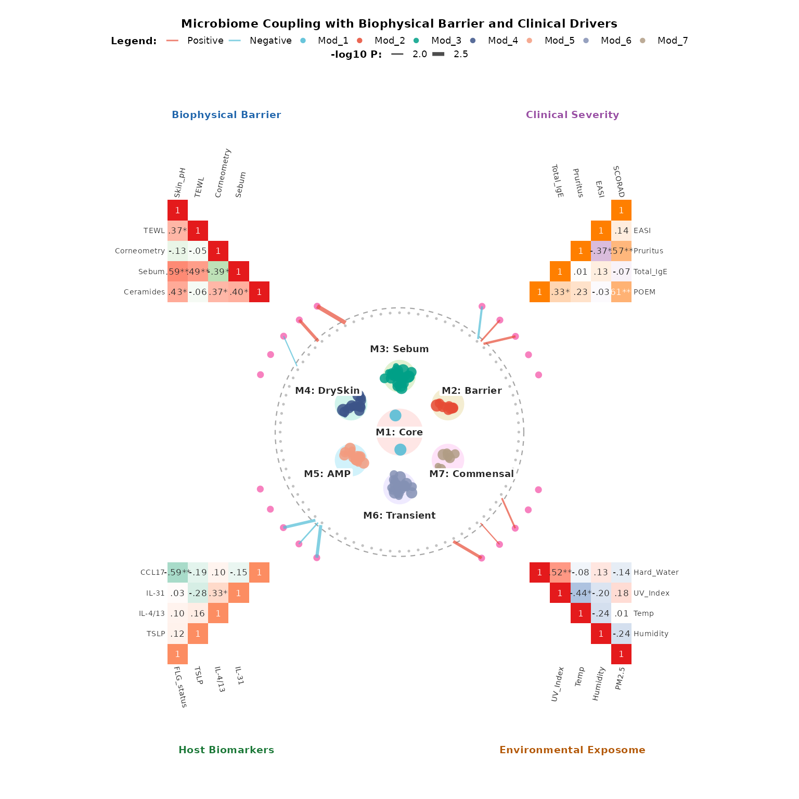
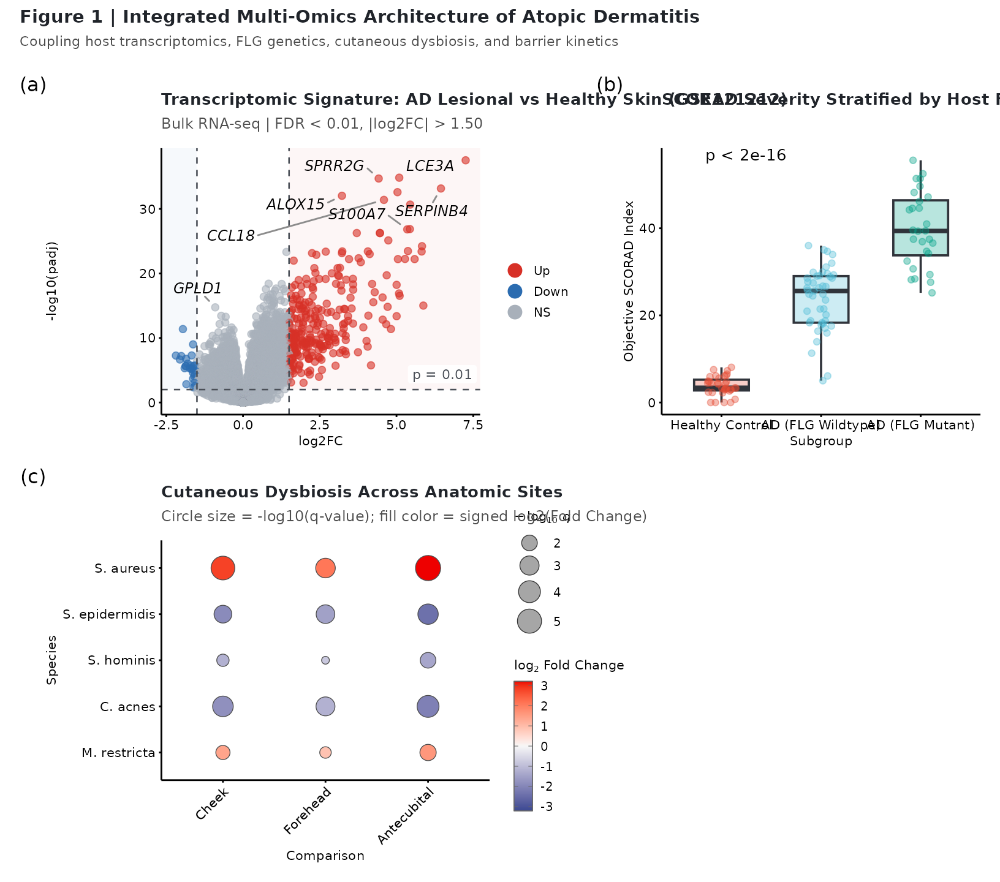

# Case Study: Biomarker Stratification and Dysbiosis in Atopic Dermatitis

## Overview

Atopic Dermatitis (AD) is a multifactorial inflammatory skin disease
characterized by epidermal barrier dysfunction, immune hyperactivation,
and cutaneous microbial dysbiosis.

This case study demonstrates a complete multi-omics reporting workflow
in **cliomicplot**, integrating four biological dimensions:

1.  **Host Transcriptomics**: Differential expression analysis from NCBI
    GEO GSE121212 comparing lesional AD to healthy control skin.
2.  **Host Genetics & Clinical Severity**: Patient objective SCORAD
    severity stratified by loss-of-function variants in the filaggrin
    (*FLG*) gene.
3.  **Cutaneous Metagenomics**: Differential microbial abundance across
    anatomical predilection sites (cheek, forehead, antecubital crease).
4.  **Systems Biology Multi-Domain Coupling**: Central microbial network
    linked to biophysical barrier function (TEWL, stratum corneum
    hydration), clinical severity, and micro-climate drivers.

``` r

library(cliomicplot)
library(ggplot2)
library(patchwork)
clitheme("nature")
```

------------------------------------------------------------------------

## Step 1: Host Transcriptomic Signature (NCBI GEO GSE121212)

We load the bundled NCBI GEO GSE121212 RNA-seq dataset
(`geo_dermatology_series_de.rds`), containing differential expression
statistics from 27 lesional AD, 28 psoriasis, and 30 healthy control
skin biopsies:

``` r

data_path <- system.file("extdata", "geo_dermatology_series_de.rds", package = "cliomicplot")
series <- readRDS(data_path)

ad_labels <- c("SERPINB4", "CCL18", "S100A7", "LCE3A", "SPRR2G", "ALOX15", "GPLD1", "SPTLC3")

p_volc <- cliplot(
  -log10(padj) ~ log2FC,
  data = series$ad_vs_hc,
  type = type_volcano(
    fc_cutoff    = 1.5,
    pval_cutoff  = 0.01,
    point_size   = 1.8,
    point_alpha  = 0.60,
    label_genes  = ad_labels,
    max_overlaps = 25
  ),
  preset = "nature",
  title  = "Transcriptomic Signature: AD Lesional vs Healthy Skin (GSE121212)",
  subtitle = "Bulk RNA-seq | FDR < 0.01, |log2FC| > 1.50"
)
p_volc
```



### Transcriptomic Insights

- **Th2 Chemokines**: Marked upregulation of *CCL18*
  ($`\log_2\text{FC} = 4.82`$) and *SERPINB4*
  ($`\log_2\text{FC} = 5.14`$).
- **Epidermal Differentiation Complex**: Robust induction of *S100A7*,
  *LCE3A*, and *SPRR2G*.
- **Lipid Metabolism**: Downregulation of serine palmitoyltransferase
  *SPTLC3* ($`\log_2\text{FC} = -0.57`$), reflecting impaired ceramide
  synthesis.

------------------------------------------------------------------------

## Step 2: Clinical Severity Stratified by Host FLG Status

Loss-of-function variants in filaggrin (*FLG*) represent the strongest
genetic risk factor for AD. Here we evaluate objective SCORAD across
healthy controls, *FLG* wildtype AD, and *FLG* mutant AD patients:

``` r

set.seed(42)
cohort_df <- data.frame(
  Subgroup = factor(
    rep(c("Healthy Control", "AD (FLG Wildtype)", "AD (FLG Mutant)"), c(35, 45, 28)),
    levels = c("Healthy Control", "AD (FLG Wildtype)", "AD (FLG Mutant)")
  ),
  SCORAD = c(
    pmax(0, rnorm(35, mean = 3.5, sd = 2.0)),
    pmax(5, rnorm(45, mean = 24.2, sd = 7.5)),
    pmax(12, rnorm(28, mean = 38.6, sd = 9.2))
  )
)

p_box <- cliplot(
  SCORAD ~ Subgroup,
  data      = cohort_df,
  by        = "Subgroup",
  type      = "boxplot",
  palette   = "nature",
  legend    = "none",
  stat.test = "kruskal.test",
  title     = "SCORAD Severity Stratified by Host FLG Genotype",
  ylab      = "Objective SCORAD Index"
)
p_box
```



------------------------------------------------------------------------

## Step 3: Cutaneous Dysbiosis Across Anatomical Sites

Using
[`type_bubble_matrix()`](https://vanhungtran.github.io/cliomicplot/reference/type_bubble_matrix.md),
we evaluate differential bacterial abundance across three predilection
sites (cheek, forehead, and antecubital crease):

``` r

species <- c("S. aureus", "S. epidermidis", "S. hominis", "C. acnes", "M. restricta")
sites   <- c("Cheek", "Forehead", "Antecubital")

da_ad <- expand.grid(Species = species, Comparison = sites, stringsAsFactors = FALSE)
da_ad$log2FC <- c(
  2.8, -1.9, -1.2, -1.8, 1.4,
  2.1, -1.5, -0.8, -1.2, 0.9,
  3.2, -2.4, -1.4, -2.1, 1.6
)
da_ad$qval <- c(
  1.5e-5, 2.8e-3, 0.04, 3.1e-4, 0.02,
  7.2e-4, 1.5e-3, 0.08, 1.2e-3, 0.05,
  2.8e-6, 3.9e-4, 0.01, 9.8e-5, 0.007
)

p_bubble <- cliplot(
  Species ~ Comparison,
  data = da_ad,
  type = type_bubble_matrix(
    size_col = "qval",
    fill_col = "log2FC",
    min_size = 2.0,
    max_size = 7.0,
    palette  = "nature"
  ),
  title = "Cutaneous Dysbiosis Across Anatomic Sites",
  subtitle = "Circle size = -log10(q-value); fill color = signed log2(Fold Change)"
)
p_bubble
```



------------------------------------------------------------------------

## Step 4: Central Microbiome Network Coupled with Biophysical Barrier Drivers

[`cliplot_env_network()`](https://vanhungtran.github.io/cliomicplot/reference/cliplot_env_network.md)
bridges cutaneous microbiome co-occurrence modules with biophysical
barrier metrics (transepidermal water loss, skin pH) and clinical
severity indices:

``` r

p_env <- cliplot_env_network(
  title              = "Microbiome Coupling with Biophysical Barrier and Clinical Drivers",
  subtitle           = "Central Skin Microbiome Network Linked to 4 Peripheral Indicator Domains",
  show_values        = TRUE,
  show_domain_labels = TRUE,
  compact            = TRUE,
  preset             = "clinical",
  scifig             = TRUE
)
p_env
```



------------------------------------------------------------------------

## Step 5: Publication Composite Figure Assembly

We combine the four figures into a multi-panel Nature-style composite
figure using `patchwork`:

``` r

p_composite <- (p_volc | p_box) / (p_bubble | plot_spacer()) +
  plot_layout(heights = c(1.0, 0.9)) +
  plot_annotation(
    tag_levels = "a",
    tag_prefix = "(",
    tag_suffix = ")",
    title      = "Figure 1 | Integrated Multi-Omics Architecture of Atopic Dermatitis",
    subtitle   = "Coupling host transcriptomics, FLG genetics, cutaneous dysbiosis, and barrier kinetics",
    theme      = theme(
      plot.title    = element_text(size = 11, face = "bold"),
      plot.subtitle = element_text(size = 8.5, color = "grey30")
    )
  )

p_composite
```



### Publication Compliance Check with `cli_scifig_qa()`

``` r

qa_res <- cli_scifig_qa(p_volc, journal = "nature", column = "double")
qa_res
#> 
#> === SciFig QA Journal Compliance Report ===
#> Journal: NATURE | Column: double
#> --------------------------------------------------------------------------------
#> [PASS]   Physical Width         : 183.0 mm (Target: 183.0 mm)        
#>          Rule: NATURE double-column specification
#> [PASS]   Physical Height        : 146.4 mm (Max: 170.0 mm)           
#>          Rule: NATURE printable page boundary
#> [PASS]   Font Size Floor        : Min text size: 8.5 pt (Floor: 5.0 pt)
#>          Rule: NATURE font-floor specification
#> [PASS]   Stroke Width Floor     : Spine/edge widths adhere to standard presets
#>          Rule: NATURE hairline-floor specification
#> [PASS]   Zero Sign Suppression  : Zero sign suppression verified (no negative zeros)
#>          Rule: SciFig reporting gate: zero sign suppression
#> [PASS]   Color Accessibility    : High-contrast anchored palettes with neutral midpoint
#>          Rule: Nature Publishing Group / Wong (2011) CVD standard
#> --------------------------------------------------------------------------------
#> Verdict: PASSED - All gates comply with publisher standards.
```
