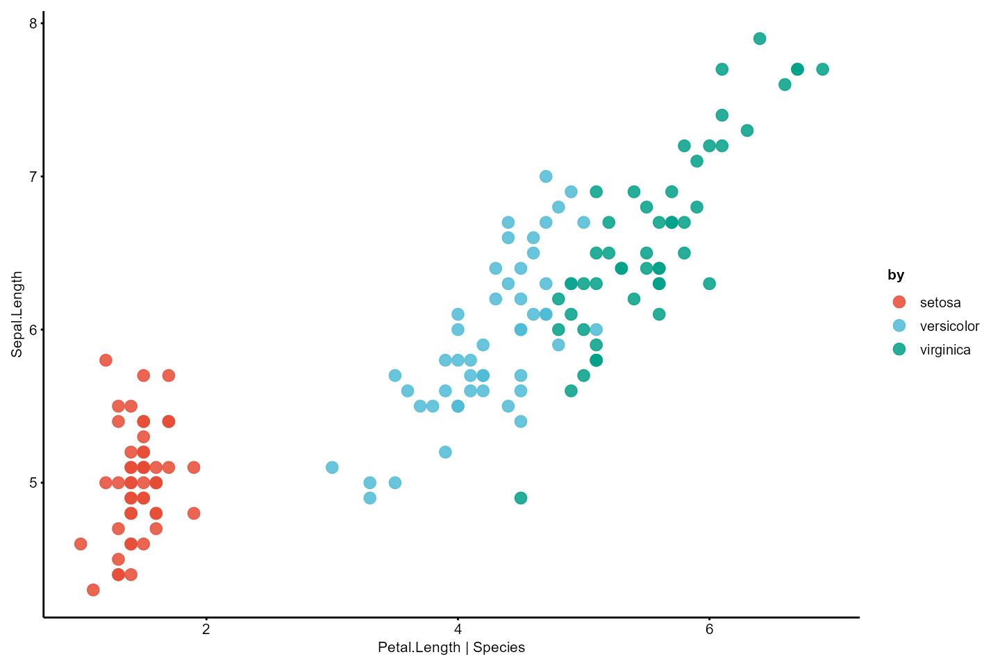
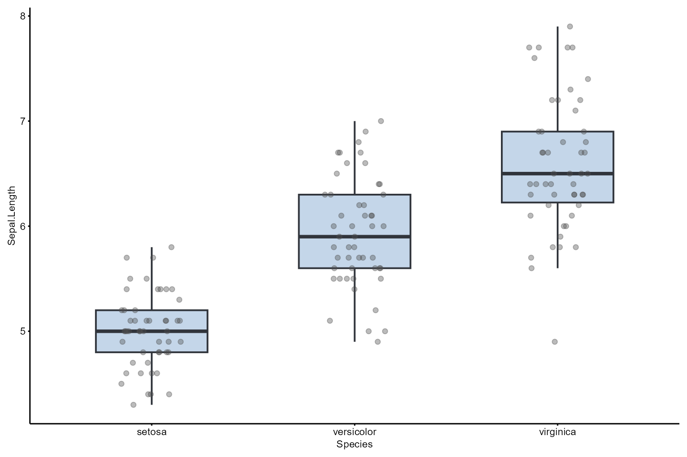
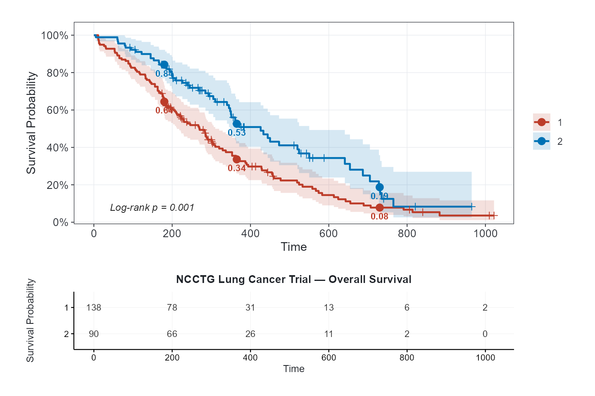
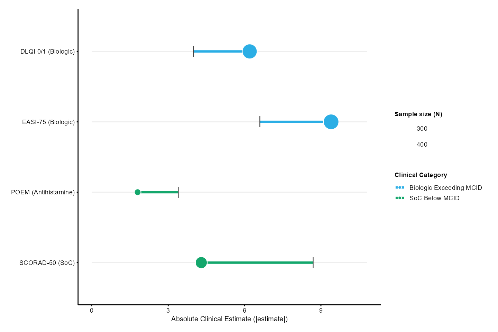
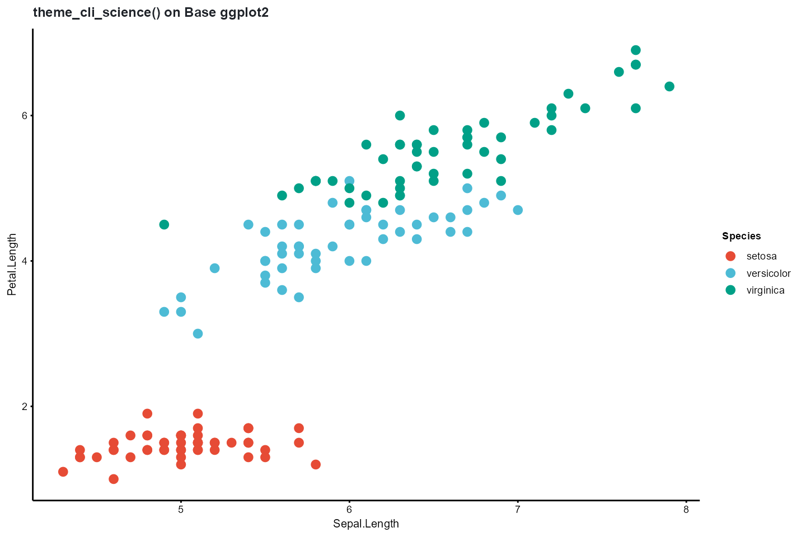
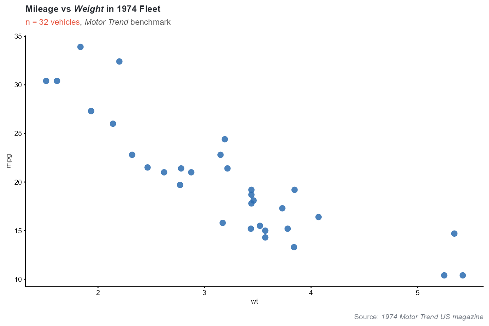
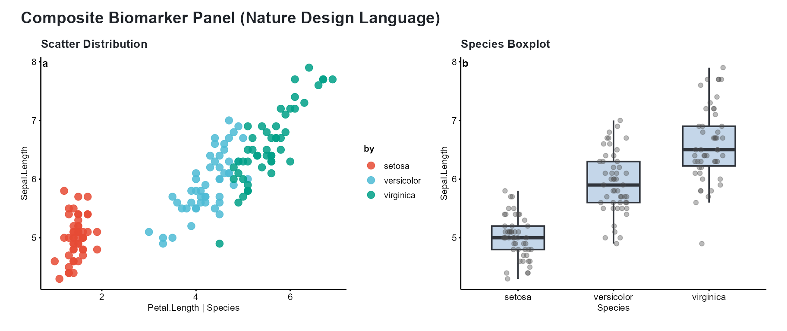

# Getting Started with cliomicplot

\+

−

⊙

×

‹

›


100 %

Scroll to zoom · Drag to pan · ← → to navigate

## Overview

**cliomicplot** is a unified grammar for publication-ready clinical and
multi-omics figures built directly on **ggplot2**. Designed around the
visual principles of **Nature**, **Cell**, and **Science**, it offers:

- **55+ specialized plot types** spanning clinical trials (Kaplan-Meier
  milestones, MCID dumbbells, trajectories, swimmers, waterfalls, forest
  plots) and multi-omics (volcano, GSEA, UpSet, PCA, heatmaps).
- **13 publication themes** covering open-axis designs (`nature`,
  `science`, `cell`, `nejm`, `lancet`) and full-box Elsevier/IEEE frames
  (`scifig`).
- **55+ curated color palettes** with strict color vision deficiency
  (CVD) accessibility.
- **Publisher trim sizing**
  ([`cli_journal_size()`](https://vanhungtran.github.io/cliomicplot/reference/cli_journal_size.md))
  for 9 major publishers with vector compliance checks
  ([`cli_save()`](https://vanhungtran.github.io/cliomicplot/reference/cli_save.md)).

``` r

library(cliomicplot)
library(ggplot2)
library(patchwork)
```

------------------------------------------------------------------------

## 1. The Formula Interface: `y ~ x | group`

cliomicplot provides a clean, expressive formula API:

``` r

# Scatter plot with categorical grouping
cliplot(Sepal.Length ~ Petal.Length | Species, data = iris,
        palette = "npg", theme = "nature")
```



The formula syntax automatically manages: - Axis titles formatted from
column names - Legend placement, titles, and symbol keys - Palette
application with colorblind safety

------------------------------------------------------------------------

## 2. Choosing a Plot Type

Pass `type = "..."` or a dedicated `type_*()` constructor to configure
advanced parameters:

### Boxplot with Automated Statistical Annotations

``` r

cliplot(Sepal.Length ~ Species, data = iris,
        type = "boxplot",
        stat.test = "kruskal.test",
        stat.label = "p.signif",
        palette = "jco", theme = "nature")
```



Supported statistical tests include `"t.test"`, `"wilcox.test"`,
`"anova"`, and `"kruskal.test"`.

### Clinical Figure Archetypes: Kaplan-Meier with Landmark Milestones

In oncology and cardiovascular clinical trials, reporting landmark
milestone survival rates (e.g., 1-year and 2-year survival) directly on
curves is a premier journal requirement:

``` r

library(survival)

cliplot(Surv(time, status) ~ sex, data = lung,
        type = type_km(
          risk_table  = TRUE,
          pval        = TRUE,
          conf_int    = TRUE,
          milestones  = c(180, 365, 730)
        ),
        palette = "nejm", theme = "nejm",
        title = "**NCCTG Lung Cancer Trial** — Overall Survival") +
  cli_markdown()
```



### Minimal Clinically Important Difference (MCID) Dumbbells

Anchor clinical effect sizes $`|\hat{\theta}|`$ against validated
instrument thresholds (Clinical Archetype 1):

``` r

mcid_df = data.frame(
  Endpoint = c("EASI-75 (Biologic)", "DLQI 0/1 (Biologic)", "SCORAD-50 (SoC)", "POEM (Antihistamine)"),
  Estimate = c(9.4, 6.2, 4.3, 1.8),
  MCID     = c(6.6, 4.0, 8.7, 3.4),
  N        = c(480, 450, 310, 220),
  Category = c("Biologic Exceeding MCID", "Biologic Exceeding MCID",
               "SoC Below MCID", "SoC Below MCID")
)

cliplot(Estimate ~ Endpoint, data = mcid_df,
        type = type_mcid(mcid = "MCID", n_treated = "N", category = "Category"),
        theme = "cell")
```



------------------------------------------------------------------------

## 3. The 13 Journal Themes

cliomicplot encapsulates distinct journal visual styles:

| Theme | Style | Spines | Grid |
|----|----|----|----|
| `nature` | Nature Publishing Group | Open (left & bottom) | None |
| `science` | Science / AAAS | Ultra-clean open | None |
| `cell` | Cell Press | Structured open | None |
| `nejm` | New England Journal of Medicine | Open | Subtle horizontal |
| `lancet` | The Lancet | Open | Subtle horizontal |
| `scifig` / `sci_box` | Elsevier / IEEE / SCI | 4 black spines | Subtle dashed (0.3 pt) |
| `cli_bw` | Laboratory default | 4 black spines | Full grid |
| `cli_classic` | Base R style | Left & bottom lines | None |
| `cli_minimal` | Modern minimal | Borderless | Faint |
| `broadsheet` | Print newspaper | Subtle border | Horizontal only |
| `dark` | Presentations / Slides | Dark background | Faint |
| `showcase` | Posters / Hero figures | Crisp frame | Accent grid |

All themes can be applied ephemerally (`theme = "nature"`), globally
(`clitheme("nature")`), or as standalone ggplot2 functions
(`+ theme_cli_nature()`, `+ theme_cli_scifig()`).

``` r

# Use as a standalone ggplot2 theme layer
ggplot(iris, aes(Sepal.Length, Petal.Length, color = Species)) +
  geom_point(size = 2.5) +
  scale_color_cli("npg") +
  theme_cli_science() +
  labs(title = "theme_cli_science() on Base ggplot2")
```



------------------------------------------------------------------------

## 4. Markdown Formatting with `cli_markdown()`

Render **bold**, *italic*, subscripts, superscripts, and hex-colored
spans inside plot titles, subtitles, and captions:

``` r

cliplot(mpg ~ wt, data = mtcars,
        theme    = "nature",
        title    = "**Mileage** vs *Weight* in 1974 Fleet",
        subtitle = "<span style='color:#E64B35'>n = 32 vehicles</span>, *Motor Trend* benchmark",
        caption  = "Source: <i>1974 Motor Trend US magazine</i>") +
  cli_markdown()
```



------------------------------------------------------------------------

## 5. Multi-Panel Composite Assembly

Assemble modular panels with **patchwork** and label them with
[`cli_panel_label()`](https://vanhungtran.github.io/cliomicplot/reference/cli_panel_label.md)
conforming to Nature (**a**, **b**) and Cell (**A**, **B**) standards:

``` r

p1 <- cliplot(Sepal.Length ~ Petal.Length | Species, data = iris,
              palette = "npg", theme = "nature", title = "Scatter Distribution") +
  cli_panel_label("a")

p2 <- cliplot(Sepal.Length ~ Species, data = iris,
              type = "boxplot", palette = "npg", theme = "nature", title = "Species Boxplot") +
  cli_panel_label("b")

p1 + p2 +
  plot_annotation(title = "Composite Biomarker Panel (Nature Design Language)")
```



------------------------------------------------------------------------

## 6. Physical Dimensions & Publication Export

When submitting manuscripts, figure dimensions must strictly match
target journal column widths.

[`cli_journal_size()`](https://vanhungtran.github.io/cliomicplot/reference/cli_journal_size.md)
returns verified millimeter dimensions across 9 publishers:

``` r

# Query Nature and Science column widths
cli_journal_size("nature", "single")$width_mm  # 89 mm
#> [1] 89
cli_journal_size("nature", "double")$width_mm  # 183 mm
#> [1] 183
cli_journal_size("science", 2)$width_mm        # 183 mm
#> [1] 183
```

Export with
[`cli_save()`](https://vanhungtran.github.io/cliomicplot/reference/cli_save.md)
to verify format compliance (vector PDF/SVG for final submission):

``` r

p_final <- p1 + p2

# Vector PDF export for 2-column Nature layout
cli_save(p_final, "Figure_1.pdf", journal = "nature", column = "double")

# Single-column Cell Press SVG export
cli_save(p1, "Figure_1a.svg", journal = "cell", column = "single")
```

------------------------------------------------------------------------

## Next Steps & Specialized Vignettes

Explore our in-depth guides for specific research workflows:

- **[`vignette("journal-plots", package = "cliomicplot")`](https://vanhungtran.github.io/cliomicplot/articles/journal-plots.md)**
  — Nature, Cell, and Science design language & clinical archetypes
- **[`vignette("oncology", package = "cliomicplot")`](https://vanhungtran.github.io/cliomicplot/articles/oncology.md)**
  — End-to-end clinical oncology analysis (swimmers, waterfalls, KM
  milestones)
- **[`vignette("multiomics", package = "cliomicplot")`](https://vanhungtran.github.io/cliomicplot/articles/multiomics.md)**
  — Proteomics, metabolomics, and longitudinal time-courses
  (xOmicsShiny)
- **[`vignette("themes-palettes", package = "cliomicplot")`](https://vanhungtran.github.io/cliomicplot/articles/themes-palettes.md)**
  — The 13 themes and 55+ color palettes in depth
- **[`vignette("volcano-plot", package = "cliomicplot")`](https://vanhungtran.github.io/cliomicplot/articles/volcano-plot.md)**
  — Differential expression volcanoes from quick to publication-ready
- **[`vignette("recreate-paper", package = "cliomicplot")`](https://vanhungtran.github.io/cliomicplot/articles/recreate-paper.md)**
  — Recreating published multi-panel figures from raw supplementary data
