# Coupled Environmental Networks and Multi-Network Architectures

## Overview

In microbiome research, systems immunology, and molecular ecology,
evaluating community organization requires moving beyond isolated
correlation matrices. `cliomicplot` provides an integrated architecture
for:

1.  **Cross-Condition Network Graphs**
    ([`cliplot_cross_network_graph()`](https://vanhungtran.github.io/cliomicplot/reference/cliplot_cross_network_graph.md)):
    Visualizing multi-group modular topology across 8 journal-styled
    layouts (`concentric`, `bipolar`, `science`, `ring`, etc.).
2.  **Coupled Environmental Networks**
    ([`cliplot_env_network()`](https://vanhungtran.github.io/cliomicplot/reference/cliplot_env_network.md)):
    Coupling a central microbial co-occurrence network with 1 to 4
    peripheral multi-domain environmental and clinical correlation
    heatmaps.
3.  **Layered Grammar of Graphics**: S3 grammar primitives
    ([`geom_env_boundary()`](https://vanhungtran.github.io/cliomicplot/reference/geom_env_boundary.md),
    [`geom_env_central_network()`](https://vanhungtran.github.io/cliomicplot/reference/geom_env_central_network.md),
    [`geom_env_corner_heatmaps()`](https://vanhungtran.github.io/cliomicplot/reference/geom_env_corner_heatmaps.md),
    [`geom_env_links()`](https://vanhungtran.github.io/cliomicplot/reference/geom_env_links.md),
    [`coord_env_network()`](https://vanhungtran.github.io/cliomicplot/reference/coord_env_network.md))
    enabling step-by-step layer composition.
4.  **Statistical Cross-Network Validation**: Hypergeometric module
    overlap
    ([`type_module_compare()`](https://vanhungtran.github.io/cliomicplot/reference/type_module_compare.md)),
    module-trait heatmaps
    ([`type_module_trait()`](https://vanhungtran.github.io/cliomicplot/reference/type_module_trait.md)),
    permutation null models
    ([`cli_network_permutation()`](https://vanhungtran.github.io/cliomicplot/reference/cli_network_permutation.md)),
    Mantel tests
    ([`cli_mantel()`](https://vanhungtran.github.io/cliomicplot/reference/cli_mantel.md)),
    and targeted attack robustness
    ([`cli_network_robustness()`](https://vanhungtran.github.io/cliomicplot/reference/cli_network_robustness.md)).

``` r

library(cliomicplot)
library(ggplot2)
library(patchwork)
clitheme("nature")
```

------------------------------------------------------------------------

## 1. Cross-Condition Network Topology

Co-occurrence networks constructed across disease states (e.g., Healthy
Control vs. Lesional Disease) require spatial separation that maintains
readability while highlighting shared vs. condition-specific edges.

[`cliplot_cross_network_graph()`](https://vanhungtran.github.io/cliomicplot/reference/cliplot_cross_network_graph.md)
provides topological layout algorithms designed for publication figures:

``` r

demo_net <- generate_demo_cross_network()

p_node <- cliplot_cross_network_graph(
  nodes       = demo_net$nodes,
  edges       = demo_net$edges,
  cross_edges = demo_net$cross_edges,
  level       = "node",
  style       = "bipolar",
  preset      = "nature",
  scifig      = TRUE,
  title       = "Cross-Network Modular Architecture (Bipolar Layout)"
) +
  labs(subtitle = "Separating Discovery (Left) and Replication (Right) Community Subgraphs")
p_node
```

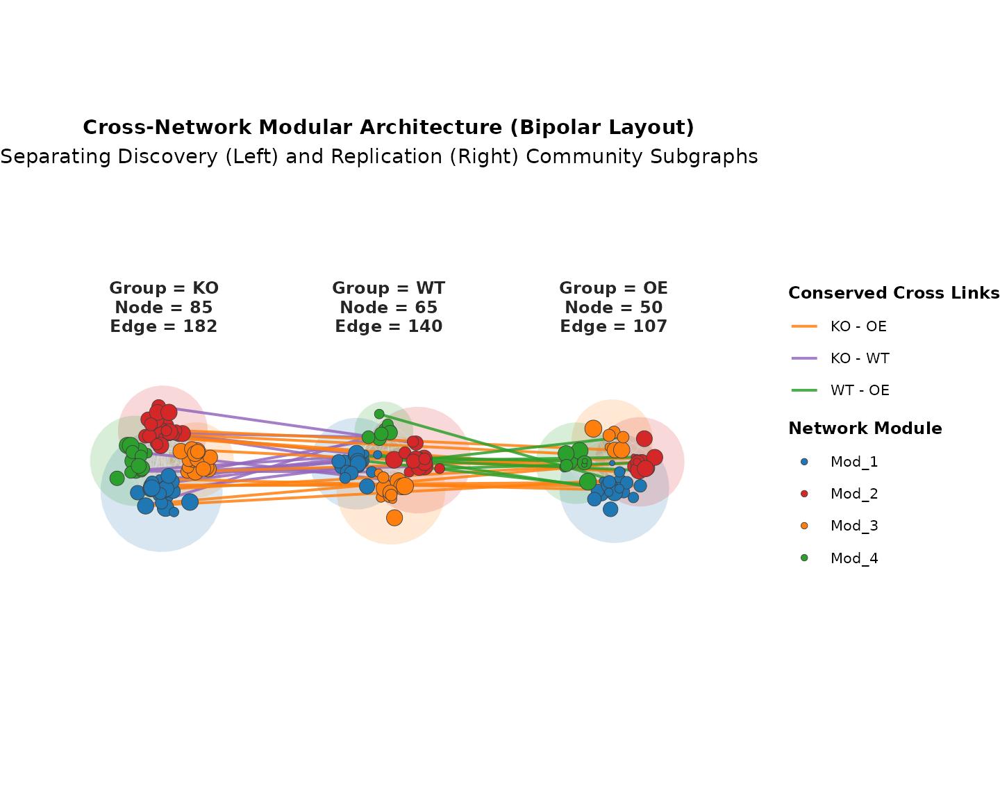

### Topological Layout Styles

`cliomicplot` supports four primary topological styles:

- **`style = "bipolar"`**: Positions two condition networks on opposing
  bilateral poles (e.g. left and right hemispheres) with inter-condition
  bridging links across the center.
- **`style = "concentric"`**: Positions a core hub module in an inner
  circle and peripheral satellite modules in an outer concentric ring.
- **`style = "science"`**: Science-journal jewel styling with
  high-contrast saturated nodes, darkened backgrounds, and stroke-width
  weighting by degree centrality.
- **`style = "ring"`**: Equal-spaced modular clusters arranged along a
  circular orbit.

``` r

p_concentric <- cliplot_cross_network_graph(
  nodes       = demo_net$nodes,
  edges       = demo_net$edges,
  cross_edges = demo_net$cross_edges,
  level       = "node",
  style       = "concentric",
  preset      = "science",
  scifig      = TRUE,
  title       = "Concentric Multi-Tier Modular Architecture"
) +
  labs(subtitle = "Core Commensal Hubs (Inner) vs Satellite Pathobionts (Outer)")
p_concentric
```

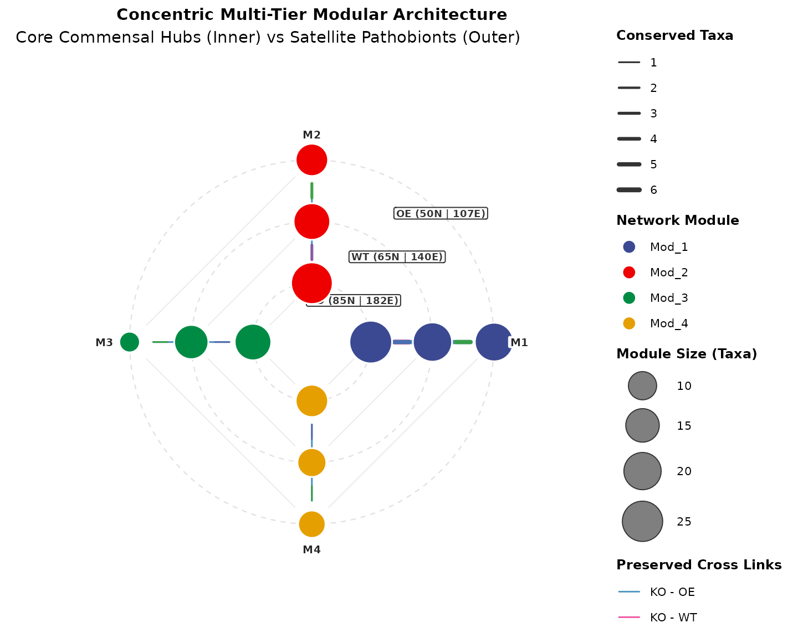

------------------------------------------------------------------------

## 2. Central Networks Coupled with Multi-Domain Environmental Heatmaps

Microbial communities exist in complex physical and clinical
environments.
[`cliplot_env_network()`](https://vanhungtran.github.io/cliomicplot/reference/cliplot_env_network.md)
couples a central circular co-occurrence network with 1 to 4 peripheral
multi-domain environmental correlation heatmaps on a unified continuous
coordinate plane ($`[-7.4, 7.4] \times [-7.4, 7.4]`$):

``` r

p_env_clinical <- cliplot_env_network(
  title              = "Multi-Domain Environmental Coupling (Clinical Style)",
  show_values        = TRUE,
  show_domain_labels = TRUE,
  compact            = TRUE,
  preset             = "clinical",
  scifig             = TRUE
) +
  labs(subtitle = "Central Microbiome Network Linked to 4 Peripheral Clinical Matrices")
p_env_clinical
```

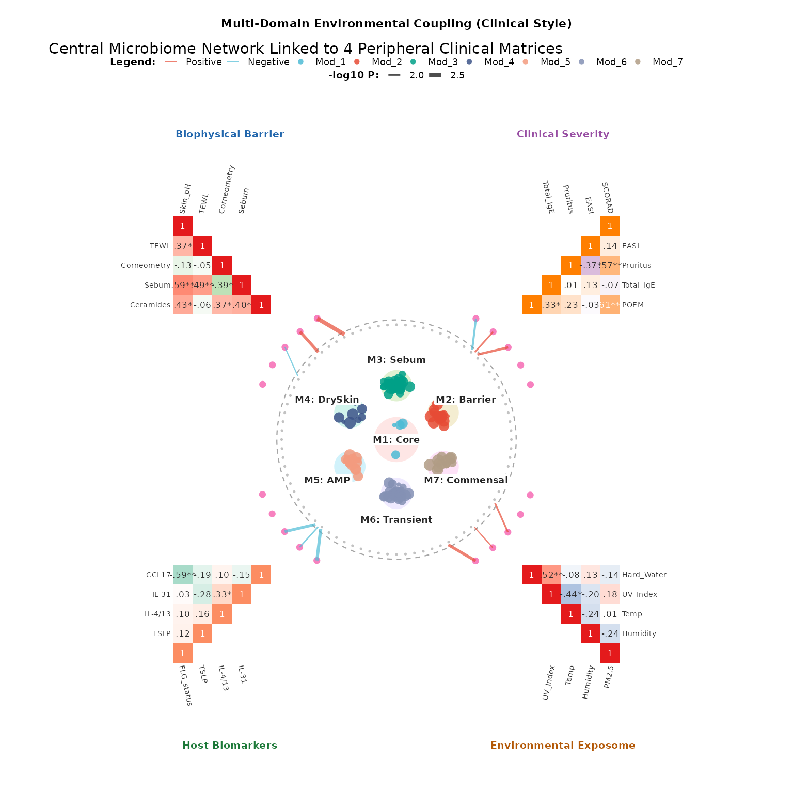

### Multi-Domain Four-Corner Canvas

The four corner heatmaps represent independent multi-omics or exposome
measurement domains:

1.  **Top-Left (Corner 1)**: Biophysical barrier function (e.g. TEWL,
    stratum corneum hydration, skin surface pH).
2.  **Top-Right (Corner 2)**: Micro-climate exposures (e.g. ambient
    temperature, particulate matter $`\text{PM}_{2.5}`$, relative
    humidity).
3.  **Bottom-Right (Corner 3)**: Clinical severity indices (e.g. SCORAD,
    EASI, pruritus visual analog scale).
4.  **Bottom-Left (Corner 4)**: Host immune mediators (e.g. serum IgE,
    IL-4/IL-13 cytokines, antimicrobial peptides).

``` r

p_env_seasonal <- cliplot_env_network(
  title              = "Environmental Coupling (Seasonal Nature Style)",
  show_values        = TRUE,
  show_domain_labels = TRUE,
  compact            = TRUE,
  preset             = "seasonal",
  scifig             = TRUE
) +
  labs(subtitle = "Diverging Pearson r Links with Collision-Free Ray Pruning")
p_env_seasonal
```

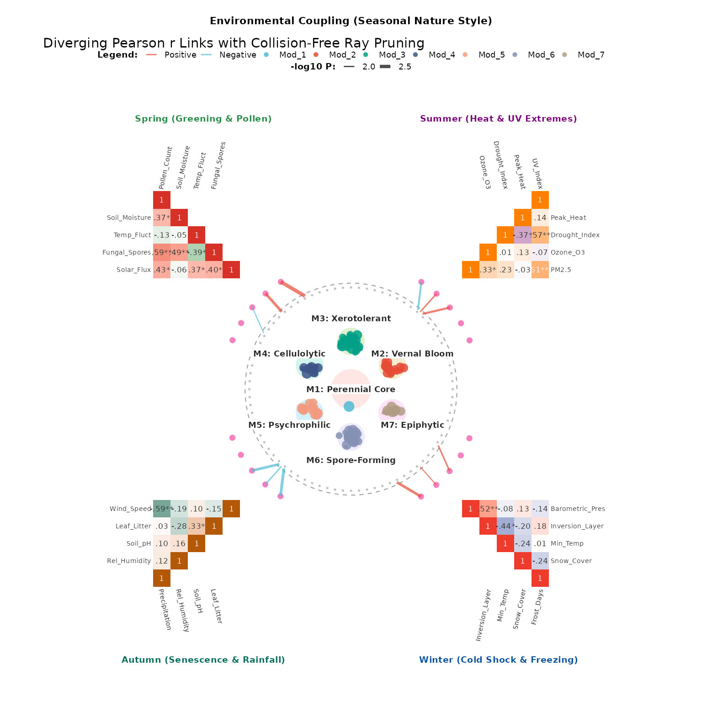

------------------------------------------------------------------------

## 3. Layered Grammar of Graphics for Coupled Networks

`cliomicplot` provides a layered grammar of graphics for coupled
environmental networks:

- **[`cli_env_network_data()`](https://vanhungtran.github.io/cliomicplot/reference/cli_env_network_data.md)**:
  Constructor assembling nodes, edges, corner heatmaps, and inter-domain
  links into an S3 data object.
- **[`geom_env_boundary()`](https://vanhungtran.github.io/cliomicplot/reference/geom_env_boundary.md)**:
  Boundary rings separating network modules.
- **[`geom_env_central_network()`](https://vanhungtran.github.io/cliomicplot/reference/geom_env_central_network.md)**:
  Circular co-occurrence network with module arcs and intra-module
  edges.
- **[`geom_env_corner_heatmaps()`](https://vanhungtran.github.io/cliomicplot/reference/geom_env_corner_heatmaps.md)**:
  Peripheral multi-domain correlation heatmaps.
- **[`geom_env_links()`](https://vanhungtran.github.io/cliomicplot/reference/geom_env_links.md)**:
  Curvature-controlled connecting links with collision pruning.
- **[`coord_env_network()`](https://vanhungtran.github.io/cliomicplot/reference/coord_env_network.md)**:
  Cartesian coordinate system fixed to the standard $`[-7.4, 7.4]`$
  canvas.
- **[`theme_env_network()`](https://vanhungtran.github.io/cliomicplot/reference/theme_env_network.md)**:
  Zero-margin canvas theme eliminating axes and grids.

``` r

# 1. Build environment network data object
net_data <- cli_env_network_data(preset = "nature", compact = TRUE)

# 2. Layer-by-layer ggplot2 assembly
p_layered <- ggplot() +
  geom_env_boundary(data = net_data) +
  geom_env_central_network(data = net_data) +
  geom_env_corner_heatmaps(data = net_data) +
  geom_env_links(data = net_data) +
  coord_env_network() +
  theme_env_network() +
  labs(title = "Coupled Network Assembled via Grammar Layers")

p_layered
```

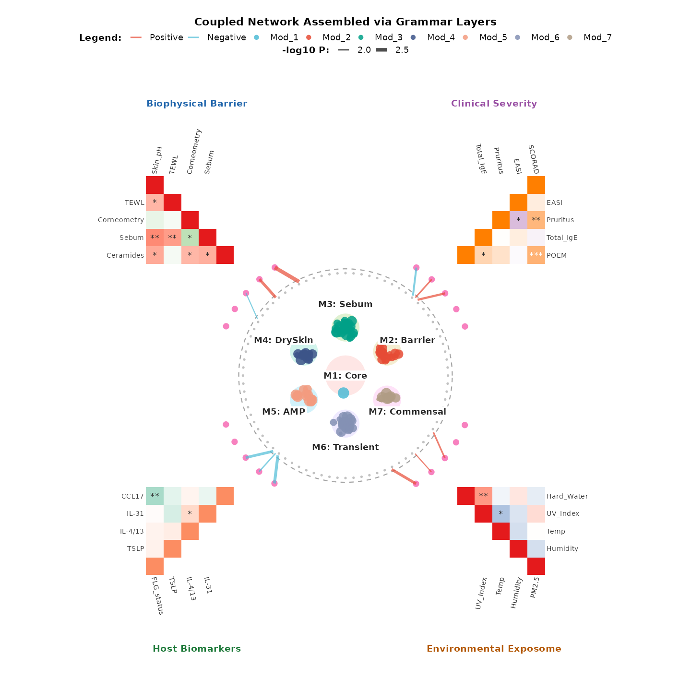

------------------------------------------------------------------------

## 4. Cross-Network Module Overlap Comparison

When validating networks across independent cohorts,
[`type_module_compare()`](https://vanhungtran.github.io/cliomicplot/reference/type_module_compare.md)
tests whether discrete modules identified in discovery remain preserved
in validation cohorts:

``` r

set.seed(42)
taxa_pool <- paste0("Taxon_", 1:120)
net_discovery <- sample(c("M1_StaphCommensal", "M2_Lipophilic", "M3_Coryneform", "M4_PathogenCluster"), 120, replace = TRUE)
net_replication <- net_discovery

# Reorganize 30% of taxa to simulate biological perturbation
perm_idx <- sample(1:120, 36)
net_replication[perm_idx] <- sample(c("ModA_Commensal", "ModB_LipidUtil", "ModC_Actinobacteria", "ModD_Inflammation"), 36, replace = TRUE)
net_replication[-perm_idx] <- gsub("M1_StaphCommensal", "ModA_Commensal", net_replication[-perm_idx])
net_replication[-perm_idx] <- gsub("M2_Lipophilic", "ModB_LipidUtil", net_replication[-perm_idx])
net_replication[-perm_idx] <- gsub("M3_Coryneform", "ModC_Actinobacteria", net_replication[-perm_idx])
net_replication[-perm_idx] <- gsub("M4_PathogenCluster", "ModD_Inflammation", net_replication[-perm_idx])

network_df <- data.frame(
  Taxon       = taxa_pool,
  Discovery   = net_discovery,
  Replication = net_replication,
  stringsAsFactors = FALSE
)

p_overlap <- cliplot(
  Replication ~ Discovery,
  data = network_df,
  type = type_module_compare(
    fill_by     = "rf",
    show_stars  = TRUE,
    show_totals = TRUE
  ),
  preset = "nature",
  title  = "Cross-Network Module Preservation: Discovery vs Replication",
  xlab   = "Discovery Cohort Modules",
  ylab   = "Replication Cohort Modules"
)
p_overlap
```

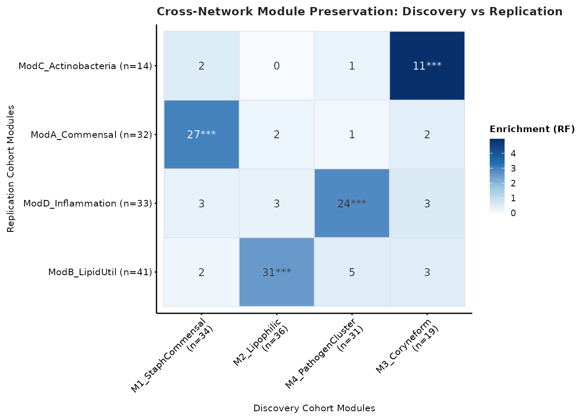

------------------------------------------------------------------------

## 5. Module-Trait Clinical Association Heatmap

[`type_module_trait()`](https://vanhungtran.github.io/cliomicplot/reference/type_module_trait.md)
computes correlation coefficients and two-sided p-values between module
eigengenes and patient phenotypic measurements:

``` r

cor_env_df <- expand.grid(
  Module = c("M1_StaphCommensal", "M2_Lipophilic", "M3_Coryneform", "M4_PathogenCluster"),
  Factor = c("Skin pH", "TEWL", "PM25", "Ambient Temp", "Relative Humidity", "SCORAD"),
  stringsAsFactors = FALSE
)

cor_env_df$cor <- c(
  -0.34,  0.42,  0.28, -0.12,  0.58,  0.72,
  -0.28,  0.38,  0.15, -0.08,  0.45,  0.64,
   0.45, -0.22, -0.35,  0.18, -0.15,  0.41,
  -0.12,  0.08,  0.15,  0.52,  0.44, -0.19
)

n_samples <- 75
t_stat <- cor_env_df$cor * sqrt((n_samples - 2) / (1 - cor_env_df$cor^2))
cor_env_df$pvalue <- 2 * stats::pt(-abs(t_stat), df = n_samples - 2)

p_trait <- cliplot(
  Module ~ Factor,
  data = cor_env_df,
  type = type_module_trait(
    show_labels     = "both",
    cluster_modules = TRUE,
    cluster_env     = TRUE,
    sig_digits      = 2
  ),
  title = "Module-Trait Associations with Environmental Exposures",
  xlab  = "Clinical & Environmental Factors",
  ylab  = "Microbial Network Modules"
)
p_trait
```

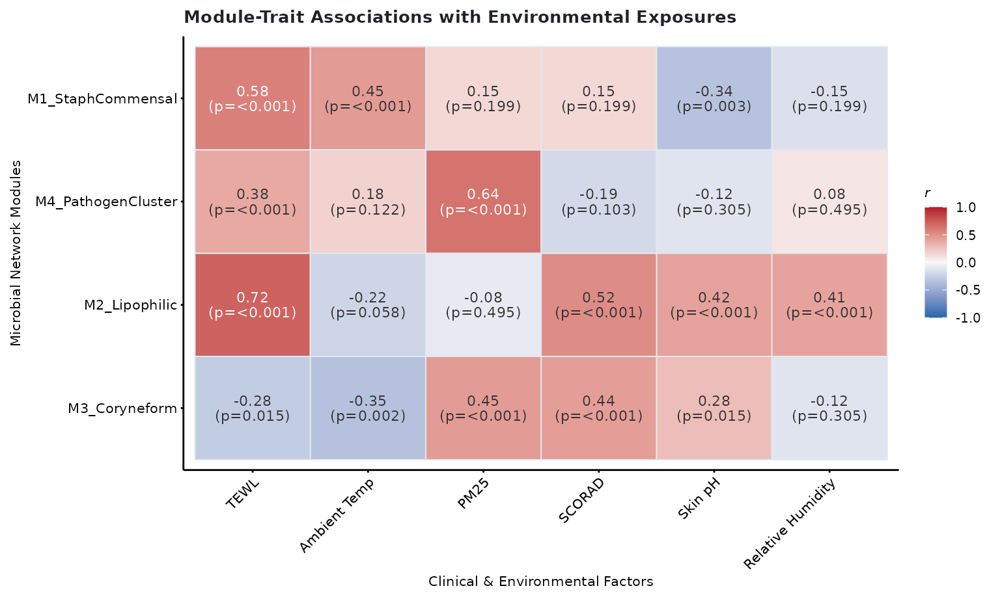

------------------------------------------------------------------------

## 6. Preservation Statistics and Network Attack Robustness

### Module Preservation Statistics: `cli_module_preservation()`

``` r

set.seed(42)
n_mods <- 6
mod_names <- paste0("Module_", LETTERS[1:n_mods])
mod_sizes <- c(45, 80, 25, 110, 60, 35)
z_scores  <- c(12.4, 8.7, 3.2, 18.5, 6.1, 1.8)

pres_df <- data.frame(
  module    = mod_names,
  size      = mod_sizes,
  z_summary = z_scores
)

p_pres <- cliplot_module_preservation(
  pres_df,
  title = "Module Preservation Across Replication Cohort"
)
p_pres
```

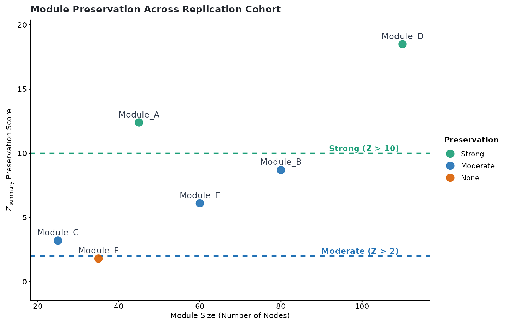

### Network Targeted Attack Robustness: `cli_network_robustness()`

Evaluating network resilience under targeted hub removal:

``` r

set.seed(42)
fractions <- seq(0, 0.5, by = 0.05)
targeted_eff <- exp(-5.0 * fractions) + rnorm(length(fractions), 0, 0.02)

robustness_df <- data.frame(
  fraction_removed = fractions,
  value            = pmax(0, targeted_eff)
)

p_rob <- cliplot_network_robustness(
  robustness_df,
  title = "Network Attack Robustness: Targeted Node Removal"
)
p_rob
```

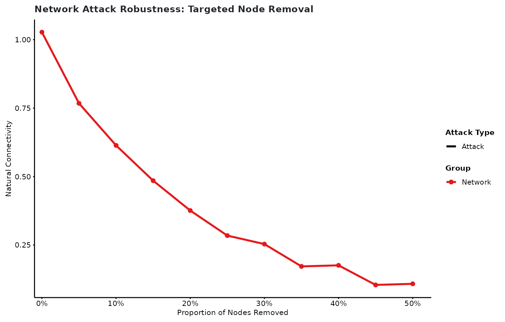

------------------------------------------------------------------------

## 7. Keystone Identification and Ecological Network Mining

Microbial ecological co-occurrence analysis relies heavily on module
partitioning, topological role classification, and cross-domain
correlation patterns (Guimerà & Amaral, *Nature* 2005; Deng et al.,
*Science* 2012; Tao Wen et al., *iMeta* 2025). `cliomicplot` provides
five dedicated network archetypes expanding on `ggClusterNet 2`
capabilities with publication-grade automated typography.

### 7.1 Zi-Pi Keystone Ecological Role Plot (`type_zipi()`)

The Zi-Pi plot classifies network nodes by mapping among-module
connectivity ($`P_i`$, participation coefficient) on the x-axis and
within-module connectivity ($`Z_i`$, degree z-score) on the y-axis.
Standard thresholds ($`Z = 2.5, P = 0.62`$) divide community taxa into
four ecological categories: **Peripherals** (specialists with few
inter-module links), **Connectors** (generalists linking distinct
modules), **Module hubs** (highly connected within their module), and
**Network hubs** (super-generalists critical to network stability).

[`type_zipi()`](https://vanhungtran.github.io/cliomicplot/reference/type_zipi.md)
automates role classification, renders soft shaded background quadrants,
adds marginal density rugs, and generates collision-free callout labels
for top keystone taxa:

``` r

set.seed(42)
n_taxa <- 50
zipi_data <- data.frame(
  taxa   = paste0("ASV_", sprintf("%02d", seq_len(n_taxa))),
  Zi     = c(rnorm(42, mean = -0.2, sd = 0.8), rnorm(4, mean = 2.9, sd = 0.3), rnorm(4, mean = 2.7, sd = 0.4)),
  Pi     = c(runif(38, 0.05, 0.55), runif(4, 0.65, 0.85), runif(4, 0.15, 0.45), runif(4, 0.68, 0.92)),
  Phylum = sample(c("Bacteroidetes", "Firmicutes", "Actinobacteria", "Proteobacteria"), n_taxa, replace = TRUE),
  stringsAsFactors = FALSE
)

p_zipi <- cliplot(Zi ~ Pi, data = zipi_data,
                  type = type_zipi(point_size = 3.2, label_top = 6),
                  title = "Microbial Keystone Hub Identification (Zi-Pi Role Classification)")
p_zipi
```

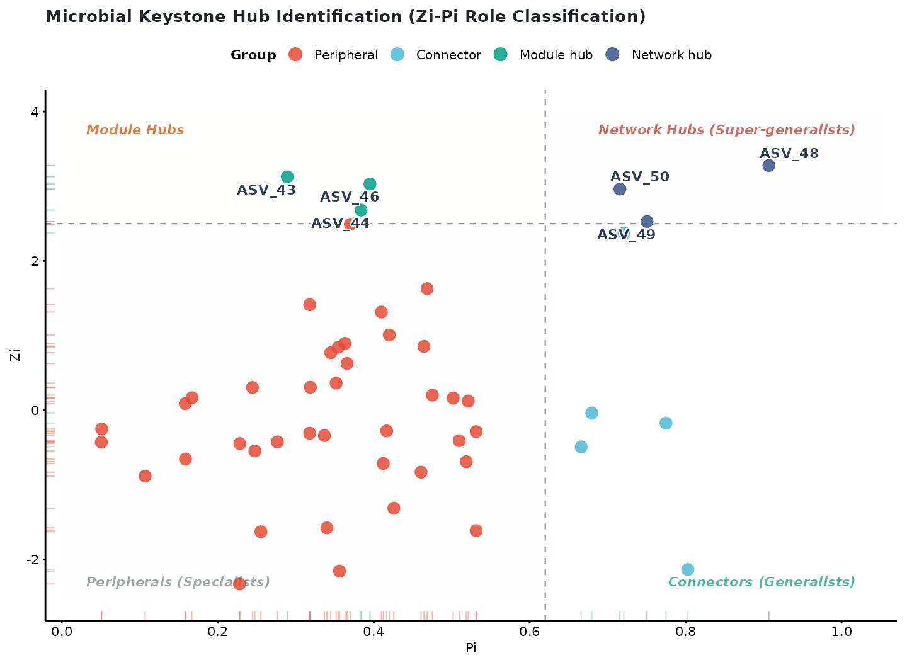

### 7.2 Triangular Correlation Heatmap with Curved Mantel Links (`type_mantel_triangle()`)

In environmental microbiomics, identifying which environmental factors
significantly drive taxonomic community composition requires linking
pairwise environmental correlations with community distance metrics.

[`type_mantel_triangle()`](https://vanhungtran.github.io/cliomicplot/reference/type_mantel_triangle.md)
pairs a lower-triangular environmental correlation matrix with curved
bezier arcs connected to target community phyla or modules:

``` r

p_mantel <- cliplot(type = type_mantel_triangle(label_size = 2.8, node_size = 3.8),
                    title = "Environmental Factors Coupled with Microbial Phyla (Mantel Correlation)")
p_mantel
```

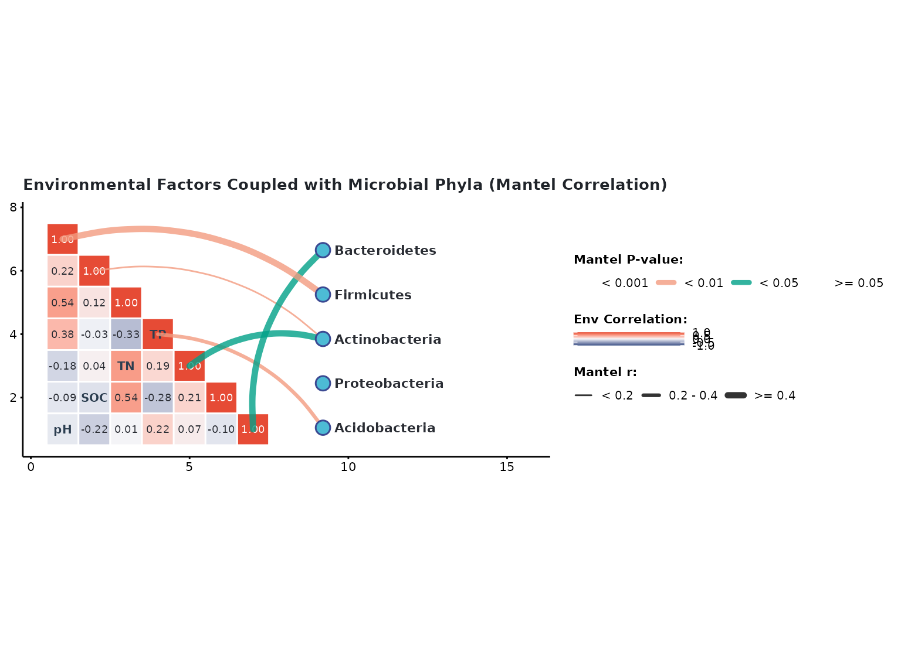

### 7.3 Modular Polygon Ring Layout (`type_polygon_network()`)

Community co-occurrence networks frequently cluster into tightly bound
functional modules. Arranging module members along circular rings
positioned at the vertices of a macro-polygon (`PolygonClusterG` and
`PolygonRrClusterG` in `ggClusterNet 2`) separates dense intra-module
edges from cross-module inter-cluster links.

In `type_polygon_network(adaptive_radius = TRUE)`, module ring radii
scale with $`\sqrt{N_k / \bar{N}}`$, providing proportional spatial area
for larger modules:

``` r

p_poly <- cliplot(type = type_polygon_network(adaptive_radius = TRUE, label_size = 2.4),
                  title = "Modular Polygon Ring Co-Occurrence Topology (PolygonRrClusterG)")
p_poly
```

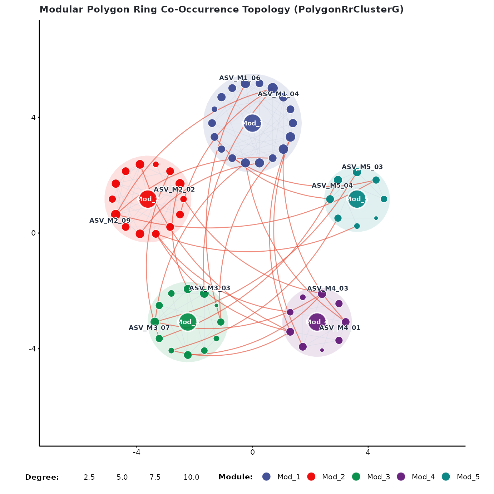

### 7.4 Transkingdom & Multi-Omics Bipartite Interactions (`type_bipartite()`)

Cross-domain interactions—such as bacterial-fungal co-occurrence or gut
microbiota coupled with serum metabolomics—require bipartite layouts
highlighting positive (synergistic) vs negative (competitive)
correlations:

``` r

p_bip <- cliplot(type = type_bipartite(domain_a = "Gut Microbiota", domain_b = "Serum Metabolites", layout = "bipolar"),
                 title = "Transkingdom Cross-Domain Network (Microbiota vs Metabolites)")
p_bip
```

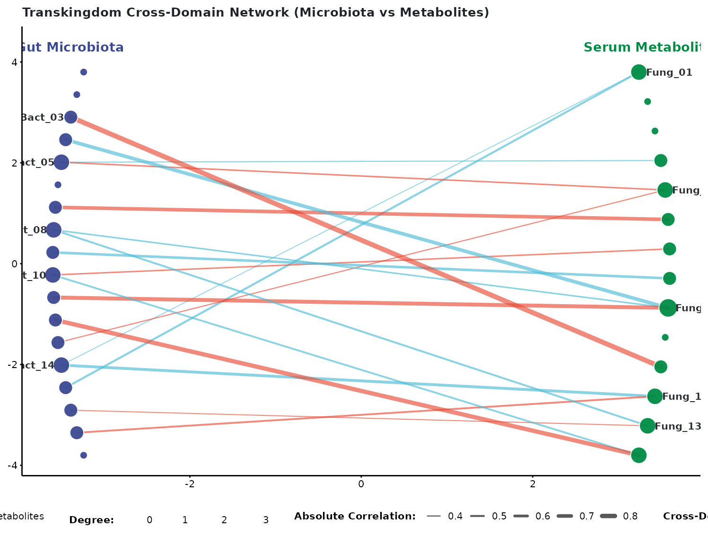

### 7.5 Ecological Network Edge-Sign Dynamics (`type_edge_dynamics()`)

The ratio of negative correlation edges (competitive exclusion or niche
differentiation) to positive correlation edges (mutualism or
cross-feeding) quantifies community stability across clinical disease
severity or environmental perturbation gradients:

``` r

p_edge <- cliplot(type = type_edge_dynamics(mode = "stack"))
p_edge
```

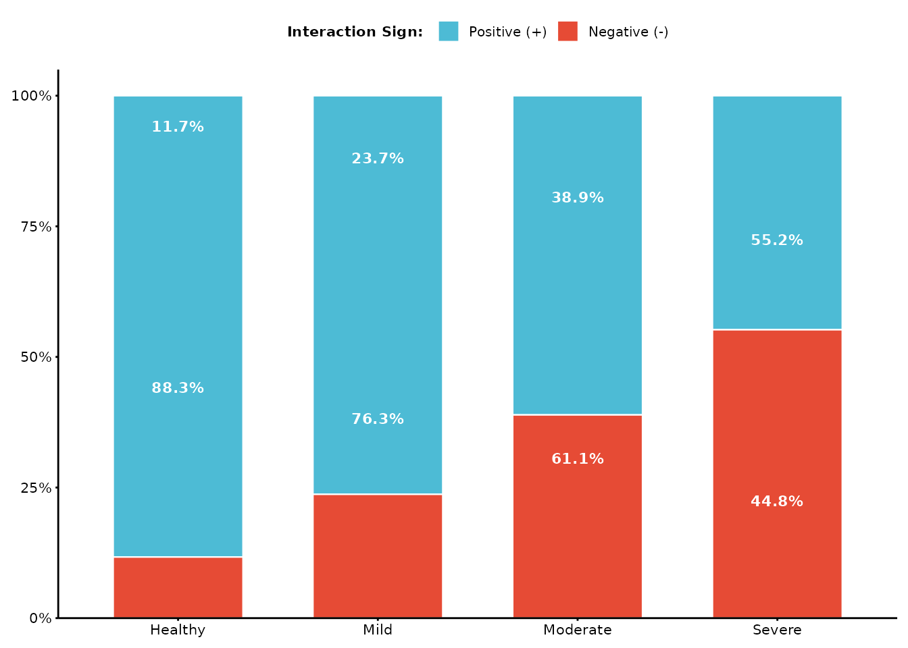

------------------------------------------------------------------------

## 8. Comparative Benchmark: `cliomicplot` vs `ggClusterNet 2`

`cliomicplot` provides pure `ggplot2` modularity, unified formula
grammar (`y ~ x | group`), and SciFig automated publication gates across
both microbial ecological network mining and general multi-omics:

| Capability / Dimension | `ggClusterNet 2` (*iMeta* 2025) | `linkET` | `microeco` | `cliomicplot` |
|:---|:---|:---|:---|:---|
| **Underlying Architecture** | Function wrappers / base `igraph` | Custom pipe grobs | R6 class methods | Pure S3 `ggplot2` grammar |
| **Primary Formula Syntax** | None (matrix/phyloseq input) | None | Method calls | Standard formula (`y ~ x \| group`) |
| **Zi-Pi Role Classification** | `ZiPiPlot()` | None | `trans_network$cal_eigen()` | [`type_zipi()`](https://vanhungtran.github.io/cliomicplot/reference/type_zipi.md) (with shaded quadrants & rugs) |
| **Triangular Heatmap + Mantel** | `MatCorPlot2()` / `cor_link3()` | `qcorrplot()` | `trans_env$plot_cor()` | [`type_mantel_triangle()`](https://vanhungtran.github.io/cliomicplot/reference/type_mantel_triangle.md) & 4-corner [`type_env_network()`](https://vanhungtran.github.io/cliomicplot/reference/type_env_network.md) |
| **Modular Polygon Ring Layout** | `PolygonClusterG()`, `PolygonRrClusterG()` | None | None | [`type_polygon_network()`](https://vanhungtran.github.io/cliomicplot/reference/type_polygon_network.md) (adaptive radius) |
| **Transkingdom Bipartite** | `corBionetwork()` | None | Bipartite method | [`type_bipartite()`](https://vanhungtran.github.io/cliomicplot/reference/type_bipartite.md) (bipolar & concentric) |
| **Edge-Sign Ratio Dynamics** | Extraction script | None | Ratio bar | [`type_edge_dynamics()`](https://vanhungtran.github.io/cliomicplot/reference/type_edge_dynamics.md) (stack, ratio, counts) |
| **Multi-Domain External Coupling** | 1 domain | 1 domain | 1 domain | 1 to 4 independent corner domains |
| **Collision-Free Keystone Labels** | Manual positioning | Manual | Manual | Automated (`ggrepel` with halo backing) |
| **Publication Typography** | None | None | None | SciFig enforced ($`\ge 5.0`$ pt font floor, CVD palettes) |
| **Clinical Trial Portfolio** | None | None | None | 15+ trial types (KM, Forest, Waterfall, Swimmer) |
| **Journal Submission Export** | None | None | None | [`cli_save()`](https://vanhungtran.github.io/cliomicplot/reference/cli_save.md) with journal dimension presets |
