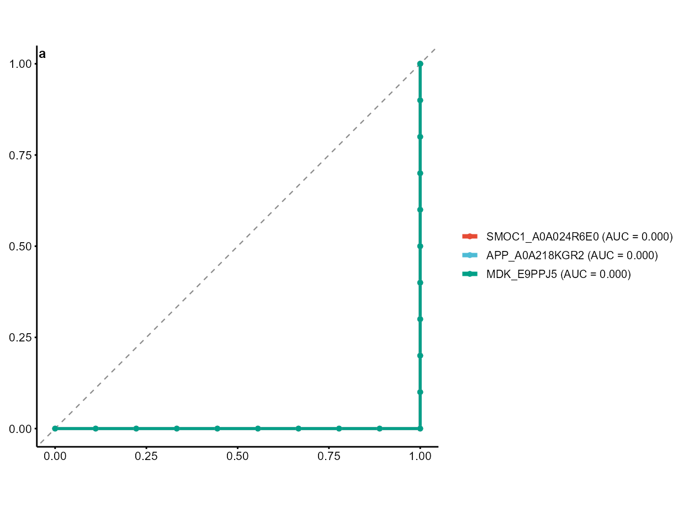
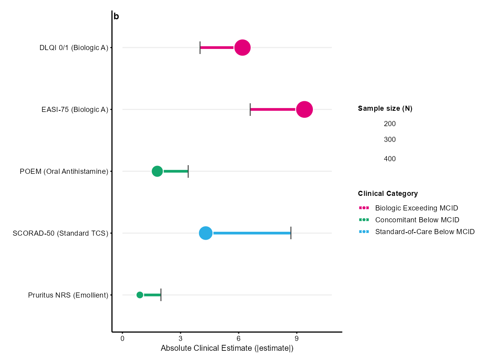
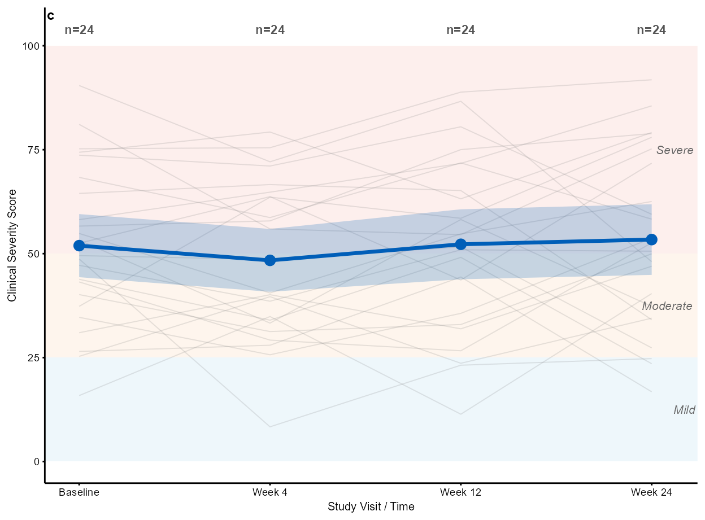
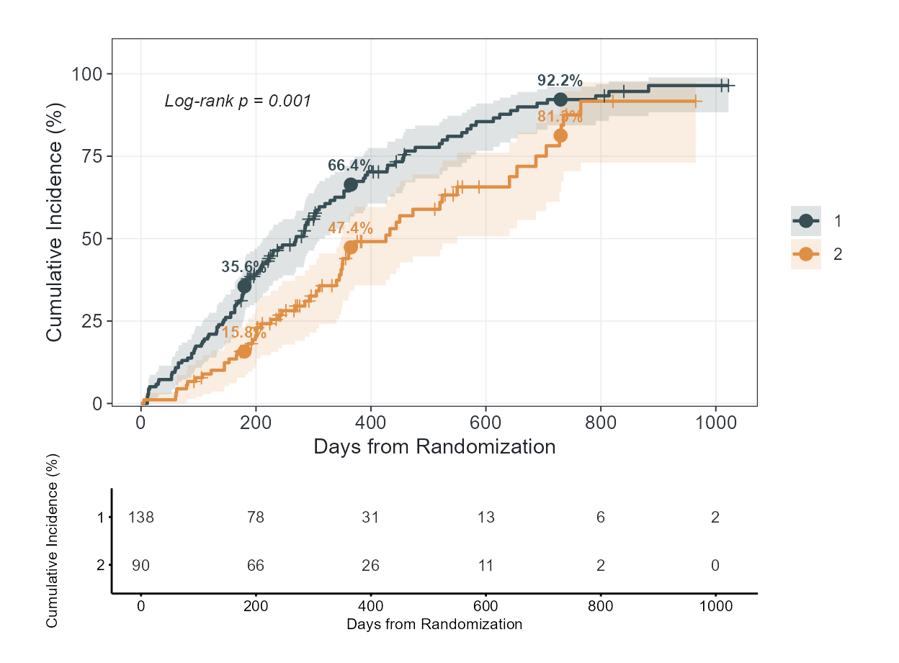
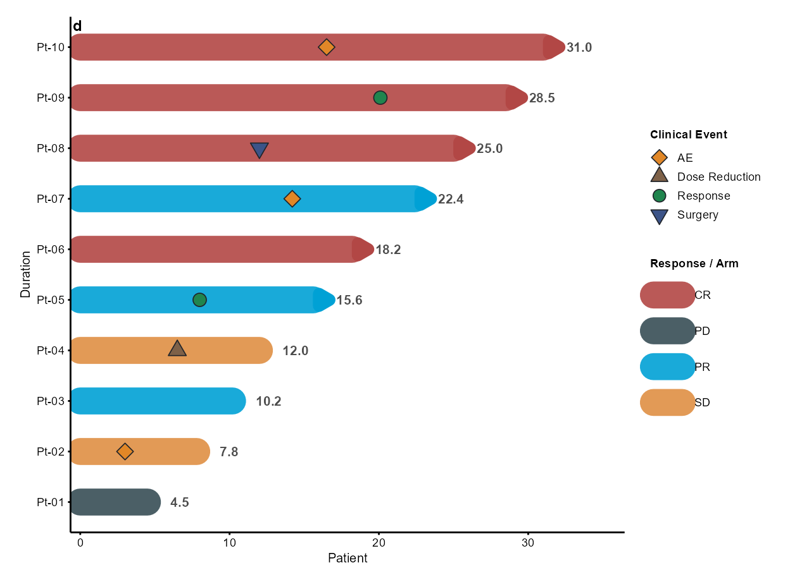
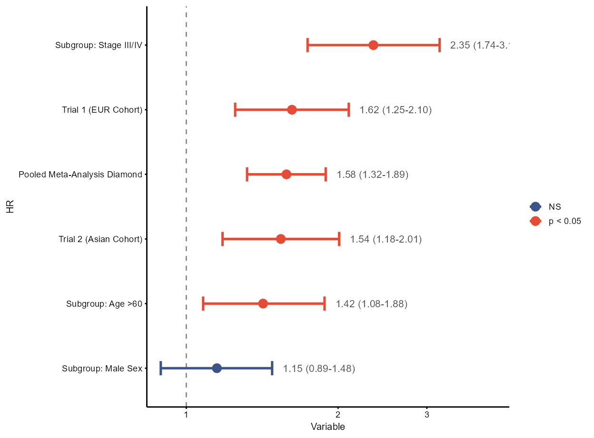
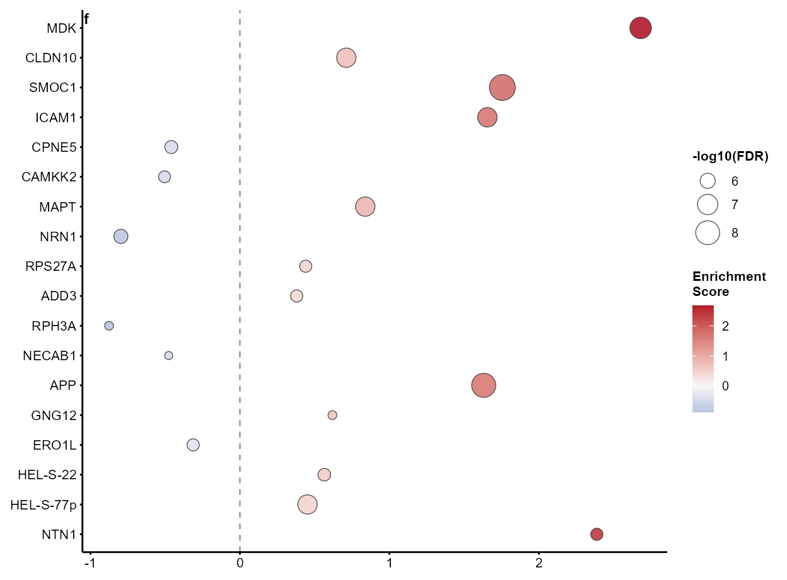
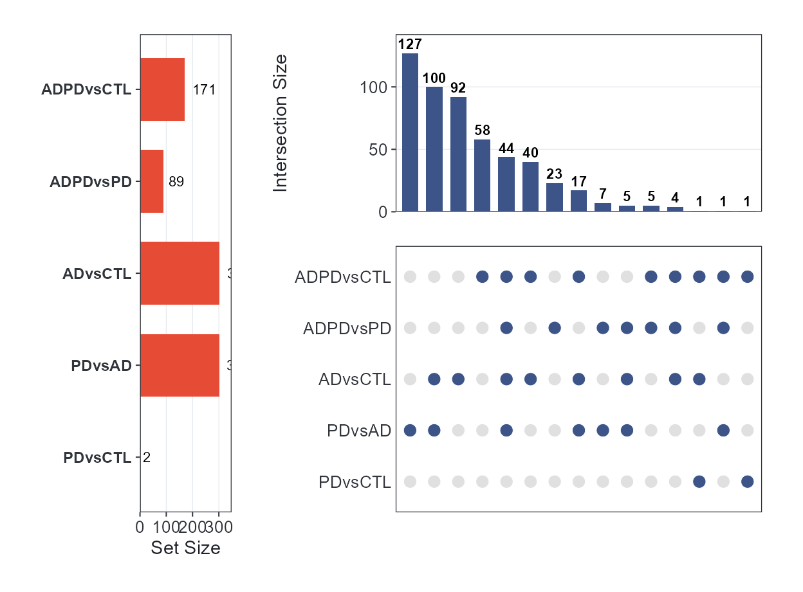
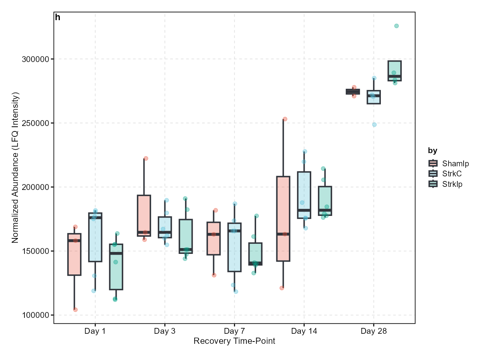
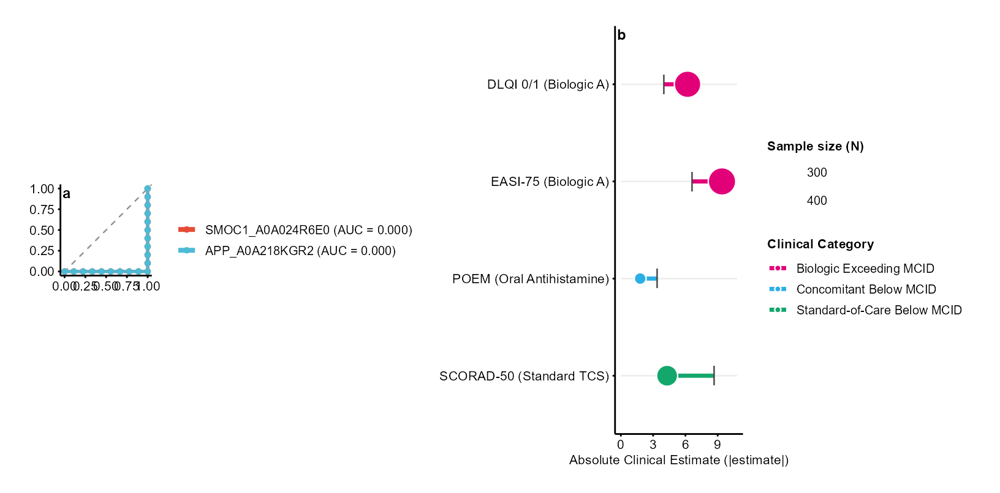

# Nature/Cell/Science-Quality Figures with cliomicplot

\+

−

⊙

×

‹

›


100 %

Scroll to zoom · Drag to pan · ← → to navigate

## Overview

Publishing in premier scientific journals—**Nature, Cell, and Science
(CNS)**—demands strict visual, typographic, and statistical discipline:

1.  **Exact physical trim sizing**: Figures must be drawn at the
    publisher’s printed column widths (e.g., 89 mm single-column, 120 mm
    1.5-column, 183 mm double-column) rather than an arbitrary 7×5 inch
    canvas scaled down during typesetting.
2.  **Minimalist typography and data-to-ink ratio**: All in-figure
    titles are removed (figure explanations belong in the
    legend/caption); panel identifier tags (**a**, **b**, **c**, **d**)
    sit at the upper left; font sizes are constrained to 5–7 pt at final
    print scale.
3.  **Open axes vs. full-box frames**: Top and right spines are removed
    for Nature and Science
    ([`theme_cli_nature()`](https://vanhungtran.github.io/cliomicplot/reference/theme_cli_nature.md),
    [`theme_cli_science()`](https://vanhungtran.github.io/cliomicplot/reference/theme_cli_science.md)),
    while structured spines and outward ticks are preserved for Cell and
    SCI/Elsevier styles
    ([`theme_cli_cell()`](https://vanhungtran.github.io/cliomicplot/reference/theme_cli_cell.md),
    [`theme_cli_scifig()`](https://vanhungtran.github.io/cliomicplot/reference/theme_cli_scifig.md)).
4.  **Clinical and biological integrity**: Clinical figures prioritize
    effect magnitudes over raw p-values (e.g. MCID thresholds), track
    exact denominators, report landmark milestones, and present
    multi-omics evidence side-by-side.

This vignette demonstrates how **cliomicplot** creates publication-ready
figures matching these exact journal requirements, drawing on the real
proteomics, metabolomics, and clinical datasets bundled with the
package.

``` r

library(cliomicplot)
library(ggplot2)
library(survival)
library(patchwork)

clipar(stat.test = NULL) # Disable auto statistical overlays for clean journal look
```

``` r

# Helper to resolve bundled example datasets
resolve_data = function(filename) {
  pkg_path = system.file("extdata", filename, package = "cliomicplot")
  if (pkg_path != "" && file.exists(pkg_path)) return(pkg_path)
  fallback = file.path("..", "inst", "extdata", filename)
  if (file.exists(fallback)) return(fallback)
  fallback2 = file.path("inst", "extdata", filename)
  if (file.exists(fallback2)) return(fallback2)
  stop("Cannot locate ", filename)
}

# 1. AD/PD cortex proteomics (MaxQuant)
e_adpd = new.env()
load(resolve_data("ADPD_cortex_Maxquant.RData"), envir = e_adpd)
adpd_meta = e_adpd$MetaData
adpd_wide = e_adpd$data_wide
adpd_res  = e_adpd$results_long

# 2. Stroke brain time-course proteomics
e_stroke = new.env()
load(resolve_data("StrokeBrain_TimeCourse.RData"), envir = e_stroke)
stroke_long = e_stroke$data_long
stroke_meta = e_stroke$MetaData
```

------------------------------------------------------------------------

## 1. The Design Language of Nature, Cell, and Science

Premier journals follow distinct visual conventions:

| Specification | Nature / Nat. Comms | Science / AAAS | Cell Press | SCI / Elsevier |
|----|----|----|----|----|
| **Theme** | `theme = "nature"` | `theme = "science"` | `theme = "cell"` | `theme = "scifig"` |
| **Spines** | Open (left & bottom only) | Ultra-clean open | Structured open | 4 visible black spines |
| **Grid lines** | Refused / None | Strictly None | None | Subtle dashed (0.3 pt) |
| **Ticks** | Outward (1.5 pt) | Outward (1.5 pt) | Outward (1.5 pt) | Outward (2.5 pt) |
| **Single Column** | 89 mm (3.50 in) | 90 mm (3.54 in) | 85 mm (3.35 in) | 85–90 mm |
| **Double Column** | 183 mm (7.20 in) | 183 mm (7.20 in) | 174–180 mm | 175–185 mm |
| **Max Height** | 170 mm (Nature) / 225 mm | 230 mm | 203 mm | 220 mm |
| **Panel Tags** | Bold lowercase (**a**, **b**) | Bold lowercase (**a**, **b**) | Bold uppercase (**A**, **B**) | Bold lowercase (**a**, **b**) |
| **Format** | Vector PDF/SVG required | Vector PDF/SVG required | Vector PDF/EPS/SVG | Vector PDF/TIFF/SVG |

------------------------------------------------------------------------

## 2. Figure 1 — Diagnostic Biomarker ROC Curves (Nature Style)

ROC curves evaluate classifier sensitivity and specificity across all
thresholds. In Nature style, coordinates are isometric (1:1 aspect
ratio), the chance diagonal is dashed, and exact AUC values are embedded
directly in the legend.

Here, we evaluate top differentially expressed cortex proteins for
distinguishing Alzheimer’s disease (AD) from neurologically normal
controls (CTL):

``` r

meta_adctl = adpd_meta[adpd_meta$group %in% c("AD", "CTL"), ]
samples = as.character(meta_adctl$sampleid)
top_markers = c("SMOC1_A0A024R6E0", "APP_A0A218KGR2", "MDK_E9PPJ5")

roc_df = data.frame(
  disease = factor(meta_adctl$group, levels = c("CTL", "AD")),
  t(adpd_wide[top_markers, samples]),
  check.names = FALSE
)

cliplot(roc_df,
        type = type_roc(predictors = top_markers, response = "disease"),
        theme = "nature", palette = "npg") +
  cli_panel_label("a")
```



------------------------------------------------------------------------

## 3. Figure 2 — Minimal Clinically Important Difference (MCID) Dumbbell (Cell Style)

Large observational cohorts or clinical trials frequently yield
$`P < 0.001`$ for effect sizes that are clinically trivial. The **MCID
Dumbbell Plot** (Clinical Archetype 1) anchors observed effect estimates
$`|\hat{\theta}|`$ against the validated minimal clinically important
difference threshold (e.g. DLQI, EASI, SCORAD).

Glyphs are dynamically sized by sample size ($`N_{\text{treated}}`$),
and endpoints are ordered by their effect-to-MCID ratio:

``` r

mcid_data = data.frame(
  Endpoint = c("EASI-75 (Biologic A)", "DLQI 0/1 (Biologic A)",
               "SCORAD-50 (Standard TCS)", "POEM (Oral Antihistamine)",
               "Pruritus NRS (Emollient)"),
  Estimate = c(9.4, 6.2, 4.3, 1.8, 0.9),
  MCID     = c(6.6, 4.0, 8.7, 3.4, 2.0),
  N        = c(480, 450, 310, 220, 160),
  Category = c("Biologic Exceeding MCID", "Biologic Exceeding MCID",
               "Standard-of-Care Below MCID", "Concomitant Below MCID",
               "Concomitant Below MCID")
)

cliplot(Estimate ~ Endpoint, data = mcid_data,
        type = type_mcid(mcid = "MCID", n_treated = "N"),
        theme = "cell") +
  cli_panel_label("b")
```



------------------------------------------------------------------------

## 4. Figure 3 — Longitudinal Trajectory with Clinical Severity Bands (Science Style)

Individual patient trajectories contain high biological noise. Plotting
only group means hides clinical heterogeneity, whereas raw spaghetti
plots create an illegible hairball.

The **Longitudinal Trajectory Plot** (Clinical Archetype 4) resolves
this by overlaying semi-transparent individual paths onto shaded
clinical severity bands (Mild, Moderate, Severe), anchored by a bold
group mean ribbon and visit sample sizes ($`n = \dots`$):

``` r

set.seed(42)
n_patients = 24
visits = c("Baseline", "Week 4", "Week 12", "Week 24")
traj_df = expand.grid(Patient = paste0("PT-", sprintf("%02d", 1:n_patients)), Visit = visits)

# Simulate clinical response trajectories
baseline_scores = rep(runif(n_patients, 50, 85), each = length(visits))
time_drop = rep(c(0, 12, 28, 42), times = n_patients)
noise = rnorm(nrow(traj_df), mean = 0, sd = 6)
traj_df$Severity = pmax(2, pmin(95, baseline_scores - time_drop + noise))

cliplot(Severity ~ Visit | Patient, data = traj_df,
        type = type_trajectory(
          severity_bands  = list(Mild = c(0, 25), Moderate = c(25, 50), Severe = c(50, 100)),
          severity_colors = c(Mild = "#D9EEF7", Moderate = "#FDE8D7", Severe = "#FADBD8"),
          show_mean = TRUE, show_ci = TRUE, show_n = TRUE
        ),
        theme = "science",
        ylab = "Disease Severity Score (0-100)") +
  cli_panel_label("c")
```



------------------------------------------------------------------------

## 5. Figure 4 — Kaplan-Meier Cumulative Incidence with Landmark Milestones (Nature Style)

In oncology and longitudinal disease cohorts, communicating exact
landmark risks (e.g., 6-month, 1-year, and 2-year cumulative incidence)
is essential.

Using the zero-dependency native survival engine in
[`type_km()`](https://vanhungtran.github.io/cliomicplot/reference/type_km.md),
we compute cumulative incidence $`[1 - S(t)] \times 100\%`$ with exact
landmark milestone dots, annotations, and aligned numbers-at-risk:

``` r

lung_data = survival::lung

cliplot(Surv(time, status) ~ sex, data = lung_data,
        type = type_km(
          cumulative_incidence = TRUE,
          milestones  = c(180, 365, 730),
          risk_table  = TRUE,
          pval        = TRUE,
          conf_int    = TRUE,
          xlab        = "Days from Randomization"
        ),
        theme = "nature", palette = "jama")
```



------------------------------------------------------------------------

## 6. Figure 5 — Clinical Oncology Swimmer Plot with Ongoing Indicators (Cell Style)

Swimmer plots display individual patient treatment durations, clinical
response categories, and distinct adverse events.

Following Clinical Archetype 13 standards, patients actively continuing
therapy at database lock are distinguished by arrowheads at their
timeline bar tips:

``` r

set.seed(101)
n_pts = 10
pt_timeline = data.frame(
  Patient  = paste0("Pt-", sprintf("%02d", 1:n_pts)),
  Duration = c(4.5, 7.8, 10.2, 12.0, 15.6, 18.2, 22.4, 25.0, 28.5, 31.0),
  Response = c("PD", "SD", "PR", "SD", "PR", "CR", "PR", "CR", "CR", "CR"),
  Ongoing  = c(FALSE, FALSE, FALSE, FALSE, TRUE, TRUE, TRUE, TRUE, TRUE, TRUE),
  stringsAsFactors = FALSE
)

# Patient adverse events and surgery milestones
event_markers = data.frame(
  ID    = c("Pt-02", "Pt-04", "Pt-05", "Pt-07", "Pt-08", "Pt-09", "Pt-10"),
  Time  = c(3.0, 6.5, 8.0, 14.2, 12.0, 20.1, 16.5),
  Event = c("AE", "Dose Reduction", "Response", "AE", "Surgery", "Response", "AE"),
  stringsAsFactors = FALSE
)

cliplot(Duration ~ Patient, data = pt_timeline,
        type = type_swimmer(
          bar_fill      = "Response",
          ongoing       = "Ongoing",
          event_times   = event_markers,
          show_duration = TRUE
        ),
        theme = "cell", bar_palette = "jama") +
  cli_panel_label("d")
```



------------------------------------------------------------------------

## 7. Figure 6 — Multivariable Forest Plot with Row Stripes & Meta-Analysis Diamond (Science Style)

Forest plots summarize hazard ratios, odds ratios, and meta-analytic
evidence. In Science and Lancet style: - Alternating subtle background
row stripes (`stripe = TRUE`) prevent horizontal eye drift across wide
canvases. - Pooled summary estimates are rendered as high-contrast
diamond glyphs (`shape = 23`). - Confidence interval annotations are
formatted cleanly without negative zero signs (`-0.00`).

``` r

cox_meta = data.frame(
  Variable = c("Subgroup: Age >60", "Subgroup: Male Sex", "Subgroup: Stage III/IV",
               "Trial 1 (EUR Cohort)", "Trial 2 (Asian Cohort)", "Pooled Meta-Analysis Diamond"),
  HR       = c(1.42, 1.15, 2.35, 1.62, 1.54, 1.58),
  CI_low   = c(1.08, 0.89, 1.74, 1.25, 1.18, 1.32),
  CI_high  = c(1.88, 1.48, 3.18, 2.10, 2.01, 1.89),
  P        = c(0.012, 0.28, 0.0001, 0.0004, 0.0015, 0.00001),
  is_summary = c(FALSE, FALSE, FALSE, FALSE, FALSE, TRUE)
)

cliplot(HR ~ Variable, data = cox_meta,
        type = type_forest(
          stripe      = TRUE,
          diamond     = TRUE,
          show_values = TRUE,
          ref_val     = 1,
          log_scale   = TRUE
        ),
        theme = "science") +
  cli_panel_label("e")
```



------------------------------------------------------------------------

## 8. Figure 7 — GSEA-Style Pathway Enrichment Dot Plot (Nature Style)

Enrichment dot plots order biological pathways or gene sets by
Normalized Enrichment Score (NES), encoding statistical significance
($`-\log_{10} \text{FDR}`$) in dot size and regulation direction in
color:

``` r

# Extract top DE proteins from AD vs CTL comparison
r_adctl = adpd_res[adpd_res$test == "ADvsCTL", ]
r_adctl = r_adctl[order(r_adctl$Adj.P.Value), ]

top_pathways = data.frame(
  Term = sub("_.*$", "", r_adctl$UniqueID[1:18]),
  NES  = r_adctl$logFC[1:18],
  FDR  = r_adctl$Adj.P.Value[1:18]
)

cliplot(top_pathways, type = "gsea", top_term = 18, theme = "nature") +
  cli_panel_label("f")
```



------------------------------------------------------------------------

## 9. Figure 8 — Multi-Set Intersection: UpSet Plot (Cell Style)

UpSet plots supersede Venn diagrams when tracking differentially
expressed gene or metabolite overlap across $`\ge 4`$ biological
contrasts:

``` r

deg_sets = lapply(unique(adpd_res$test), function(tt) {
  sub = adpd_res[adpd_res$test == tt, ]
  sub$UniqueID[sub$Adj.P.Value < 0.05 & abs(sub$logFC) > 0.5]
})
names(deg_sets) = unique(adpd_res$test)
deg_sets = deg_sets[vapply(deg_sets, length, integer(1)) > 0]

cliplot(deg_sets, type = "upset", theme = "cell") +
  cli_panel_label("g")
```



------------------------------------------------------------------------

## 10. Figure 9 — SCI / Elsevier Full-Box Style with `theme_cli_scifig()`

For manuscripts submitted to Elsevier, IEEE, and SCI journals requiring
full four-sided spines and outward tick marks,
[`theme_cli_scifig()`](https://vanhungtran.github.io/cliomicplot/reference/theme_cli_scifig.md)
provides a crisp box frame with a subtle dashed reference grid:

``` r

# Protein abundance across stroke recovery time-points
lxn_sub = stroke_long[stroke_long$UniqueID == "Lxn_P70202", ]
lxn_sub$timepoint = factor(paste0("Day ", lxn_sub$conc),
                           levels = c("Day 1", "Day 3", "Day 7", "Day 14", "Day 28"))

cliplot(expr ~ timepoint | treatment, data = lxn_sub,
        type = "boxplot",
        theme = "scifig",
        palette = "npg",
        xlab = "Recovery Time-Point",
        ylab = "Normalized Abundance (LFQ Intensity)") +
  cli_panel_label("h")
```



------------------------------------------------------------------------

## 11. Multi-Panel Composite Assembly & Journal-Sized Export

A key requirement in CNS journals is assembling modular panels into a
unified figure and exporting at exact physical millimeter trim width:

``` r

panel_a = cliplot(roc_df, type = type_roc(predictors = top_markers[1:2], response = "disease"),
                  theme = "nature", palette = "npg") +
  cli_panel_label("a")

panel_b = cliplot(Estimate ~ Endpoint, data = mcid_data[1:4, ],
                  type = type_mcid(mcid = "MCID", n_treated = "N"),
                  theme = "nature") +
  cli_panel_label("b")

# Combine side-by-side using patchwork
composite_fig = panel_a + panel_b + plot_layout(widths = c(1, 1.4))
composite_fig
```



### Exact Journal Dimensions & Vector Export

[`cli_journal_size()`](https://vanhungtran.github.io/cliomicplot/reference/cli_journal_size.md)
provides the publisher’s exact column specifications:

``` r

journals = c("nature", "natcomms", "science", "cell", "jama", "nejm", "lancet", "plos", "ieee")
size_table = do.call(rbind, lapply(journals, function(j) {
  s_single = cli_journal_size(j, "single")
  s_double = cli_journal_size(j, "double")
  data.frame(
    Publisher       = toupper(j),
    Single_Width_mm = s_single$width_mm,
    Double_Width_mm = s_double$width_mm,
    Max_Height_mm   = s_single$max_height_mm,
    stringsAsFactors = FALSE
  )
}))
size_table
```

    #>   Publisher Single_Width_mm Double_Width_mm Max_Height_mm
    #> 1    NATURE            89.0           183.0         170.0
    #> 2  NATCOMMS            88.0           180.0         225.0
    #> 3   SCIENCE            90.0           183.0         230.0
    #> 4      CELL            85.0           180.0         203.0
    #> 5      JAMA            86.4           177.8         220.0
    #> 6      NEJM            89.0           180.0         220.0
    #> 7    LANCET            85.0           175.0         220.0
    #> 8      PLOS            83.0           190.5         222.3
    #> 9      IEEE            88.9           181.9         220.0

Export with
[`cli_save()`](https://vanhungtran.github.io/cliomicplot/reference/cli_save.md)
to enforce exact millimeter dimensions and submission format compliance:

``` r

# Nature double-column vector PDF (183 mm width) at 600 DPI
cli_save(composite_fig, file = "Figure_1.pdf", journal = "nature", column = "double", dpi = 600)

# Cell single-column vector SVG (85 mm width)
cli_save(panel_a, file = "Figure_1a.svg", journal = "cell", column = "single")
```

------------------------------------------------------------------------

## Summary

By pairing the
[`cliplot()`](https://vanhungtran.github.io/cliomicplot/reference/cliplot.md)
formula grammar with Nature, Cell, and Science themes and journal
clinical archetypes:

1.  **Every figure adheres to strict publisher layout and typography
    rules**.
2.  **Clinical and omics interpretations remain mathematically robust
    and transparent**.
3.  **Multi-panel figures can be assembled and saved directly at journal
    trim specifications**.
