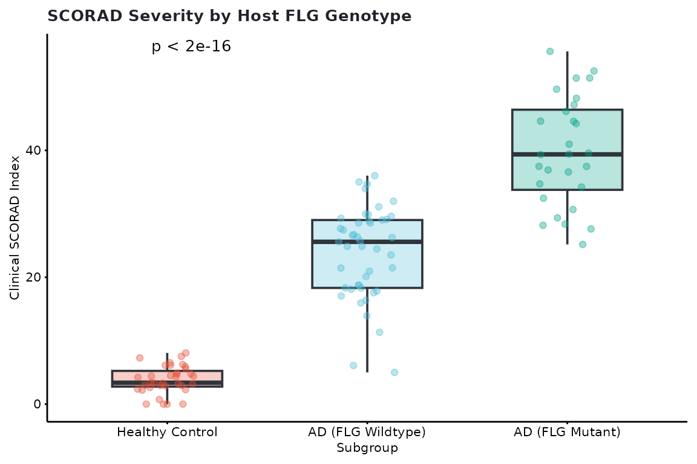
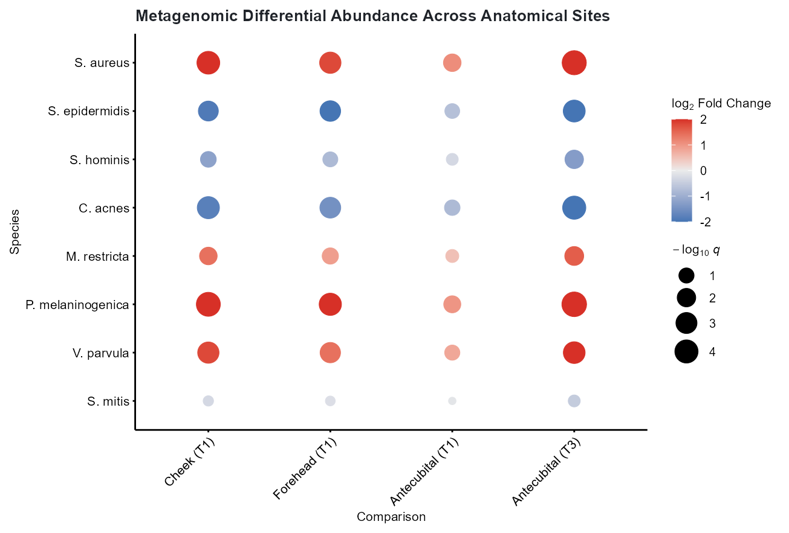
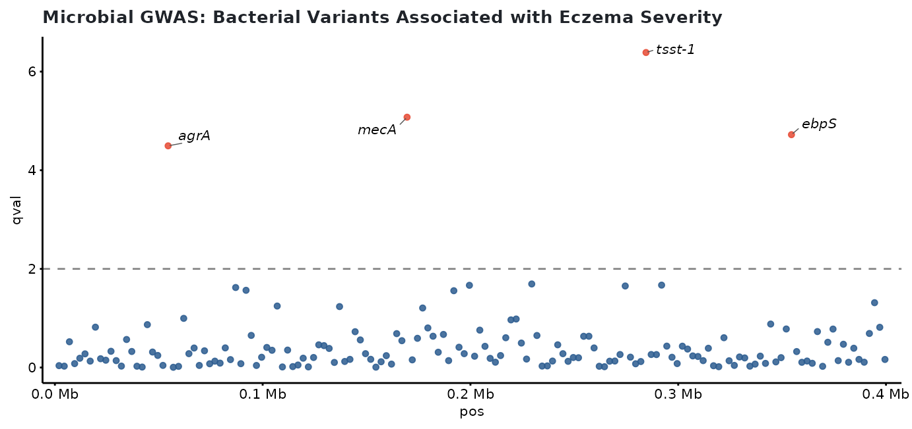
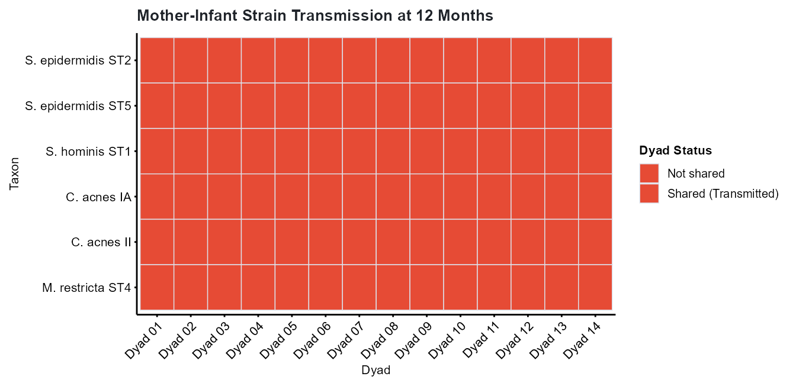
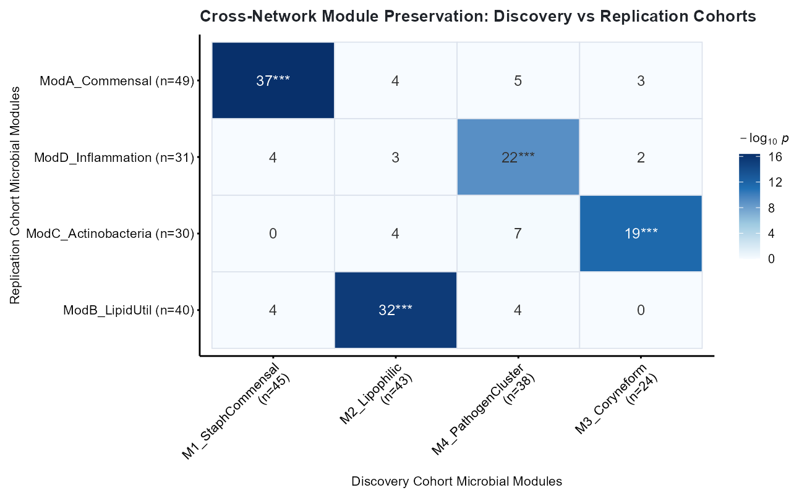
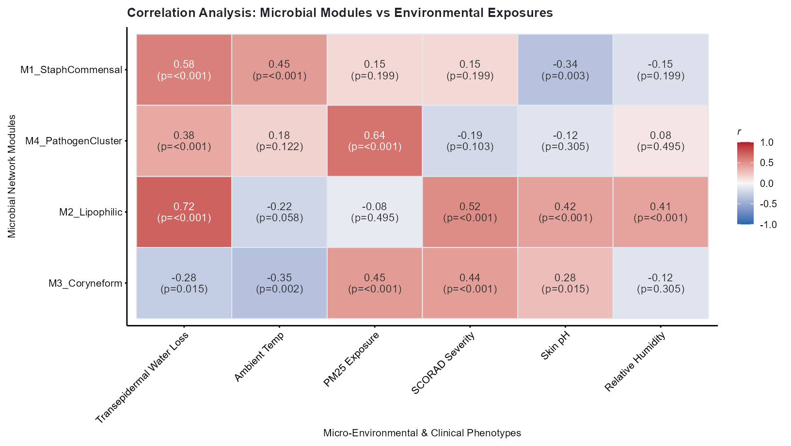
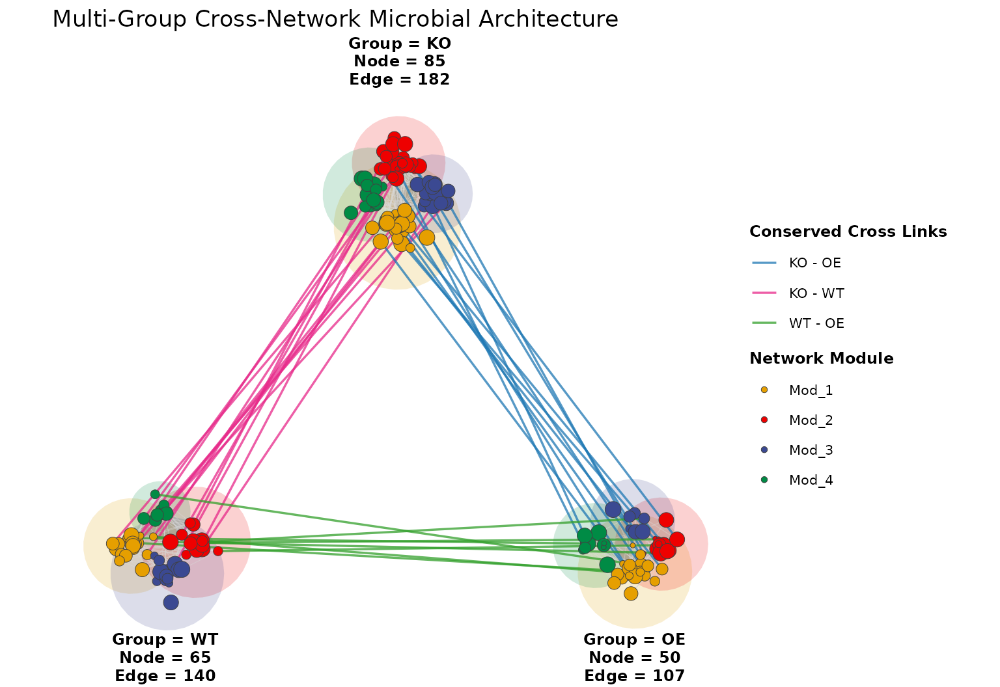
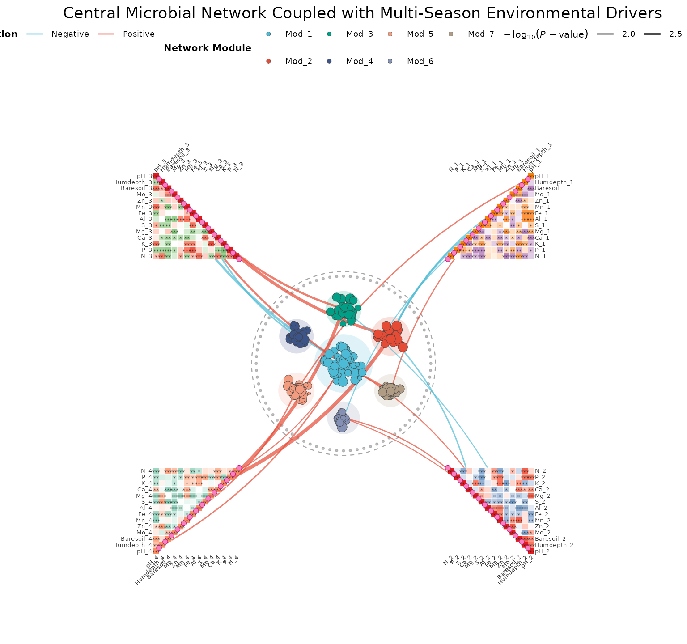

# Microbial Metagenomics and mGWAS in Clinical Cohorts

## Overview

Clinical microbiome and microbial genome-wide association studies
(mGWAS) link microbial community shifts, strain transmission, and
bacterial genetic variation to patient phenotypes. This workflow adapts
the clinical metagenomics archetypes from the VITALITY infant atopic
dermatitis trial (Shen et al.) into standardized `cliomicplot` figure
calls.

``` r

library(cliomicplot)
library(ggplot2)
clitheme("nature")
```

------------------------------------------------------------------------

## 1. Clinical Severity Stratification by Host Genetics

In cohort studies of atopic dermatitis, host genetic lesions (such as
*FLG* loss-of-function variants) interact with microbial colonization.
Here, clinical eczema severity (SCORAD index) is compared across disease
subgroups with overlaid patient jitter and rank-sum tests:

``` r

set.seed(42)
cohort_df <- data.frame(
  Subgroup = factor(rep(c("Healthy Control", "AD (FLG Wildtype)", "AD (FLG Mutant)"), c(35, 45, 28)),
                    levels = c("Healthy Control", "AD (FLG Wildtype)", "AD (FLG Mutant)")),
  SCORAD = c(
    pmax(0, rnorm(35, mean = 3.5, sd = 2.0)),
    pmax(5, rnorm(45, mean = 24.2, sd = 7.5)),
    pmax(12, rnorm(28, mean = 38.6, sd = 9.2))
  )
)

cliplot(
  SCORAD ~ Subgroup,
  data = cohort_df,
  type = "boxplot",
  palette = "nature",
  stat.test = "kruskal.test",
  title = "SCORAD Severity by Host FLG Genotype",
  ylab = "Clinical SCORAD Index"
)
```



------------------------------------------------------------------------

## 2. Differential Abundance Bubble Matrix

Differential abundance tests report both directional effect size (signed
$`\log_2\text{FC}`$) and statistical significance ($`-\log_{10} q`$).
[`type_bubble_matrix()`](https://vanhungtran.github.io/cliomicplot/reference/type_bubble_matrix.md)
renders both across anatomical sampling sites and study visits:

``` r

set.seed(42)
species <- c("S. aureus", "S. epidermidis", "S. hominis", "C. acnes",
             "M. restricta", "P. melaninogenica", "V. parvula", "S. mitis")
comparisons <- c("Cheek (T1)", "Forehead (T1)", "Antecubital (T1)", "Antecubital (T3)")

da_df <- expand.grid(Species = species, Comparison = comparisons, stringsAsFactors = FALSE)
da_df$log2FC <- c(
  2.3, -1.9, -1.2, -1.8, 1.4, 2.7, 1.8, -0.3,
  1.8, -2.1, -0.8, -1.5, 0.9, 2.0, 1.4, -0.2,
  1.1, -0.7, -0.3, -0.8, 0.5, 1.0, 0.8, -0.1,
  2.8, -2.5, -1.3, -2.3, 1.6, 3.1, 2.3, -0.5
)
da_df$qval <- c(
  1.5e-4, 2.8e-3, 0.07, 3.1e-4, 0.02, 3.8e-5, 7.5e-4, 0.65,
  7.2e-4, 1.5e-3, 0.11, 1.2e-3, 0.05, 2.8e-4, 1.9e-3, 0.72,
  0.02,   0.12,   0.42, 0.08,   0.28, 0.03,   0.10,   0.88,
  2.8e-5, 3.9e-4, 0.01, 9.8e-5, 0.007, 1.5e-5, 4.8e-4, 0.42
)

cliplot(
  Species ~ Comparison,
  data = da_df,
  type = type_bubble_matrix(size_col = "qval", fill_col = "log2FC", min_size = 2.0, max_size = 7.0),
  title = "Metagenomic Differential Abundance Across Anatomical Sites"
)
```



------------------------------------------------------------------------

## 3. Microbial GWAS (mGWAS) Manhattan Plot

Microbial GWAS maps bacterial genetic variation (single nucleotide
variants and indels) to continuous clinical outcomes such as SCORAD or
treatment response.
[`type_manhattan()`](https://vanhungtran.github.io/cliomicplot/reference/type_manhattan.md)
draws chromosome positions with significance cutoff lines and labeled
gene hits:

``` r

set.seed(42)
mgwas_df <- data.frame(
  pos = seq(2000, 400000, by = 2500),
  qval = runif(160, 0.02, 1.0),
  gene = "",
  stringsAsFactors = FALSE
)

# Insert significant microbial variant associations
hit_positions <- c(22, 68, 114, 142)
mgwas_df$qval[hit_positions] <- c(3.2e-5, 8.4e-6, 4.1e-7, 1.9e-5)
mgwas_df$gene[hit_positions] <- c("agrA", "mecA", "tsst-1", "ebpS")

cliplot(
  qval ~ pos,
  data = mgwas_df,
  type = type_manhattan(
    threshold = 0.01,
    label_col = "gene",
    point_size = 1.3,
    xlab = "Staphylococcus aureus Genome Position (bp)",
    ylab = expression(-log[10]~italic(q))
  ),
  title = "Microbial GWAS: Bacterial Variants Associated with Eczema Severity"
)
```



------------------------------------------------------------------------

## 4. Mother-Infant Dyad Strain Transmission Heatmap

Bacterial vertical transmission and strain persistence across early
infancy are evaluated across mother-infant dyads.
[`type_sharing_heatmap()`](https://vanhungtran.github.io/cliomicplot/reference/type_sharing_heatmap.md)
summarizes binary dyad sharing patterns across species:

``` r

set.seed(42)
dyads <- paste0("Dyad ", sprintf("%02d", 1:14))
taxa <- c("S. epidermidis ST2", "S. epidermidis ST5", "S. hominis ST1",
          "C. acnes IA", "C. acnes II", "M. restricta ST4")

dyad_data <- expand.grid(Taxon = taxa, Dyad = dyads, stringsAsFactors = FALSE)
dyad_data$Transmission <- ifelse(
  runif(nrow(dyad_data)) > 0.44, "Shared (Transmitted)", "Not shared"
)

cliplot(
  Taxon ~ Dyad,
  data = dyad_data,
  type = type_sharing_heatmap(
    status_col = "Transmission",
    shared_color = "#E64B35",
    unshared_color = "#EDF1F7",
    legend_title = "Dyad Status"
  ),
  title = "Mother-Infant Strain Transmission at 12 Months"
)
```



------------------------------------------------------------------------

## 5. Cross-Network Module Comparison

Co-occurrence networks constructed in discovery cohorts must be compared
against replication cohorts to assess whether microbial communities
reorganize or remain preserved.
[`type_module_compare()`](https://vanhungtran.github.io/cliomicplot/reference/type_module_compare.md)
(alias `type = "cross_network"`) computes hypergeometric overlap
statistics, Jaccard similarity indices, and representation factors
across module pairs:

``` r

set.seed(42)
taxa_pool <- paste0("Taxon_", 1:150)
net_discovery <- sample(c("M1_StaphCommensal", "M2_Lipophilic", "M3_Coryneform", "M4_PathogenCluster"), 150, replace = TRUE)
net_replication <- net_discovery

# Reorganize 35% of taxa to simulate biological perturbation
perm_idx <- sample(1:150, 50)
net_replication[perm_idx] <- sample(c("ModA_Commensal", "ModB_LipidUtil", "ModC_Actinobacteria", "ModD_Inflammation"), 50, replace = TRUE)
net_replication[-perm_idx] <- gsub("M1_StaphCommensal", "ModA_Commensal", net_replication[-perm_idx])
net_replication[-perm_idx] <- gsub("M2_Lipophilic", "ModB_LipidUtil", net_replication[-perm_idx])
net_replication[-perm_idx] <- gsub("M3_Coryneform", "ModC_Actinobacteria", net_replication[-perm_idx])
net_replication[-perm_idx] <- gsub("M4_PathogenCluster", "ModD_Inflammation", net_replication[-perm_idx])

network_df <- data.frame(
  Taxon = taxa_pool,
  Discovery = net_discovery,
  Replication = net_replication,
  stringsAsFactors = FALSE
)

cliplot(
  Replication ~ Discovery,
  data = network_df,
  type = type_module_compare(
    fill_by = "log10p",
    show_counts = TRUE,
    show_stars = TRUE,
    show_totals = TRUE
  ),
  title = "Cross-Network Module Preservation: Discovery vs Replication Cohorts",
  xlab = "Discovery Cohort Microbial Modules",
  ylab = "Replication Cohort Microbial Modules"
)
```



------------------------------------------------------------------------

## 6. Correlation Analysis Between Modules and Environmental Factors

Connecting microbial community modules with micro-environmental
exposures and clinical phenotypes elucidates how extrinsic conditions
shape mucosal barrier dysfunction.
[`type_module_trait()`](https://vanhungtran.github.io/cliomicplot/reference/type_module_trait.md)
(alias `type = "module_env"`) calculates Pearson or Spearman
correlations, exact p-values, and performs two-way hierarchical
clustering across modules and environmental parameters:

``` r

cor_env_df <- expand.grid(
  Module = c("M1_StaphCommensal", "M2_Lipophilic", "M3_Coryneform", "M4_PathogenCluster"),
  Factor = c("Skin_pH", "Transepidermal_Water_Loss", "PM25_Exposure", "Ambient_Temp", "Relative_Humidity", "SCORAD_Severity"),
  stringsAsFactors = FALSE
)

# Assigned biological associations
cor_env_df$cor <- c(
  -0.34,  0.42,  0.28, -0.12,  0.58,  0.72, # Skin_pH
  -0.28,  0.38,  0.15, -0.08,  0.45,  0.64, # TEWL
   0.45, -0.22, -0.35,  0.18, -0.15,  0.41, # PM25
  -0.12,  0.08,  0.15,  0.52,  0.44, -0.19, # Temp
  -0.25, -0.31,  0.20,  0.38,  0.55, -0.28, # Humidity
   0.68,  0.48, -0.32, -0.14, -0.22,  0.81  # SCORAD
)[1:nrow(cor_env_df)]

# Calculate exact two-sided p-values for n=75
n_samples <- 75
t_stat <- cor_env_df$cor * sqrt((n_samples - 2) / (1 - cor_env_df$cor^2))
cor_env_df$pvalue <- 2 * stats::pt(-abs(t_stat), df = n_samples - 2)

cliplot(
  Module ~ Factor,
  data = cor_env_df,
  type = type_module_trait(
    show_labels = "both",
    cluster_modules = TRUE,
    cluster_env = TRUE,
    sig_digits = 2
  ),
  title = "Correlation Analysis: Microbial Modules vs Environmental Exposures",
  xlab = "Micro-Environmental & Clinical Phenotypes",
  ylab = "Microbial Network Modules"
)
```



------------------------------------------------------------------------

## 7. Multi-Group Network Comparison Graphs and Multi-Season Environmental Coupling

For graphical network topologies beyond 2D matrix heatmaps,
`cliomicplot` provides
[`cliplot_cross_network_graph()`](https://vanhungtran.github.io/cliomicplot/reference/cliplot_cross_network_graph.md)
and
[`cliplot_env_network()`](https://vanhungtran.github.io/cliomicplot/reference/cliplot_env_network.md)
implementing the multi-group and multi-indicator integration layouts
from *ggClusterNet 2.0* (*iMeta* 2022).

### 7.1 Multi-Group Node Topology & Module Ring Preservation

[`cliplot_cross_network_graph()`](https://vanhungtran.github.io/cliomicplot/reference/cliplot_cross_network_graph.md)
displays co-occurrence networks across conditions (e.g. KO vs WT vs OE)
with module background hulls, intra-group edges, and conserved
cross-group links at either node level (`level = "node"`) or module
level (`level = "module"`):

``` r

# Demonstration data with 3 groups
demo_net <- generate_demo_cross_network()

# Node-level topology with module clustering and conserved links
p_node <- cliplot_cross_network_graph(
  nodes = demo_net$nodes,
  edges = demo_net$edges,
  cross_edges = demo_net$cross_edges,
  level = "node",
  title = "Multi-Group Cross-Network Microbial Architecture"
)
p_node
```



### 7.2 Central Network Coupled with Multi-Season Environmental Heatmaps

[`cliplot_env_network()`](https://vanhungtran.github.io/cliomicplot/reference/cliplot_env_network.md)
couples a central circular modular network with peripheral triangular
correlation heatmaps and significance-weighted curved links:

``` r

# Central modular network coupled with 4 corner seasonal environmental heatmaps
p_env <- cliplot_env_network(
  title = "Central Microbial Network Coupled with Multi-Season Environmental Drivers"
)
p_env
```


