# Themes and Palettes in cliomicplot

\+

−

⊙

×

‹

›


100 %

Scroll to zoom · Drag to pan · ← → to navigate

## Overview

**cliomicplot** provides 13 publication-quality themes and 55+ curated
color palettes engineered around the design specifications of premier
journals: **Nature**, **Cell**, **Science**, **NEJM**, **The Lancet**,
and **JAMA**.

This vignette covers: 1. **The 13 Themes** — open axes vs. full-box
frames, typography, and tick styles 2. **55+ Color Palettes** — journal
presets, genomics, and strict colorblind-safe palettes 3. **Standalone
Scales** — using
[`palette_scale()`](https://vanhungtran.github.io/cliomicplot/reference/palette_scale.md),
[`scale_color_cli()`](https://vanhungtran.github.io/cliomicplot/reference/palette_scale.md),
and
[`scale_fill_cli()`](https://vanhungtran.github.io/cliomicplot/reference/palette_scale.md)
on any ggplot2 figure 4. **Physical Canvas Sizing** — exact millimeter
column widths for 9 major publishers
([`cli_journal_size()`](https://vanhungtran.github.io/cliomicplot/reference/cli_journal_size.md))
5. **Vector Publication Export** — automated compliance checks with
[`cli_save()`](https://vanhungtran.github.io/cliomicplot/reference/cli_save.md)

``` r

library(cliomicplot)
library(ggplot2)
library(patchwork)
```

------------------------------------------------------------------------

## Part 1: Themes & Journal Styles

### Theme Catalog

| Theme | Spines | Grid | Ticks | Best For |
|----|----|----|----|----|
| `nature` | Open (left & bottom only) | None | Outward (1.5 pt) | Nature, Nature Medicine, Nat. Comms |
| `science` | Ultra-clean open | None | Outward (1.5 pt) | Science, Science Immunology, Science Advances |
| `cell` | Structured open | None | Outward (1.5 pt) | Cell, Cancer Cell, Immunity, Molecular Cell |
| `nejm` | Open | Subtle horizontal | Outward (1.2 pt) | New England Journal of Medicine |
| `lancet` | Open | Subtle horizontal | Outward (1.2 pt) | The Lancet, Lancet Oncology |
| `scifig` / `sci_box` | 4 crisp black spines | Subtle dashed (0.3 pt) | Outward (2.5 pt) | Elsevier, IEEE, SCI journal submissions |
| `cli_bw` | 4 spines (box) | Full grid | Inward | Standard laboratory exploration (default) |
| `cli_classic` | Left & bottom spines | None | Inward | Traditional base R appearance |
| `cli_minimal` | None | Faint | None | Modern presentations and dashboards |
| `broadsheet` | Subtle frame | Horizontal only | Outward | High-contrast newsprint / executive briefs |
| `dark` | Minimal dark | Faint | None | Keynote slides and conference presentations |
| `showcase` | High-contrast border | None | Outward | Poster presentations and hero figures |

------------------------------------------------------------------------

### Side-by-Side Journal Theme Comparison

The code below renders identical biomarker distributions across Nature,
Science, Cell, NEJM, Lancet, and SCI full-box themes:

``` r

p_theme <- function(thm, title_txt) {
  cliplot(Sepal.Length ~ Petal.Length | Species, data = iris,
          palette = "npg", theme = thm,
          stat.test = NULL,
          title = title_txt)
}

(p_theme("nature", "Nature (Open Spines)") + p_theme("science", "Science (Clean Open)")) /
(p_theme("cell", "Cell Press (Structured)") + p_theme("scifig", "SCI Full-Box (4 Spines)")) /
(p_theme("nejm", "NEJM (Subtle Grid)") + p_theme("lancet", "The Lancet (Clinical)")) +
  plot_annotation(title = "Theme Comparison Across Premier Scientific Journals")
```

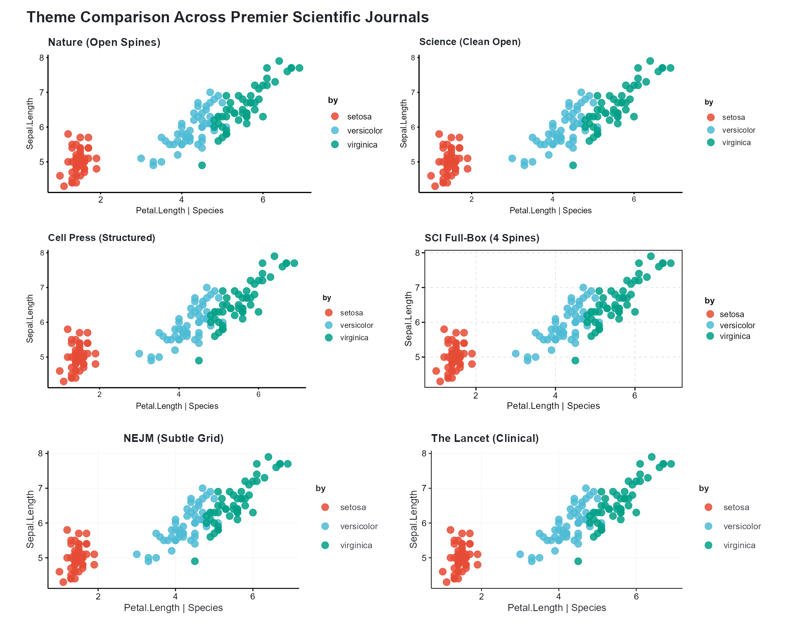

------------------------------------------------------------------------

### Open Axes vs. Full-Box Frames: Which to Choose?

1.  **Open Axes (`nature`, `science`, `cell`, `nejm`, `lancet`)**:
    - Nature and Science strongly prefer removing top and right spines
      to maximize data ink and avoid confining the visual field.
    - Outward tick marks prevent overlap with data points near the axis
      boundaries.
2.  **Full-Box Frame (`scifig` / `sci_box`)**:
    - Elsevier, IEEE, and many specialized SCI journals require full
      rectangular frames enclosing all four sides of the plot.
    - [`theme_cli_scifig()`](https://vanhungtran.github.io/cliomicplot/reference/theme_cli_scifig.md)
      applies 0.5 pt dark borders, crisp outward tick marks, and 0.3 pt
      dashed reference grid lines.

``` r

# Elsevier / IEEE style box plot with full frame
cliplot(len ~ dose | supp, data = ToothGrowth,
        type = "boxplot",
        theme = "scifig",
        palette = "jco",
        title = "Tooth Growth by Supplement & Dose",
        subtitle = "Full-box frame with outward ticks (theme_cli_scifig)")
```

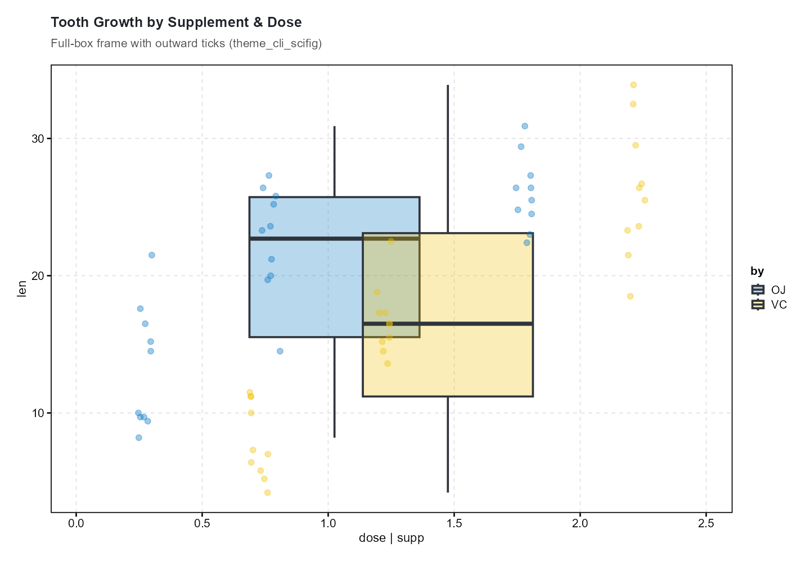

------------------------------------------------------------------------

### Persistent vs. Ephemeral Themes

``` r

# ── Persistent: applies to all subsequent plots ────────────────────
clitheme("nature")

cliplot(mpg ~ wt, data = mtcars,
        title = "Plot 1 — Nature theme persists globally")
```

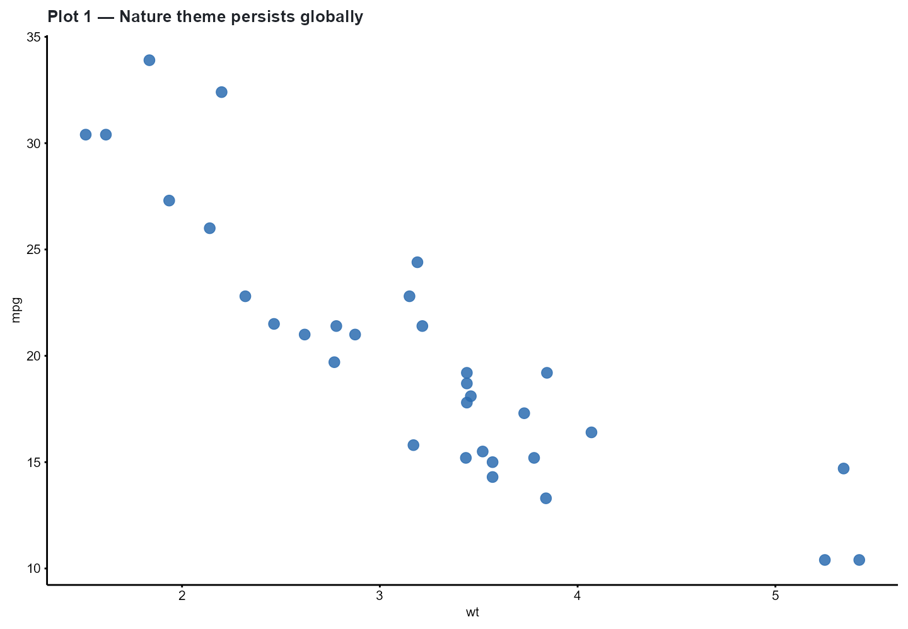

``` r


cliplot(len ~ dose, data = ToothGrowth, type = "boxplot",
        title = "Plot 2 — Still using Nature theme")
```

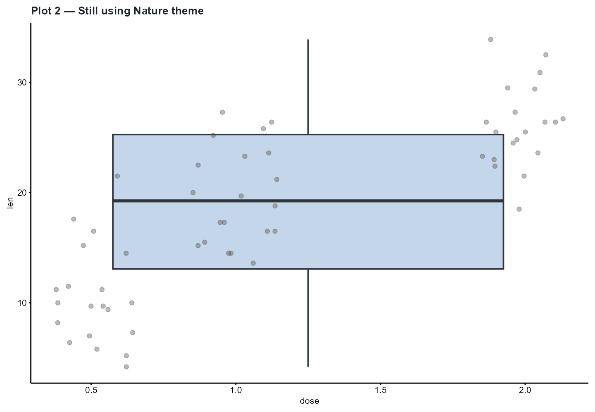

``` r


clitheme()  # ← reset to default (cli_bw)
```

``` r

# ── Ephemeral: applies to one plot only ────────────────────────────
cliplot(mpg ~ wt, data = mtcars, theme = "cell",
        title = "This plot uses Cell theme")
```

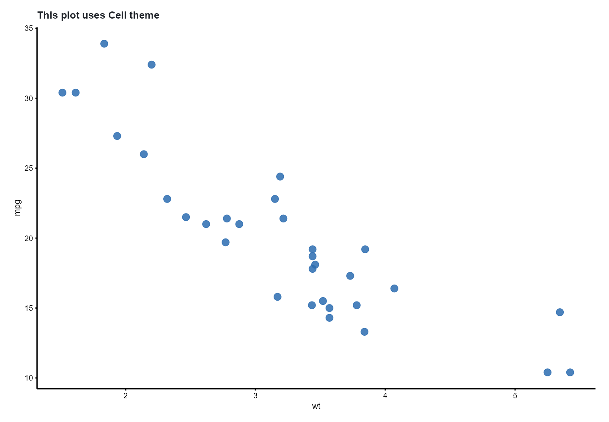

``` r


cliplot(mpg ~ wt, data = mtcars,
        title = "Returned to default theme (cli_bw)")
```

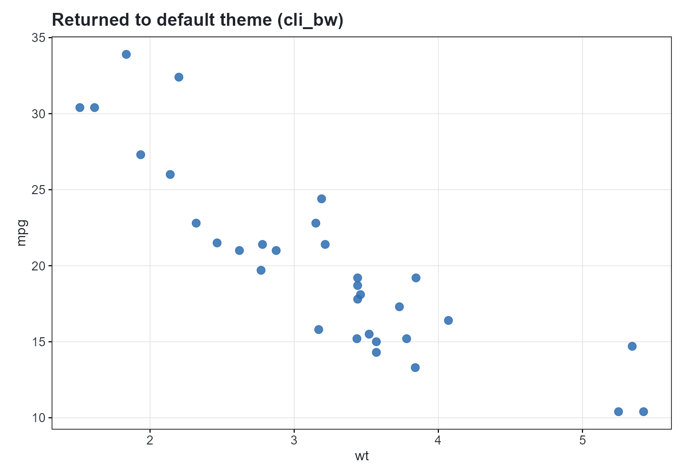

------------------------------------------------------------------------

### Custom Theme Registration

You can register bespoke lab or journal themes that remain accessible
across your R session:

``` r

# Register custom institute theme
clitheme_register("broad_institute",
  base          = "nature",
  axis.text     = ggplot2::element_text(size = 9, face = "bold", color = "#1A1A1A"),
  axis.title    = ggplot2::element_text(size = 10, face = "bold"),
  plot.title    = ggplot2::element_text(size = 12, face = "bold", hjust = 0),
  legend.position = "right"
)

# Apply registered theme
cliplot(mpg ~ wt, data = mtcars,
        theme = "broad_institute",
        title = "Broad Institute Custom Theme")
```

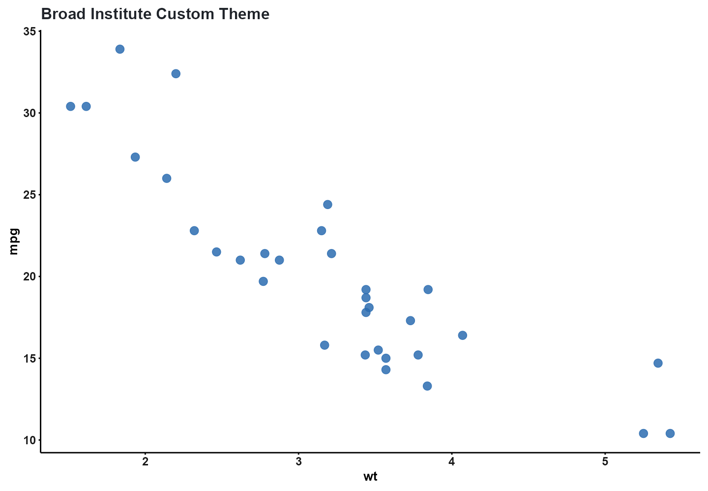

``` r


# Clean up
clitheme_unregister("broad_institute")
```

------------------------------------------------------------------------

## Part 2: Color Palettes & Accessibility

cliomicplot provides 55+ palettes organized into clinical, journal,
genomic, accessibility, and diverging families:

``` r

all_pals <- cli_palette_list()
cat(sprintf("Total available palettes: %d\n", length(all_pals)))
#> Total available palettes: 44
cat("Representative selection:\n")
#> Representative selection:
cat(paste(head(all_pals, 24), collapse = ", "))
#> jco, nejm, lancet, nature, science, okabe_ito, tableau10, tol_muted, heatmap_rdbu, heatmap_rdylbu, heatmap_prgn, volcano, pastel, soft, neon, cyberpunk, blues, reds, greens, purples, oranges, rd_yl_gn, spectral, pi_yg
```

------------------------------------------------------------------------

### 📰 Journal Palettes

Journal palettes match the official color schemes of premier
publications:

``` r

p_npg <- cliplot(Sepal.Length ~ Petal.Length | Species, data = iris,
                 palette = "npg", theme = "nature", title = "Nature (npg)")

p_jama <- cliplot(Sepal.Length ~ Petal.Length | Species, data = iris,
                  palette = "jama", theme = "nejm", title = "JAMA (jama)")

p_npg + p_jama
```

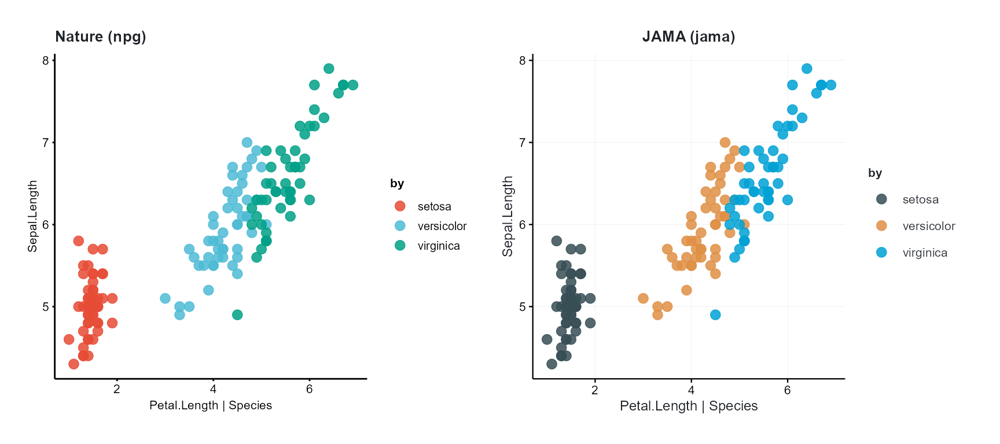

------------------------------------------------------------------------

### ♿ Nature Policy: Colorblind Accessibility

Nature and Science submission guidelines explicitly mandate that figures
must be interpretable by individuals with color vision deficiencies
(CVD).

Never rely on green-red contrast alone. Use validated CVD-safe palettes:

``` r

p_oi <- cliplot(Sepal.Length ~ Petal.Length | Species, data = iris,
                palette = "okabe_ito", theme = "nature",
                title = "Okabe & Ito (2008) — Colorblind-Safe")

p_tol <- cliplot(Sepal.Length ~ Petal.Length | Species, data = iris,
                 palette = "tol_muted", theme = "nature",
                 title = "Paul Tol Muted — Universal CVD Safety")

p_oi + p_tol
```

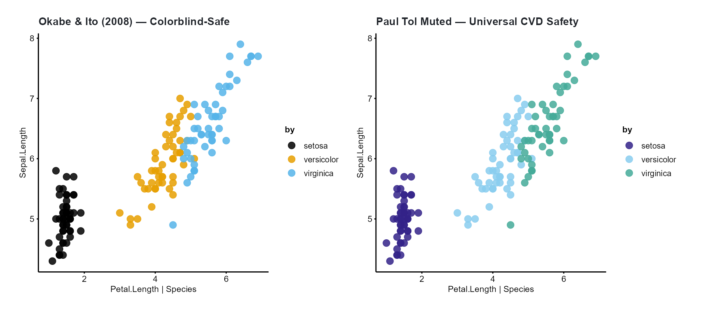

------------------------------------------------------------------------

### 🧬 Genomics & Cancer Hallmarks

``` r

p_ucsc <- cliplot(Sepal.Length ~ Petal.Length | Species, data = iris,
                  palette = "ucscgb", theme = "cell",
                  title = "UCSC Genome Browser Chromosome Colors")

p_cosmic <- cliplot(Sepal.Length ~ Petal.Length | Species, data = iris,
                    palette = "cosmic", theme = "cell",
                    title = "COSMIC Cancer Hallmarks")

p_ucsc + p_cosmic
```

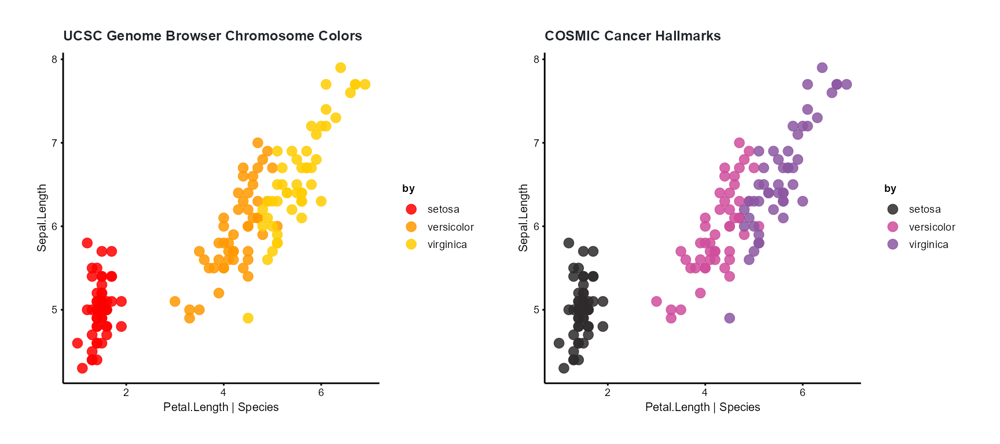

------------------------------------------------------------------------

### 🔥 Continuous & Diverging Heatmap Scales

For heatmaps, correlation matrices, and spatial omics,
[`palette_scale()`](https://vanhungtran.github.io/cliomicplot/reference/palette_scale.md)
seamlessly provides continuous color gradients:

``` r

p1 <- ggplot(faithfuld, aes(waiting, eruptions, fill = density)) +
  geom_tile() +
  palette_scale("heatmap_rdbu", "fill", type = "continuous") +
  labs(title = "heatmap_rdbu (Diverging Red-Blue)") +
  theme_cli_nature()

p2 <- ggplot(faithfuld, aes(waiting, eruptions, fill = density)) +
  geom_tile() +
  palette_scale("heatmap_prgn", "fill", type = "continuous") +
  labs(title = "heatmap_prgn (Diverging Purple-Green)") +
  theme_cli_nature()

p1 + p2
```

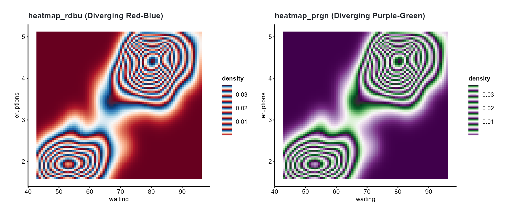

------------------------------------------------------------------------

## Part 3: Using Palettes as Standalone Scales

Every cliomicplot palette integrates with standard **ggplot2**
pipelines:

``` r

# Use with standard ggplot2 geom layers
ggplot(iris, aes(Sepal.Length, Petal.Length, color = Species)) +
  geom_point(size = 3) +
  scale_color_cli("lancet") +
  theme_cli_lancet() +
  labs(title = "scale_color_cli('lancet') on Base ggplot2")
```

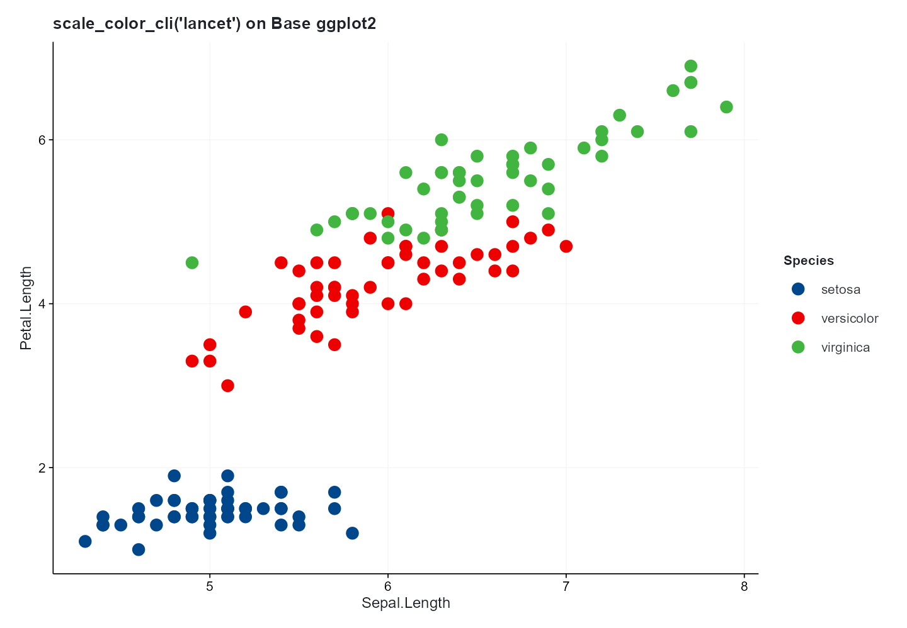

------------------------------------------------------------------------

## Part 4: Physical Canvas Sizing (`cli_journal_size`)

Submitting figures with arbitrary pixel dimensions results in distorted
font sizes and downscaled labels during journal layout.

[`cli_journal_size()`](https://vanhungtran.github.io/cliomicplot/reference/cli_journal_size.md)
returns exact millimeter column dimensions for 9 premier publishers:

``` r

journals <- c("nature", "science", "cell", "jama", "nejm", "lancet", "plos", "ieee")

dim_summary <- do.call(rbind, lapply(journals, function(j) {
  s1 <- cli_journal_size(j, "single")
  s2 <- cli_journal_size(j, "double")
  data.frame(
    Journal       = toupper(j),
    Single_Col_mm = s1$width_mm,
    Double_Col_mm = s2$width_mm,
    Max_Height_mm = s1$max_height_mm
  )
}))

dim_summary
#>   Journal Single_Col_mm Double_Col_mm Max_Height_mm
#> 1  NATURE          89.0         183.0         170.0
#> 2 SCIENCE          90.0         183.0         230.0
#> 3    CELL          85.0         180.0         203.0
#> 4    JAMA          86.4         177.8         220.0
#> 5    NEJM          89.0         180.0         220.0
#> 6  LANCET          85.0         175.0         220.0
#> 7    PLOS          83.0         190.5         222.3
#> 8    IEEE          88.9         181.9         220.0
```

Both string aliases (`"single"`, `"one_half"`, `"double"`) and numeric
columns (`1`, `1.5`, `2`) are supported:

``` r

# Numeric columns supported
cli_journal_size("nature", 1)$width_mm   # 89 mm
#> [1] 89
cli_journal_size("nature", 2)$width_mm   # 183 mm
#> [1] 183
```

------------------------------------------------------------------------

## Part 5: Vector Publication Export (`cli_save`)

[`cli_save()`](https://vanhungtran.github.io/cliomicplot/reference/cli_save.md)
combines exact journal dimensions, 600 DPI rasterization when needed,
and format compliance checking:

``` r

# Create publication figure
p <- cliplot(Sepal.Length ~ Petal.Length | Species, data = iris,
             palette = "npg", theme = "nature",
             title = "Biomarker Distribution by Species")

# 1. Export vector PDF for Nature (2 columns, 183 mm width)
cli_save(p, "Figure_1_Nature.pdf", journal = "nature", column = "double")

# 2. Export vector SVG for Cell Press (1 column, 85 mm width)
cli_save(p, "Figure_1_Cell.svg", journal = "cell", column = "single")

# 3. Export 600 DPI TIFF for clinical journal line art
cli_save(p, "Figure_1_Lancet.tiff", journal = "lancet", column = "double", dpi = 600)
```

------------------------------------------------------------------------

## Summary

- **13 Themes**: Open spines (`nature`, `science`, `cell`, `nejm`,
  `lancet`), full 4-spine boxes (`scifig`), and presentation modes
  (`dark`, `showcase`).
- **55+ Palettes**: Strict CVD safety (`okabe_ito`, `tol_muted`),
  premier journals (`npg`, `jama`, `lancet`), and cancer hallmarks
  (`cosmic`).
- **Standard ggplot2 integration**:
  [`palette_scale()`](https://vanhungtran.github.io/cliomicplot/reference/palette_scale.md),
  [`scale_color_cli()`](https://vanhungtran.github.io/cliomicplot/reference/palette_scale.md),
  and
  [`scale_fill_cli()`](https://vanhungtran.github.io/cliomicplot/reference/palette_scale.md).
- **Publisher Sizing**:
  [`cli_journal_size()`](https://vanhungtran.github.io/cliomicplot/reference/cli_journal_size.md)
  covers Nature, Cell, Science, JAMA, NEJM, Lancet, PLOS, and IEEE.
- **Export Validation**:
  [`cli_save()`](https://vanhungtran.github.io/cliomicplot/reference/cli_save.md)
  ensures font embedding and canvas compliance.
