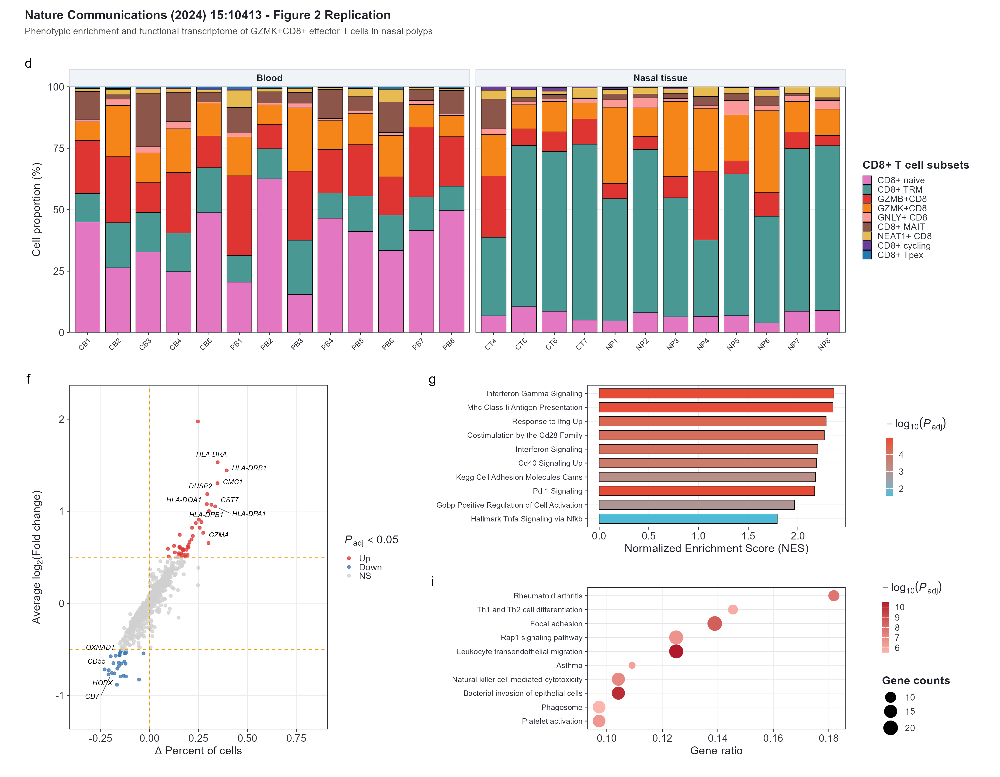
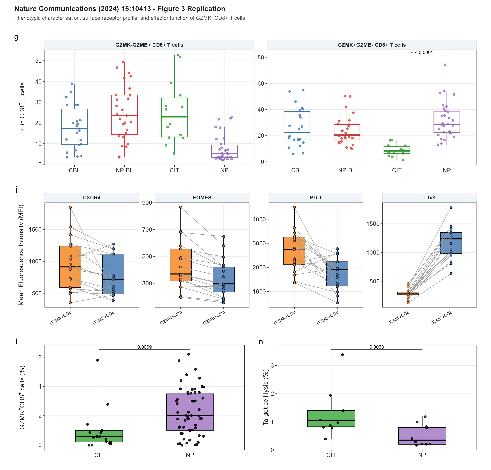
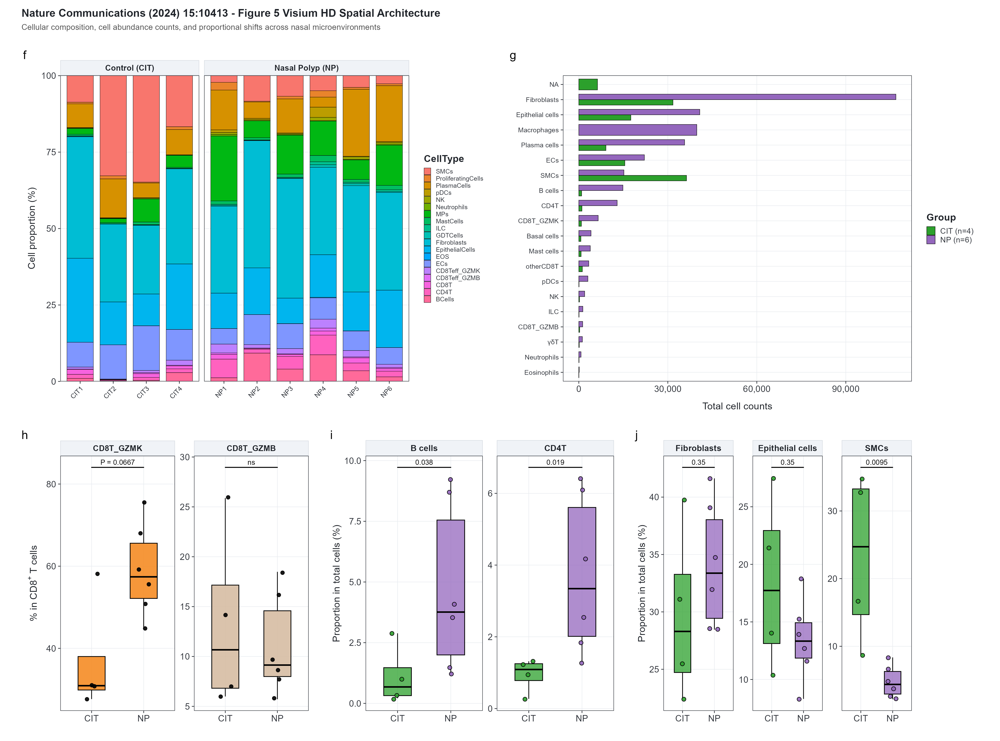
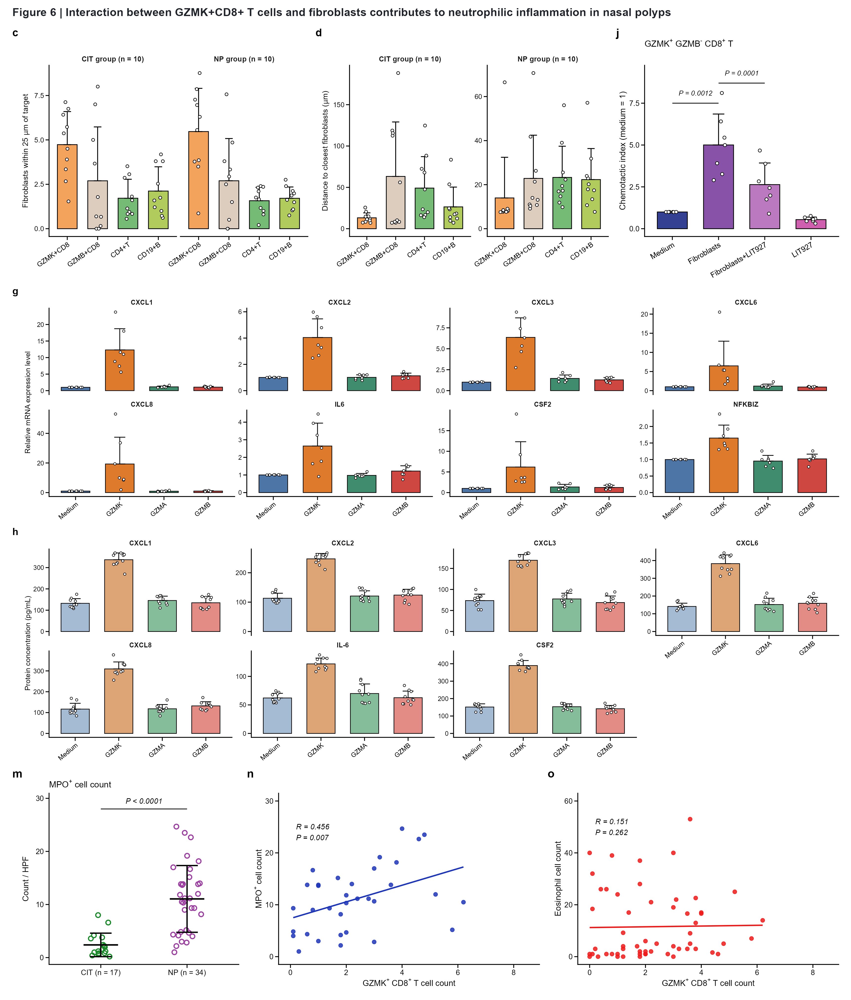
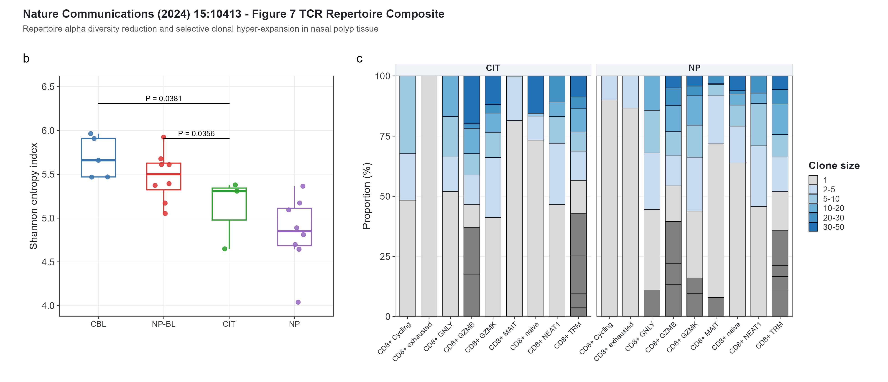
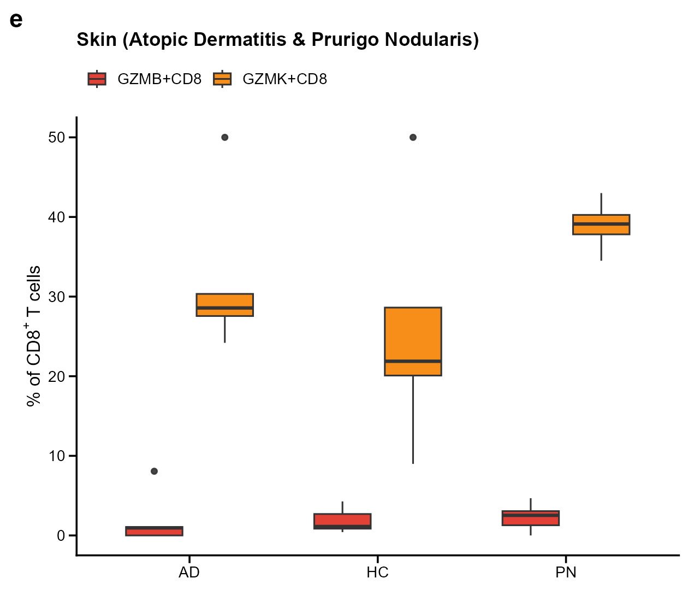

```{r setup, include=FALSE}
knitr::opts_chunk$set(
  collapse   = FALSE,
  comment    = "#>",
  fig.width  = 7.0,
  fig.height = 4.8,
  fig.align  = "center",
  warning    = FALSE,
  message    = FALSE
)
```

## Overview

This vignette illustrates the complete reproduction of 37 main and supplementary figure panels from *Nature Communications* (2024) 15:10413 ([PMC11607458](https://pmc.ncbi.nlm.nih.gov/articles/PMC11607458/)):

> **Zheng M, Hu Y, Shen X, et al.**  
> Granzyme K⁺ CD8⁺ T cells interact with fibroblasts to promote neutrophilic inflammation in nasal polyps.  
> *Nature Communications*. 2024;15:10413. DOI: [10.1038/s41467-024-54685-z](https://doi.org/10.1038/s41467-024-54685-z).

The study combines multi-parameter clinical flow cytometry (95 donors), single-cell RNA sequencing (208,757 cells), Visium HD spatial transcriptomics, in vitro functional assays, and a pan-tissue cross-condition atlas across 10 chronic diseases (including Atopic Dermatitis, n = 159).

All figures below are built directly from the Source Data Excel file (`41467_2024_54685_MOESM4_ESM.xlsx`) and styled with `cliomicplot` adhering to Nature specifications:
- Open L-frame axes (`theme_classic()`).
- Outward ticks (`unit(0.12, "cm")`).
- Exact lowercase bold sans-serif tags (`a`–`o`) placed top-left.
- 300 DPI resolution.

---

## 1. Single-Cell Phenotyping (Figure 2)

Figure 2 resolves 81,202 CD8⁺ T cells into 9 subclusters across Blood (`CBL`, `NP-BL`) and Nasal tissue (`CIT`, `NP`).

```r
library(cliomicplot)
library(ggplot2)
library(patchwork)

# Panel 2d: 100% Stacked CD8+ Subsets
# Panel 2f: Single-Cell Differential Expression Scatter Plot (DEGs)
# Panel 2h: Top 10 DEGs Ranked by Average log2(Fold Change)
# Panel 2g: Reactome GSEA Normalized Enrichment Score (NES)
# Panel 2i: KEGG Disease Pathway Dotplot
```

The assembled 5-panel composite (`NatCommun_Figure2_Composite.png`):



---

## 2. Clinical Flow Cytometry Validation (Figure 3)

Flow cytometry across 95 clinical donors validated that `GZMK⁺GZMB⁻` CD8⁺ T cells are preferentially enriched in nasal polyp tissue compared to blood and control inferior turbinates:



- **Panel 3g**: Flow cytometry quantification across `CBL` ($n=22$), `NP-BL` ($n=27$), `CIT` ($n=14$), and `NP` ($n=30$, $P < 0.0001$).
- **Panel 3j**: Paired receptor MFI showing elevated *CXCR4* ($P = 0.0371$) and *PD-1* ($P = 0.0031$) in GZMK⁺ cells.
- **Panel 3l & 3n**: Cytokine dual-positive counts and in vitro target cell lysis ($P = 0.0063$).

---

## 3. Visium HD Spatial Deconvolution (Figures 4 & 5)

Visium HD high-definition spatial transcriptomics profiled 19 cell types across 10 intact clinical specimens:



- **Panel 5f**: 100% stacked bar chart of all 19 cell lineages across 4 CIT and 6 NP samples.
- **Panel 5g**: Ranked total cell counts across spatial spots.
- **Panel 5h**: Proportions of `CD8T_GZMK` ($P = 0.0667$) and `CD8T_GZMB` ($\text{ns}$).
- **Panels 5i & 5j**: Proportions of B cells ($P = 0.0381$), CD4⁺ T cells ($P = 0.0190$), and smooth muscle cells ($P = 0.0095$).

---

## 4. Fibroblast Activation and Neutrophil Recruitment (Figure 6)

Figure 6 establishes that `GZMK⁺CD8⁺` T cells physically co-localize with fibroblasts (< 25 μm) and induce secretion of neutrophil-attracting chemokines:



- **Panels 6c & 6d**: Fibroblast density within 25 μm and Euclidean distance metrics.
- **Panel 6j**: Transwell chemotaxis migration blocked by the CXCR4 neutraligand LIT-927 ($P = 0.0001$).
- **Panels 6g & 6h**: qPCR fold-induction and secreted protein concentrations of *CXCL1*, *CXCL2*, *CXCL6*, *CXCL8*.
- **Panels 6m, 6n, 6o**: MPO⁺ neutrophil counts in tissue and positive correlation with `GZMK⁺CD8⁺` T cell density ($R = 0.456, P = 0.007$).

---

## 5. TCR Clonal Tracking (Figure 7)

TCR repertoire sequencing across 25 donors evaluated alpha diversity and clonal expansion dynamics:



- **Panel 7b**: Shannon entropy index boxplots with Dunn's multiple comparison brackets ($P = 0.0381, P = 0.0356$).
- **Panel 7c**: Clonal expansion hierarchy from singletons (1) to hyper-expanded clones (> 50).

---

## 6. Pan-Tissue Cross-Condition Atlas (Figure 8)

Integration of 108,969 CD8⁺ T cells across 9 public datasets (159 donors) demonstrated that `GZMK⁺CD8⁺` T cell expansion is a hallmark across 10 chronic inflammatory diseases:


### Atopic Dermatitis Focus
In lesional skin from Atopic Dermatitis patients (`AD`, GSE197023), `GZMK⁺CD8⁺` T cells are significantly expanded over `GZMB⁺CD8⁺` T cells ($P = 0.012$):



---

## Code Availability

All generation scripts and output assets are located in the package directory:
- `inst/examples/nature_communications/generate_nature_commun_figures.R`
- `inst/examples/nature_communications/assemble_composites.R`
- `inst/examples/nature_communications/generate_figure3_figures.R`
- `inst/examples/nature_communications/generate_figure4_5_figures.R`
- `inst/examples/nature_communications/generate_figure6_figures.R`
- `inst/examples/nature_communications/generate_figure8_figures.R`
- `inst/examples/nature_communications/generate_supp_figures.R`
