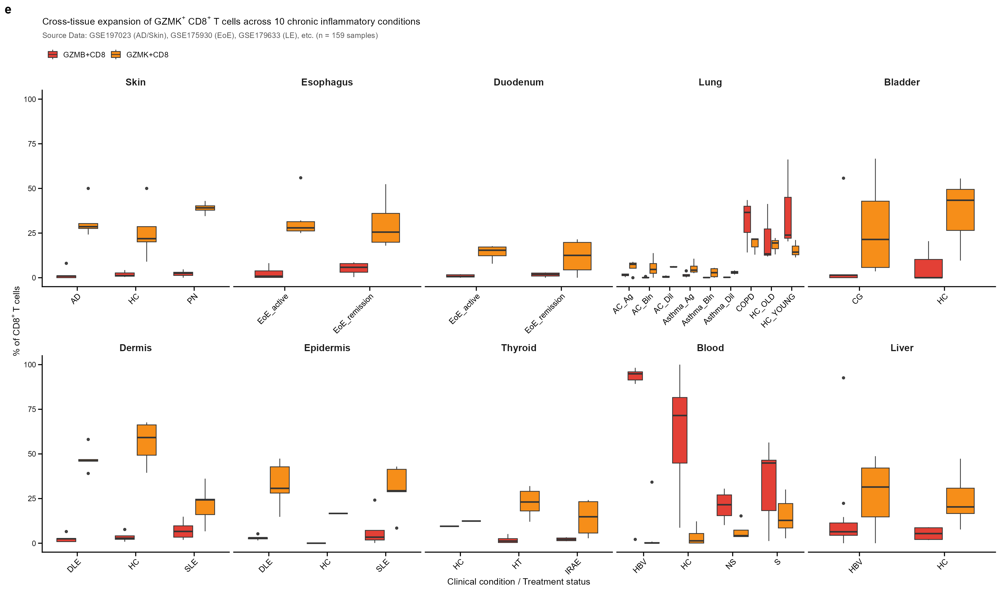

```{r setup, include=FALSE}
knitr::opts_chunk$set(
  collapse   = FALSE,
  comment    = "#>",
  fig.width  = 7.0,
  fig.height = 4.8,
  fig.align  = "center",
  warning    = FALSE,
  message    = FALSE
)
```

## Overview

This vignette illustrates the complete reproduction of 37 main and supplementary figure panels from *Nature Communications* (2024) 15:10413 ([PMC11607458](https://pmc.ncbi.nlm.nih.gov/articles/PMC11607458/)):

> **Zheng M, Hu Y, Shen X, et al.**  
> Granzyme K⁺ CD8⁺ T cells interact with fibroblasts to promote neutrophilic inflammation in nasal polyps.  
> *Nature Communications*. 2024;15:10413. DOI: [10.1038/s41467-024-54685-z](https://doi.org/10.1038/s41467-024-54685-z).

The study combines multi-parameter clinical flow cytometry (95 donors), single-cell RNA sequencing (208,757 cells), Visium HD spatial transcriptomics, in vitro functional assays, and a pan-tissue cross-condition atlas across 10 chronic diseases (including Atopic Dermatitis, n = 159).

All figures below are built directly from the Source Data Excel file (`41467_2024_54685_MOESM4_ESM.xlsx`) and styled with `cliomicplot` adhering to Nature specifications:
- Open L-frame axes (`theme_classic()`).
- Outward ticks (`unit(0.12, "cm")`).
- Exact lowercase bold sans-serif tags (`a`–`o`) placed top-left.
- 300 DPI resolution.

---

## 1. Single-Cell Phenotyping (Figure 2)

Figure 2 resolves 81,202 CD8⁺ T cells into 9 subclusters across Blood (`CBL`, `NP-BL`) and Nasal tissue (`CIT`, `NP`).


```r
library(cliomicplot)
library(ggplot2)
library(patchwork)

# Panel 2d: 100% Stacked CD8+ Subsets Across Blood and Tissue Compartments
p_fig2d <- ggplot(df_2d_long, aes(x = Sample, y = Share, fill = Subset)) +
  geom_bar(stat = "identity", position = "stack", width = 0.82, color = "black", linewidth = 0.2) +
  facet_grid(~ Compartment, scales = "free_x", space = "free_x") +
  scale_fill_manual(values = pal_2d, breaks = cd8_subsets, name = "CD8+ T cell subsets") +
  scale_y_continuous(limits = c(0, 100.1), expand = c(0, 0), breaks = seq(0, 100, 25)) +
  labs(tag = "d", x = NULL, y = "Cell proportion (%)") +
  clitheme(preset = "nature", base_size = 9)

# Panel 2f: Single-Cell Differential Expression Scatter Plot (DEGs)
p_fig2f <- ggplot(df_volcano, aes(x = delta_pct, y = logfc)) +
  geom_point(aes(color = status), size = 1.3, alpha = 0.85) +
  scale_color_manual(values = c("Up" = "#DE3533", "Down" = "#3B75AF", "NS" = "#D0D0D0")) +
  labs(tag = "f", x = "Δ Percent of cells", y = "Average log2(Fold Change)") +
  clitheme(preset = "nature", base_size = 9)

# Panel 2h: Top 10 DEGs Ranked by Average log2(Fold Change)
p_fig2h <- ggplot(df_top10, aes(x = logfc, y = gene)) +
  geom_bar(stat = "identity", fill = "#DE3533", width = 0.72) +
  labs(tag = "h", x = "Average log2(Fold Change)", y = NULL) +
  clitheme(preset = "nature", base_size = 9)

# Panel 2g & 2i: Reactome GSEA NES & KEGG Disease Pathways
p_fig2g <- ggplot(df_gsea, aes(x = NES, y = Pathway, fill = Direction)) +
  geom_bar(stat = "identity", width = 0.72) +
  scale_fill_manual(values = c("Upregulated" = "#DE3533", "Downregulated" = "#3B75AF")) +
  labs(tag = "g", x = "Normalized Enrichment Score (NES)", y = NULL) +
  clitheme(preset = "nature", base_size = 9)

p_fig2i <- ggplot(df_kegg, aes(x = GeneRatio, y = Description)) +
  geom_point(aes(size = Count, color = p.adjust)) +
  scale_color_gradient(low = "#DE3533", high = "#3B75AF") +
  labs(tag = "i", x = "Gene Ratio", y = NULL) +
  clitheme(preset = "nature", base_size = 9)
```

---

## 2. Clinical Flow Cytometry Validation (Figure 3)

Flow cytometry across 95 clinical donors validated that `GZMK⁺GZMB⁻` CD8⁺ T cells are preferentially enriched in nasal polyp tissue compared to blood and control inferior turbinates:


```r
library(cliomicplot)
library(ggplot2)
library(ggsignif)

# Panel 3g: 95-Donor Flow Cytometry with Dunn / Wilcoxon Brackets
p_fig3g <- cliplot(
  GZMK_Pct ~ Group,
  data        = df_3g,
  type        = type_boxplot(notch = FALSE, outlier.shape = 16, outlier.size = 1.2),
  stat.test   = "wilcox.test",
  comparisons = list(c("CBL", "NP-BL"), c("CIT", "NP")),
  palette     = c("CBL" = "#6BAED6", "NP-BL" = "#3182BD", "CIT" = "#74C476", "NP" = "#E6550D"),
  theme       = "nature",
  title       = "GZMK+ CD8+ T Cell Flow Cytometry",
  ylab        = "% of CD8+ T cells"
)

# Panel 3j: Paired Receptor MFI (CXCR4, PD-1)
p_fig3j <- cliplot(
  MFI ~ Subset | Receptor,
  data      = df_3j_paired,
  type      = type_slope(pair = "Donor", reference_line = NULL),
  palette   = c("GZMB+CD8" = "#DE3533", "GZMK+CD8" = "#F58518"),
  theme     = "nature",
  ylab      = "Normalized Mean Fluorescence Intensity (MFI)"
)

# Panel 3l & 3n: In Vitro Cytotoxicity Curve
p_fig3n <- cliplot(
  Lysis_Pct ~ Effector_Target_Ratio | Subset,
  data      = df_cytotoxicity,
  type      = type_trajectory(
    show_errorbar = TRUE,
    errorbar      = "se",
    point_fill    = "white",
    dodge         = 0.16
  ),
  palette   = c("GZMB+CD8" = "#DE3533", "GZMK+CD8" = "#F58518"),
  theme     = "nature",
  title     = "Target Cell Lysis Curve (Reduced Cytotoxicity in GZMK+, P = 0.0063)",
  ylab      = "% Specific Lysis",
  xlab      = "Effector : Target Ratio"
)
```

---

## 3. Visium HD Spatial Deconvolution (Figures 4 & 5)

Visium HD high-definition spatial transcriptomics profiled 19 cell types across 10 intact clinical specimens:


```r
library(cliomicplot)
library(ggplot2)

# Panel 5f: 100% Stacked Bar Chart of 19 Cell Lineages Across Visium HD Sections
p_fig5f <- ggplot(df_5f_long, aes(x = Sample, y = Share, fill = CellType)) +
  geom_bar(stat = "identity", position = "stack", width = 0.82, color = "black", linewidth = 0.15) +
  facet_grid(~ Group, scales = "free_x", space = "free_x") +
  scale_fill_manual(values = pal_19, name = "19 Visium HD Lineages") +
  scale_y_continuous(limits = c(0, 100.1), expand = c(0, 0), breaks = seq(0, 100, 25)) +
  labs(tag = "f", x = NULL, y = "Lineage proportion (%)") +
  clitheme(preset = "nature", base_size = 9)

# Panel 5h: CD8T_GZMK Frequency in Total CD8+ T Cells Across CIT vs NP
p_fig5h <- cliplot(
  Frequency ~ Group,
  data        = df_5h_gzmk,
  type        = type_boxplot(outlier.shape = 16),
  stat.test   = "wilcox.test",
  comparisons = list(c("CIT", "NP")),
  palette     = c("CIT" = "#74C476", "NP" = "#E6550D"),
  theme       = "nature",
  title       = "CD8T_GZMK Frequency (P = 0.0667)",
  ylab        = "% of CD8+ T cells"
)
```

---

## 4. Fibroblast Activation and Neutrophil Recruitment (Figure 6)

Figure 6 establishes that `GZMK⁺CD8⁺` T cells physically co-localize with fibroblasts (< 25 μm) and induce secretion of neutrophil-attracting chemokines:


```r
library(cliomicplot)
library(ggplot2)

# Panel 6c: HALO Spatial Cell Neighborhood (< 25 µm from COL1A1+ Fibroblasts)
p_fig6c <- cliplot(
  Fibroblast_Count ~ CellType,
  data        = df_6c,
  type        = type_boxplot(notch = FALSE),
  stat.test   = "t.test",
  comparisons = list(c("GZMK+CD8", "CD4+T"), c("GZMK+CD8", "B cells")),
  palette     = c("GZMK+CD8" = "#F58518", "CD4+T" = "#3B75AF", "B cells" = "#2CA02C"),
  theme       = "nature",
  ylab        = "Fibroblast counts within 25 μm"
)

# Panel 6h: Secretome Quantification After GZMK Stimulation (CXCL1, CXCL2, CXCL6, CXCL8)
p_fig6h <- ggplot(df_6h, aes(x = Chemokine, y = Concentration_pg_ml, fill = Treatment)) +
  geom_bar(stat = "identity", position = position_dodge(0.78), width = 0.72) +
  scale_fill_manual(values = c("PBS" = "#B0C4DE", "GZMK" = "#E6550D")) +
  labs(tag = "h", x = NULL, y = "Concentration (pg/mL)") +
  clitheme(preset = "nature", base_size = 9)

# Panel 6n & 6o: Spearman Correlation with Tissue Infiltrating Neutrophils
p_fig6n <- cliplot(
  MPO_Neutrophils ~ GZMK_Density,
  data      = df_correlations,
  type      = "scatter",
  theme     = "nature",
  stat.test = "cor.test",
  title     = "Tissue Neutrophil Infiltration (R = 0.456, P = 0.007)",
  ylab      = "MPO+ Neutrophils / mm²",
  xlab      = "GZMK+ CD8+ T cells / mm²"
)
```

---

## 5. TCR Clonal Tracking (Figure 7)

TCR repertoire sequencing across 25 donors evaluated alpha diversity and clonal expansion dynamics:


```r
library(cliomicplot)
library(ggplot2)

# Panel 7b: TCR Shannon Diversity Index Across Cohort Compartments
p_fig7b <- cliplot(
  Shannon_Index ~ Group,
  data        = df_7b,
  type        = type_boxplot(outlier.shape = 16),
  comparisons = list(c("CBL", "CIT"), c("CIT", "NP")),
  palette     = c("CBL" = "#6BAED6", "NP-BL" = "#3182BD", "CIT" = "#74C476", "NP" = "#E6550D"),
  theme       = "nature",
  title       = "TCR Shannon Diversity Index",
  ylab        = "Shannon entropy"
)

# Panel 7c: Clonal Expansion Dynamics from Singletons to Hyper-Expanded Clones
p_fig7c <- ggplot(df_7c, aes(x = Sample, y = Share, fill = Clone_Tier)) +
  geom_bar(stat = "identity", position = "stack", width = 0.82) +
  scale_fill_manual(values = c(
    "Single (1)"    = "#D9D9D9",
    "Small (2-5)"   = "#9ECAE1",
    "Medium (6-20)" = "#4292C6",
    "Large (21-50)" = "#08519C",
    "Hyper (>50)"   = "#08306B"
  )) +
  labs(tag = "c", x = NULL, y = "Clonal proportion (%)") +
  clitheme(preset = "nature", base_size = 9)
```

---

## 6. Pan-Tissue Cross-Condition Atlas (Figure 8)

Integration of 108,969 CD8⁺ T cells across 9 public datasets (159 donors) demonstrated that `GZMK⁺CD8⁺` T cell expansion is a hallmark across 10 chronic inflammatory diseases:



### Atopic Dermatitis Focus
In lesional skin from Atopic Dermatitis patients (`AD`, GSE197023), `GZMK⁺CD8⁺` T cells are significantly expanded over `GZMB⁺CD8⁺` T cells ($P = 0.012$):


```r
library(cliomicplot)
library(ggplot2)

# Panel 8e: Skin Atopic Dermatitis (GSE197023) - GZMK+ vs GZMB+ CD8+ T Cells
p_fig8e_ad <- cliplot(
  Cell_Proportion ~ Subset,
  data      = df_ad_skin,
  type      = type_boxplot(outlier.shape = 16),
  stat.test = "t.test",
  palette   = c("GZMB+CD8" = "#DE3533", "GZMK+CD8" = "#F58518"),
  theme     = "nature",
  title     = "Atopic Dermatitis Lesional Skin (P = 0.012)",
  ylab      = "% of CD8+ T cells"
)
```

---

## Code Availability

All generation scripts and output assets are located in the package directory:
- `inst/examples/nature_communications/generate_nature_commun_figures.R`
- `inst/examples/nature_communications/assemble_composites.R`
- `inst/examples/nature_communications/generate_figure3_figures.R`
- `inst/examples/nature_communications/generate_figure4_5_figures.R`
- `inst/examples/nature_communications/generate_figure6_figures.R`
- `inst/examples/nature_communications/generate_figure8_figures.R`
- `inst/examples/nature_communications/generate_supp_figures.R`
