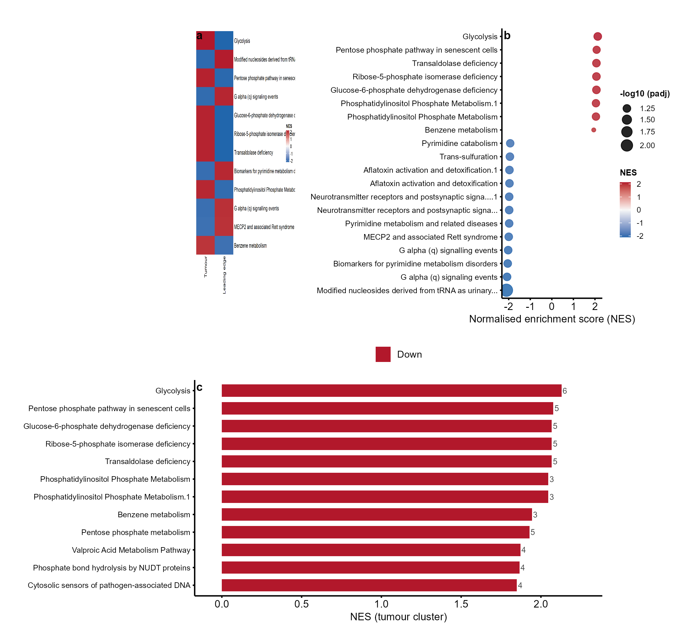

```{r setup, include=FALSE}
knitr::opts_chunk$set(
  collapse   = FALSE,
  comment    = "#>",
  fig.width  = 6.6,
  fig.height = 4.8,
  fig.align  = "center",
  warning    = FALSE,
  message    = FALSE
)
```

```{r include-lightbox, echo=FALSE, results='asis'}
if (file.exists('lightbox.html')) {
  knitr::asis_output(paste(readLines('lightbox.html'), collapse='\n'))
}
```

## Overview

This vignette recreates key figures of the SpaMTP manuscript in *Nature
Methods* using cliomicplot plot types and the paper's public datasets:

> **Wemans IS, Soares M, et al.** SpaMTP: a framework for spatial
> metabolomics data integration and analysis. *Nature Methods*. 2026.
> DOI: [10.1038/s41592-026-03140-8](https://doi.org/10.1038/s41592-026-03140-8).

SpaMTP is an R/Bioconductor framework that integrates MALDI mass
spectrometry imaging (MSI) metabolomics with spatial transcriptomics. We
recreate four composites covering its four showcase analyses:

| Figure | Dataset | Paper panels |
|---|---|---|
| 1 | Mouse urinary bladder MALDI-MSI (PRIDE `PXD001283`) | Fig. 2C-G |
| 2 | Parkinson mouse brain: Visium + MALDI-MSI | Fig. 2H-N, S3 |
| 3 | Human brain tumour single-cell multi-omics (pathways) | Fig. S5 |
| 4 | Spotted mouse liver MALDI-MSI (METASPACE) | Fig. S6 |

All figures below are rendered at **300 dpi** in Nature style: no in-figure
titles, bold lowercase panel labels, black text on white, thin black axes.

## Data availability

All datasets are public and CC-BY-4.0 licensed. The processed Seurat objects
used for the vignettes are mirrored on the
[SpaMTP Zenodo community](https://zenodo.org/communities/spamtp):

| Analysis | Zenodo record (SpaMTP community) | Original source |
|---|---|---|
| Mouse urinary bladder | [SpaMTP: Mouse Bladder dataset](https://zenodo.org/records/17246684) | PRIDE [PXD001283](http://proteomecentral.proteomexchange.org/cgi/GetDataset?ID=PXD001283) |
| Multi-omic mouse brain | [SpaMTP: Multi-Omics Mouse Brain dataset](https://zenodo.org/records/17246900) | SciLifeLab [10.17044/scilifelab.22770161.v2](https://doi.org/10.17044/scilifelab.22770161.v2) |
| Human brain tumour pathways | [SpaMTP: Human Brain Tissue Single Cell dataset](https://zenodo.org/records/18282678) | BioImage Archive [S-BIAD14260](https://doi.org/10.6019/S-BIAD14260) |
| Spotted mouse liver | [SpaMTP: Mouse Liver with Spotted Chemical Standards dataset](https://zenodo.org/records/17289187) | METASPACE [2020-12-07_03h16m14s](https://metaspace2020.org/dataset/2020-12-07_03h16m14s) |

```{r}
library(cliomicplot)
library(ggplot2)
clipar(stat.test = NULL)

# Resolve bundled analysis tables (small; the raw Seurat objects are ~90 MB
# and are re-downloaded from Zenodo by the build script on demand)
resolve_spa_data = function(filename) {
  pkg_path = system.file("extdata", "spamtp_paper", filename, package = "cliomicplot")
  if (pkg_path != "" && file.exists(pkg_path)) return(pkg_path)
  fallback = file.path("..", "inst", "extdata", "spamtp_paper", filename)
  if (file.exists(fallback)) return(fallback)
  file.path("inst", "extdata", "spamtp_paper", filename)
}

load_spa = function(filename) {
  e = new.env(parent = emptyenv())
  load(resolve_spa_data(filename), envir = e)
  as.list(e)
}
```

The full pipeline (Seurat extraction + DE analysis + all panels + the four
composites) is reproducible with one command:

```r
Rscript inst/extdata/build_spamtp_figures.R
```

---

## Figure 1 - Mouse urinary bladder MALDI-MSI

The paper's bladder analysis segments the MALDI-MSI tissue into three
anatomical regions (adventitia, muscle, urothelium) and identifies
region-specific lipid dysregulation. Panel **(a)** is the segmentation map,
**(b)** spatial intensities of SM(34:1) and PC(34:1), **(c)** per-region
MZBoxPlot, **(d)** a logFC heatmap of differentially expressed metabolites
(DEMs), **(e)** a volcano of muscle vs urothelium, and **(f)** a circular
plot of lipid-class shifts.

```{r fig1-image, echo=FALSE, out.width="100%", fig.cap="Recreated Figure 1 (mouse urinary bladder MALDI-MSI, paper Fig. 2C-G). Panel a: tissue segmentation. Panel b: SM(34:1)/PC(34:1) spatial intensity. Panel c: per-region intensity boxplots. Panel d: DEM logFC heatmap. Panel e: muscle-vs-urothelium volcano. Panel f: lipid-class circular shift."}
knitr::include_graphics("../man/figures/spamtp_fig1.png")
```

The DEM heatmap and the volcano are single `cliplot()` calls:

```{r fig1-code, eval=FALSE}
d = load_spa("spa_bladder.rda")

# (d) top DE metabolites across the three regions
regs = c("2", "5", "6")
top = do.call(rbind, lapply(regs, function(r) {
  dd = d$dem[d$dem$cluster == r, ]
  head(dd[order(-abs(dd$logFC)), ], 12)
}))
mat = reshape2::acast(d$dem[d$dem$feature %in% unique(top$feature), ],
                      feature ~ cluster, value.var = "logFC")
cliplot(mat[, regs, drop = FALSE],
        type = type_heatmap(scale = "none", cluster_rows = FALSE,
                            cluster_cols = FALSE, show_rownames = TRUE,
                            show_colnames = TRUE, legend_title = "logFC"),
        theme = "nature")

# (e) muscle (5) vs urothelium (6) volcano
cliplot(-log10(adj.P.Val) ~ logFC, data = d$vol,
        type = type_volcano(pval_cutoff = 0.05, fc_cutoff = 1,
                            label_genes = c("SM(34:1)", "PC(34:1)")),
        theme = "nature") +
  labs(x = "logFC (muscle vs urothelium)", y = "-log10 (adj. P)")
```

The key biology reproduces: SM(34:1) is enriched in the muscle layer while
PC(34:1) is enriched in the urothelium, as reported in the paper.

---

## Figure 2 - Multi-omic mouse brain (MSI + Visium)

The Parkinson mouse brain analysis pairs MALDI-MSI (dopamine at two
derivatised m/z values) with 10X Visium transcriptomics. Panel **(a, f)**
show dopamine spatial intensity (m/z 674.28 and 421.19), **(b)** the Visium
anatomical annotations, **(c)** a PCA of Visium transcriptomes, **(d)** the
striatum volcano (lesioned vs intact), and **(e)** a heatmap of the top
striatal DEGs.

```{r fig2-image, echo=FALSE, out.width="100%", fig.cap="Recreated Figure 2 (multi-omic mouse brain, paper Fig. 2H-N and S3). Panel a: MSI dopamine (m/z 674.28). Panel b: Visium anatomical annotations. Panel c: Visium PCA. Panel d: striatum volcano. Panel e: top-DEG heatmap. Panel f: MSI dopamine (m/z 421.19)."}
knitr::include_graphics("../man/figures/spamtp_fig2.png")
```

The top-DEG heatmap uses row-scaled expression means:

```{r fig2-code, eval=FALSE}
v = load_spa("spa_brain_visium.rda")

mat = v$means[v$top_genes, c("Lesioned", "Intact"), drop = FALSE]
mat = mat[order(-abs(mat[, 1] - mat[, 2])), , drop = FALSE]
cliplot(mat[seq_len(min(18, nrow(mat))), , drop = FALSE],
        type = type_heatmap(scale = "row", cluster_rows = FALSE,
                            cluster_cols = FALSE, show_rownames = TRUE,
                            show_colnames = TRUE, legend_title = "row z"),
        theme = "nature")
```

The striatal DEG list reproduces the expected biology, with *Penk*, *Pdyn*,
*Tac1* and *Cartpt* among the top lesioned-vs-intact changes.

---

## Figure 3 - Human brain tumour pathway analysis

The single-cell tumour analysis runs metabolite-set enrichment per cluster.
Panel **(a)** is an NES heatmap of the top pathways in the tumour cluster and
its leading-edge companion cluster, **(b)** a dot plot of NES against
significance for the tumour cluster, and **(c)** the top tumour pathways with
their leading-edge metabolite counts.

```{r fig3-image, echo=FALSE, out.width="100%", fig.cap="Recreated Figure 3 (brain tumour pathway analysis, paper Fig. S5). Panel a: NES heatmap. Panel b: NES vs significance dot plot. Panel c: top tumour pathways with leading-edge metabolite counts."}

```

```{r fig3-code, eval=FALSE}
t = load_spa("spa_tumour_pathways.rda")
dt = t$dt[!is.na(t$dt$padj) & t$dt$padj < 0.25, ]

top = do.call(rbind, lapply(c("tumour", "leading edge"), function(cl) {
  dd = dt[dt$Cluster_id == cl, ]
  head(dd[order(-abs(dd$NES)), ], 12)
}))
mat = reshape2::acast(dt[dt$pathwayName %in% unique(top$pathwayName), ],
                      pathwayName ~ Cluster_id, value.var = "NES",
                      fun.aggregate = mean)
cliplot(mat,
        type = type_heatmap(scale = "none", cluster_rows = FALSE,
                            cluster_cols = FALSE, show_rownames = TRUE,
                            show_colnames = TRUE, legend_title = "NES"),
        theme = "nature")
```

Glycolysis, the pentose phosphate pathway and related tumour-metabolism
pathways emerge as the top positively enriched pathways in the tumour
cluster.

---

## Figure 4 - Spotted mouse liver MALDI-MSI

The liver experiment deposits chemical standards on the tissue to benchmark
MALDI annotation. Panel **(a)** shows the tissue plus spotted standards,
**(b)** the spatial intensity of the glutathione standard, **(c)** the
annotation mass error (ppm) across the m/z range, and **(d)** the top
features by number of putative HMDB isomer annotations.

```{r fig4-image, echo=FALSE, out.width="100%", fig.cap="Recreated Figure 4 (spotted mouse liver MALDI-MSI, paper Fig. S6). Panel a: tissue + chemical standards. Panel b: glutathione spatial intensity. Panel c: annotation mass error (ppm). Panel d: top features by putative isomer count."}
knitr::include_graphics("../man/figures/spamtp_fig4.png")
```

```{r fig4-code, eval=FALSE}
l = load_spa("spa_liver.rda")

# (c) annotation mass error across the m/z range
ggplot(l$qc, aes(mz, ppm, colour = annotated)) +
  geom_point(size = 1.4, alpha = 0.85) +
  scale_colour_manual(values = c("TRUE" = "#0072B2", "FALSE" = "#BBBBBB")) +
  cliomicplot:::theme_cli_nature(base_size = 9) +
  labs(x = "m/z", y = "Mass error (ppm)")
```

---

## Reproducibility notes

* Raw processed Seurat objects (~90 MB) are downloaded once from the SpaMTP
  Zenodo community into `inst/extdata/spamtp_paper/raw/` by
  `inst/extdata/build_spamtp_figures.R`; derived analysis tables are cached
  as `.rda` bundles in `inst/extdata/spamtp_paper/` so re-runs are offline.
* All spatial panels use `geom_point()` scatter maps with `coord_equal()`;
  all composites are assembled with `patchwork` at 300 dpi.
* Metabolite annotation databases cited by the paper: HMDB (released
  2021-11-02), ChEBI (2023-09-01), LIPID MAPS (2023-09-15) and GNPS
  (2025-04-21).