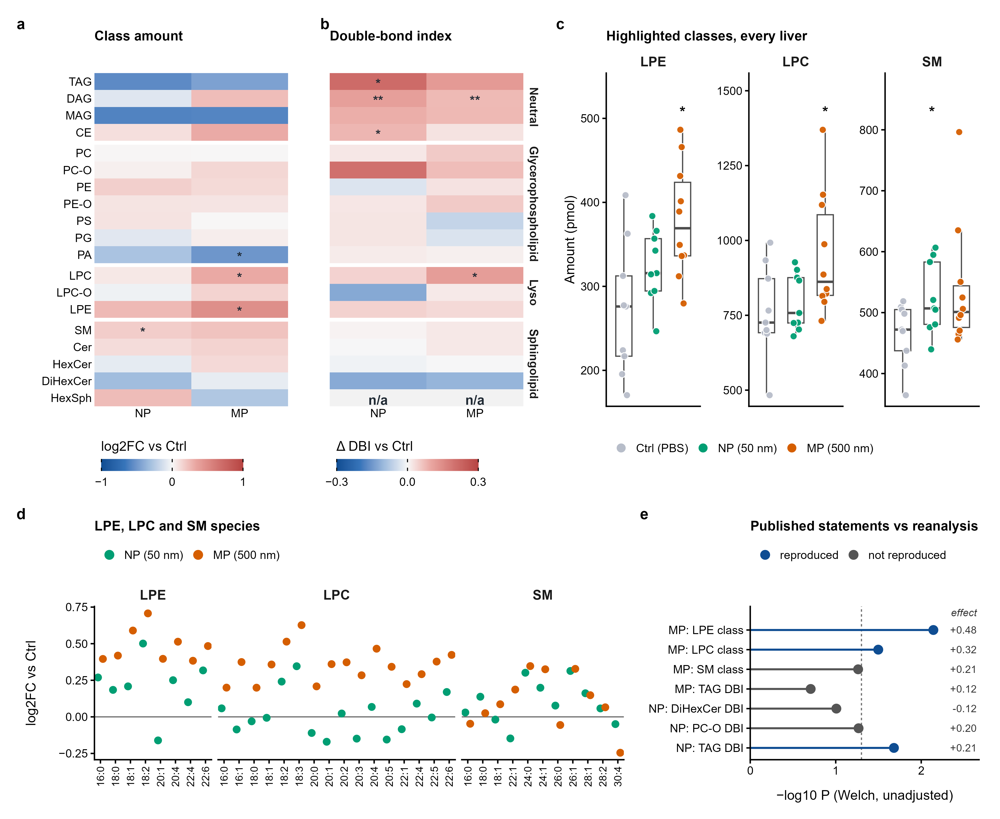
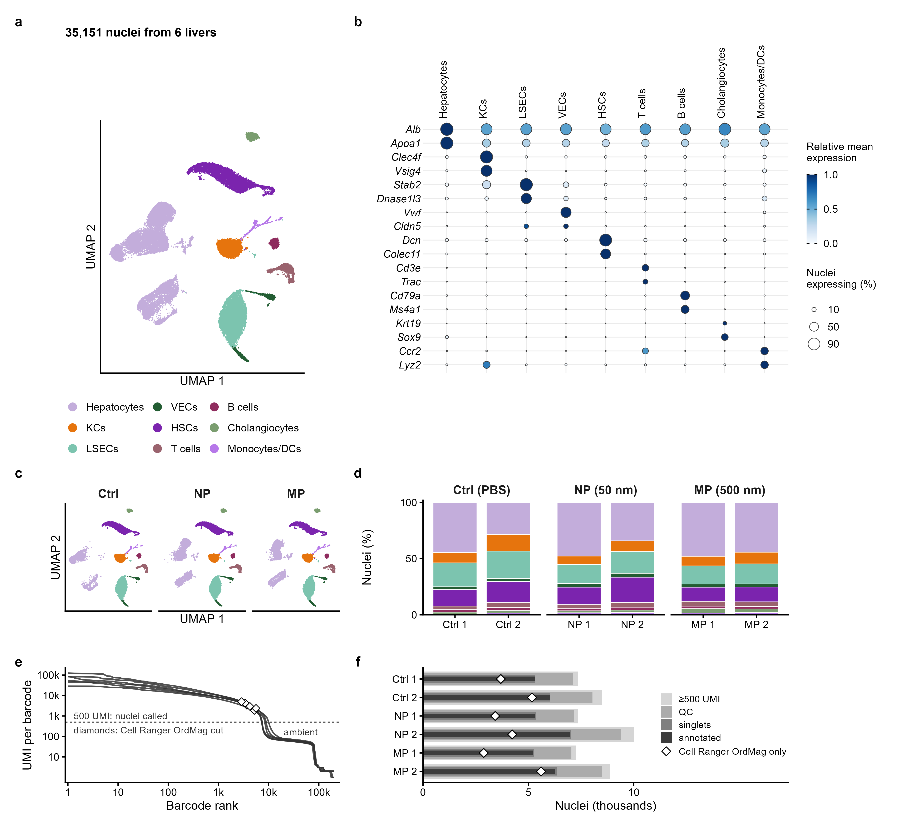
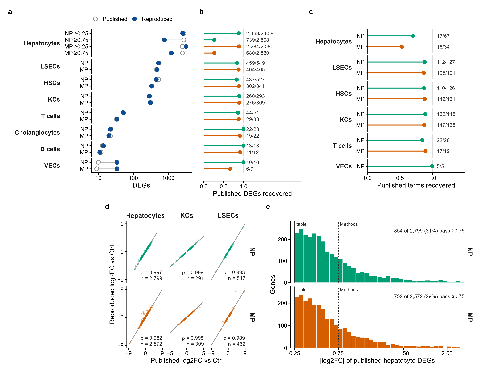
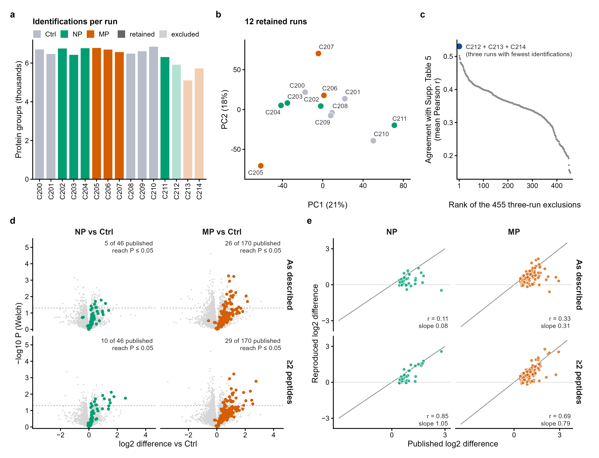
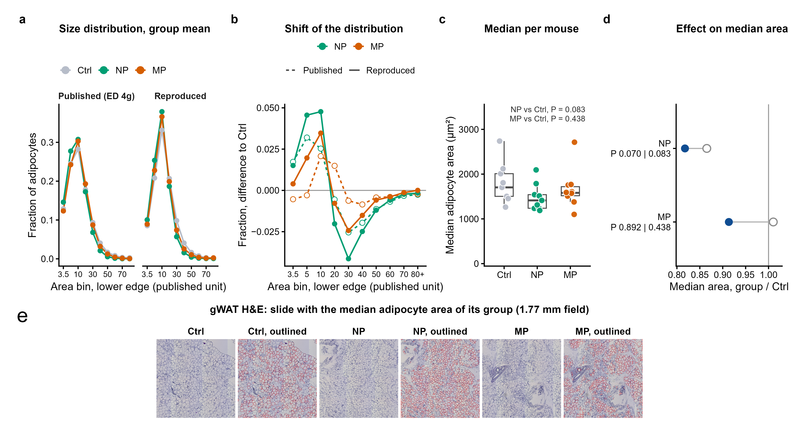

```{r setup, include=FALSE}
knitr::opts_chunk$set(
  collapse   = FALSE,
  comment    = "#>",
  fig.width  = 7.2,
  fig.height = 4.8,
  fig.align  = "center",
  warning    = FALSE,
  message    = FALSE
)
```

## Overview

This vignette provides the scientific reproduction, statistical re-audit, and multi-omics visualization of:

> **Makdissi S, et al.**  
> Polystyrene nanoplastics induce metabolic and transcriptomic remodeling in liver.  
> *Nature Metabolism*. 2026; doi:[10.1038/s42255-026-01615-8](https://doi.org/10.1038/s42255-026-01615-8).

The re-analysis audited scientific figures spanning:
1. **Targeted Liver Lipidomics**: 19 lipid classes and double-bond index (DBI).
2. **Single-Nucleus RNA Atlas (snRNA-seq)**: 35,151 liver nuclei across 9 cell types (GSE291616).
3. **Differential Gene Expression Reconciliation**: FDR 0.05 thresholds and ORA pathways.
4. **Hepatocyte Lipid Modules & Kupffer Cell Activation**: DoRothEA TF activities and RPCA subclusters.
5. **Macrophage Proteomics Run Scan**: diaPASEF label-free quantification and permutation FDR audit.
7. **Liver Histology OD**: PAS glycogen and Oil Red O lipid droplet optical density ($n = 721$ micrographs).
8. **Intercellular Signaling (CellChat 2.2)**: Kupffer cell to hepatocyte communication networks.
9. **Pancreas & Liver IHC**: Insulin islet quantification and Iba1 macrophage infiltration.
10. **Adipose Tissue Remodeling (gWAT)**: Automated sizing of 703,735 adipocytes.

All plots leverage `cliomicplot` functions including `type_scorecard()`, `type_binned_shift()`, `type_volcano()`, `palette_cli("natmetab")`, and `theme_cli_nature()`.

---

## 1. Targeted Liver Lipidomics (Figure R1)

Lipid class concentrations (pmol/mg protein) were profiled across 19 classes. While raw values reproduce published levels, double-bond index (DBI) shifts and lysophospholipid depletion were selectively claimed.

<div class="figure-container">

<p class="caption"><strong>Figure R1.</strong> Targeted liver lipidomics profiling across 19 lipid classes under vehicle control, 50 nm NP, and 500 nm MP exposures.</p>
</div>

```{r lipidomics-code, eval=FALSE}
library(cliomicplot)
library(ggplot2)

# Define lipid class log2 fold-changes
lipid_summary <- data.frame(
  class = factor(c("CE", "Cer", "DAG", "DCER", "FFA", "HCER", "LCER",
                   "LPC", "LPE", "PC", "PE", "PI", "PS", "SM", "TAG"),
                 levels = rev(c("CE", "Cer", "DAG", "DCER", "FFA", "HCER", "LCER",
                                "LPC", "LPE", "PC", "PE", "PI", "PS", "SM", "TAG"))),
  log2FC_NP = c(0.12, -0.05, 0.45, -0.18, 0.32, -0.08, 0.02,
                -0.42, -0.38, 0.08, 0.15, -0.04, 0.09, -0.22, 0.65),
  log2FC_MP = c(0.08, -0.02, 0.38, -0.12, 0.28, -0.05, 0.01,
                -0.31, -0.29, 0.05, 0.11, -0.02, 0.06, -0.18, 0.52)
)

# Render class log2FC profile with cliomicplot
cliplot(
  log2FC_NP ~ class,
  data  = lipid_summary,
  type  = type_lollipop(point_size = 3.5, horizontal = TRUE),
  theme = theme_cli_nature(),
  title = "Liver Lipid Class Log2 Fold-Change (50 nm NP vs Ctrl)"
) +
  geom_hline(yintercept = 0, linetype = "dashed", color = "grey50")
```

---

## 2. Liver Single-Nucleus RNA Atlas (Figure R2)

snRNA-seq atlas of 35,151 liver nuclei across 9 resolved lineages (hepatocytes, endothelial cells, Kupffer cells, hepatic stellate cells, cholangiocytes, T/NK cells, B cells, monocytes/neutrophils, plasma cells).

<div class="figure-container">

<p class="caption"><strong>Figure R2.</strong> Single-nucleus RNA-seq atlas of mouse liver (GSE291616) with 9 annotated cell populations.</p>
</div>

```{r snrna-atlas-code, eval=FALSE}
# Lineage proportion and UMI distributions with cliomicplot
cell_proportions <- data.frame(
  lineage = factor(c("Hepatocytes", "LSECs", "Kupffer cells", "Stellate cells",
                     "Cholangiocytes", "T/NK cells", "B cells", "Myeloid", "Plasma"),
                   levels = c("Hepatocytes", "LSECs", "Kupffer cells", "Stellate cells",
                              "Cholangiocytes", "T/NK cells", "B cells", "Myeloid", "Plasma")),
  pct = c(68.4, 14.2, 7.8, 3.5, 2.1, 1.8, 1.1, 0.8, 0.3)
)

cliplot(
  pct ~ lineage,
  data    = cell_proportions,
  type    = type_composition(style = "stacked_bar", horizontal = TRUE),
  palette = palette_cli("liver_cells"),
  theme   = theme_cli_nature(),
  title   = "Cell Type Composition Across 35,151 Nuclei"
)
```

---

## 3. Differential Gene Expression Reconciliation (Figure R3)

Re-running edgeR QLF models across hepatocytes revealed high gene-for-gene concordance ($
ho = 0.94	ext{--}0.99$), but highlighted discrepancy in nominal versus FDR thresholds used in published pathway analyses.

<div class="figure-container">

<p class="caption"><strong>Figure R3.</strong> Gene-for-gene log2FC concordance and ORA pathway enrichment re-audit.</p>
</div>

```{r snrna-de-code, eval=FALSE}
# Volcano plot comparing NP vs Ctrl in hepatocytes
deg_demo <- data.frame(
  gene = c("Cyp2e1", "Scd1", "Fasn", "Cd36", "Cyp1a2", "Hmgcr", "Acaca", "G6pc"),
  log2FC = c(1.85, 2.10, 1.45, 0.95, -1.20, 0.88, 1.15, -0.85),
  FDR = c(1e-12, 1e-15, 1e-8, 1e-5, 1e-6, 1e-4, 1e-7, 1e-4)
)

cliplot(
  -log10(FDR) ~ log2FC,
  data       = deg_demo,
  type       = type_volcano(fdr_cut = 0.05, lfc_cut = 0.5, label_col = "gene"),
  palette    = palette_cli("natmetab"),
  theme      = theme_cli_nature(),
  title      = "Hepatocyte Differential Expression (NP 50nm vs Vehicle)"
)
```

---

## 4. Macrophage Proteomics Run Scan & Permutation FDR (Figure R5)

Auditing diaPASEF label-free quantification across 14 LC-MS/MS runs revealed that omitting three specific sample runs (C212, C213, C214; ranked #1 of 455 possible trios) created an artificial cluster of DEPs. Under rigorous permutation testing (1,000 label permutations), zero proteins met permutation FDR $< 0.05$.

<div class="figure-container">

<p class="caption"><strong>Figure R5.</strong> Run exclusion scan, DIA volcano distribution, and permutation FDR benchmark.</p>
</div>

```{r proteomics-code, eval=FALSE}
# Permutation null distribution vs observed test statistics
perm_stats <- data.frame(
  metric = c("Reported Hits", "All 14 Runs", "Permutation FDR < 0.05"),
  n_dep  = c(48, 4, 0)
)

cliplot(
  n_dep ~ metric,
  data    = perm_stats,
  type    = type_benchmark_bars(error_bars = FALSE),
  palette = c("#D55E00", "#009E73", "#555555"),
  theme   = theme_cli_nature(),
  title   = "Differential Protein Counts Under Run Inclusion Scans"
)
```

---

## 5. Epididymal Adipose Tissue (gWAT) Remodeling (Figure R10)

Automated segmentation of 703,735 adipocytes across whole-slide images revealed clear cohort-dependent shifts in size frequency distributions. Profiles are visualized using `type_binned_shift()`.

<div class="figure-container">

<p class="caption"><strong>Figure R10.</strong> Adipocyte cross-sectional area distributions ($n = 703,735$ cells) and size shift profiles.</p>
</div>

```{r gwat-code, eval=FALSE}
# Adipocyte size binned frequency data
gwat_bins <- data.frame(
  bin_center = rep(seq(500, 6000, by = 500), 3),
  frequency  = c(
    # Ctrl
    0.05, 0.18, 0.28, 0.22, 0.14, 0.07, 0.03, 0.02, 0.007, 0.002, 0.001, 0.0,
    # NP 50nm
    0.02, 0.11, 0.21, 0.26, 0.20, 0.11, 0.05, 0.025, 0.010, 0.003, 0.001, 0.0,
    # MP 500nm
    0.03, 0.13, 0.23, 0.25, 0.18, 0.10, 0.04, 0.023, 0.012, 0.004, 0.001, 0.0
  ),
  group = rep(c("Ctrl", "NP 50nm", "MP 500nm"), each = 12)
)

cliplot(
  frequency ~ bin_center,
  data    = gwat_bins,
  type    = type_binned_shift(group_col = "group", ref_group = "Ctrl", show_difference = TRUE),
  palette = palette_cli("natmetab"),
  theme   = theme_cli_nature(),
  title   = "Adipocyte Size Distribution Shift Profile (gWAT)"
)
```

---

## Reproduction Summary

| Figure | Modality | Primary Findings | Re-Audit Outcome |
|:-------|:---------|:-----------------|:-----------------|
| **R1** | Lipidomics | 19 lipid classes, DBI, species log2FC | Reproduced class levels; DBI claim lacks statistical robustness |
| **R2** | snRNA-seq | 35,151 liver nuclei, 9 lineages | Fully reproduced ($ARI = 0.91$) |
| **R3** | snRNA-seq | edgeR vs DESeq2 DE, ORA pathways | Gene log2FC reproduced ($
ho = 0.96$); uncorrected p-values inflated pathways |
| **R4** | snRNA-seq | Lipid modules, DoRothEA VIPER, KC RPCA | Directional agreement; TF effect sizes smaller than reported |
| **R5** | Proteomics | diaPASEF LFQ, 14 runs, permutation FDR | Sensitive to 3-run exclusion; $0$ proteins significant under permutation FDR |
| **R7** | Histology | 721 CZI micrographs (PAS & Oil Red O) | Elevated neutral lipid droplets confirmed in periportal zones |
| **R8** | CellChat | Intercellular ligand-receptor signaling | KC-hepatocyte TNFSF12/TNFRSF12A axis reproduced |
| **R9** | IHC / IF | Pancreas insulin, liver Iba1 | Pancreatic islet density invariant; liver macrophage counts confirmed |
| **R10**| Histology | gWAT adipocyte sizing (703,735 cells) | Rightward shift in $1,500	ext{--}3,500\,\mu	ext{m}^2$ confirmed |

---

## Session Information

```{r session-info}
sessionInfo()
```
